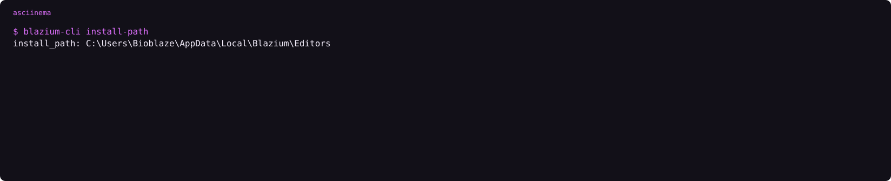
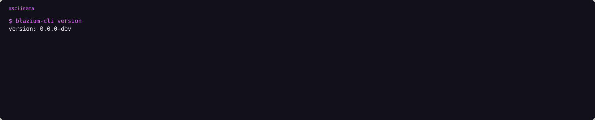

# Blazium CLI

### The binary Hub shells, CI calls, and the OS points blazium:// at

*By Bioblaze Payne, Co-Founder of [Blazium Games](https://blazium.games)*

---

Hub is a window. This is the program that actually moves files. [blazium-cli](https://github.com/blazium-games/blazium-cli) installs editors from `cdn.blazium.app`, keeps the project registry Hub reads, fetches export templates, updates itself, talks to a running editor on localhost, and can push a finished build to Steam or itch.io. We built it so a script and a desktop launcher would not grow two install paths.

Installing Hub is the path that also installs the CLI. The other paths are for machines that should not run Hub: npm, a GitHub release asset, or the CDN manifest.


## Get it

Published binaries are Linux and Windows, x86_64 and x86_32. CI does not publish a macOS CLI. A CLI you compile on macOS can still install a macOS editor. Go 1.25 or later. `go build` without the CI stamp prints `0.0.0-dev` until `data/cliBuild.txt` exists.

1. **Hub bundle.** Inno on Windows and the `.deb` on Linux put `blazium-cli` next to Hub and on `PATH`.
2. **npm.** `npm install -g @blazium-engine/cli` or `npx @blazium-engine/cli`. Optional packages are `@blazium-engine/cli-linux-x64`, `cli-linux-ia32`, `cli-win32-x64`, and `cli-win32-ia32`. If that package is present, nothing is downloaded from the CDN.
3. **GitHub Releases.** `blazium-cli-windows-x86_64.exe`, `blazium-cli-windows-x86_32.exe`, `blazium-cli-linux-x86_64`, `blazium-cli-linux-x86_32`.
4. **CDN manifest.** `https://cdn.blazium.app/cli/cli.json`. Files live at `https://cdn.blazium.app/cli/{os}/{arch}/{version}/`.

There is no official Flatpak. [blazium#428](https://github.com/blazium-games/blazium/issues/428) asks for one.


```text
asciinema play assets/cli-help.cast
```

## Install an editor

```text
blazium-cli install 0.6.838
blazium-cli install nightly --templates
blazium-cli install 0.6.924 --channel nightly
blazium-cli uninstall 0.6.838
```

`EditorInstallDir` puts editors in `{install-path}/{channel}/{version}`. Channels are `release`, `prerelease`, and `nightly`. An empty channel is `release`. As of 11 October 2026, [release latest](https://cdn.blazium.app/catalog/versions/release/latest.json) is 0.6.838 and nightly latest is 0.6.924.

`--templates` pulls the `.tpz` for that version from the CDN. Template metadata is resolved as `template_files.json`, then `templates.json`, then `details.json`, all under `https://cdn.blazium.app/{channel}/{version}/`. The CLI only asks Cerebro when `BLAZIUM_CEREBRO_URL` is set. It does not default to `https://blazium.app`.

Template channel handling is narrower than editor installs. The template resolver treats a build as nightly or release. A prerelease version is fetched from the `release` CDN folder unless you are on the nightly flag. Editor installs do keep a real `prerelease` directory.

On Windows the template root is `%LOCALAPPDATA%\Blazium\export_templates`. On Unix, including macOS, it is `~/.local/share/blazium/export_templates`. Override with `BLAZIUM_EXPORT_TEMPLATES_DIR`. The folder name is the Blazium version and channel, such as `0.6.838.release`, not Godot's `4.3.2.stable`.

The editor's own template manager does not use this CLI path. It asks `https://blazium.app/api/mirrorlist/`, and that live list currently points at the GitHub release copy of the pack. The CDN copy is what the CLI downloads.



`blazium-cli install-path` prints the root. `blazium-cli install-path D:\Blazium\Editors` changes it. `--move` relocates editors already on disk.

## List, default, projects

```text
blazium-cli editors
blazium-cli editors default
blazium-cli editors default --channel release --version latest
blazium-cli editors default 0.6.838
blazium-cli projects add ./MyProject
blazium-cli open ./MyProject
blazium-cli load ./MyProject
blazium-cli run ./MyProject
blazium-cli project-manager
```

Unset policy is the latest installed editor on the `release` channel. A hard pin (`editors default 0.6.838`) wins when that build is installed.

`open` and `load` start the editor with `--editor --path`. They do not run the game. `load` also prints a project profile: JustAMCP, remote control, editor version, features. Both attach remote control by default (`remote.enable_on_open` is true). After `GET /v1/health` responds, the CLI assigns a 6-character instance id with `POST /v1/instance`.

`run` (alias `play`) starts the game with `--path` and without `--editor`. If `application/run/main_scene` is empty, the CLI returns an error and does not start the binary. Remote control stays off for `run`. `project-manager` starts the default editor with `--project-manager` and no project path.

The registry file is the same one Hub uses: `%APPDATA%\blazium\hub.json` or `~/.config/blazium/hub.json`.




## Upgrade

```text
blazium-cli update check
blazium-cli update apply --product cli
blazium-cli update apply --product hub --install-root "C:\Program Files\Blazium"
blazium-cli update apply --product crash_reporter
blazium-cli update apply --product toolchain
blazium-cli update apply --product launcher --install-root "C:\Program Files\Blazium\Games"
```

`update apply` knows `cli`, `hub`, `crash_reporter`, `toolchain`, and `launcher`. `--product launcher` installs the Games launcher and, on Windows, starts setup with `/NOCLI` so an existing `blazium://` handler is left alone. Under Program Files, apply may raise a UAC prompt.


## Remote

The editor module listens on `127.0.0.1:6508` by default. Routes include `GET /v1/health`, `GET /v1/status`, `POST /v1/exec`, and `POST /v1/eval`. Eval stays off until `blazium/remote_control/allow_eval` is true. JustAMCP, the editor MCP server, is port 6506. A game export port of `0` means 6507. Do not point this CLI at 6507.

| Command | Job |
|---|---|
| `remote status` | Health, instance id, project |
| `remote ping` / `remote exec` | Built-in commands |
| `remote eval` / `eval-gdscript` / `eval-lua` | Expressions, if `allow_eval` is on |
| `remote logs` / `errors` | Engine log |
| `remote autowork run --wait` | Run Autowork |
| `remote snapshot editor` | PNG of the editor |
| `remote doctor` | Config check |


One live instance is used automatically. Two or more: the newest is the default, and the CLI prints a warning unless you pass `--quiet`. Select with `--instance <id>` or `--project <path>`.

Env overrides: `BLAZIUM_REMOTE_HOST`, `BLAZIUM_REMOTE_PORT`, `BLAZIUM_REMOTE_TOKEN`. CLI prefs live in `%APPDATA%\blazium\cli.json` or `~/.config/blazium/cli.json`.

## URI handler and deploy

OS installers point `blazium://` at `handle-uri`. `blazium://hub` focuses Hub on port 39218. `blazium://open`, `load`, `install`, and `register` stay in this binary. `blazium://game/<uuid>` and `blazium://buy/<uuid>` are forwarded to the Games launcher on port 39220.


Steam and itch.io deploys live here. Optional `blazium-deploy.yml` sits next to the game. Secrets come from flags, then the YAML, then `BLAZIUM_*` environment variables.

```text
blazium-cli deploy tools status
blazium-cli deploy steam upload --dry-run
blazium-cli deploy itch push ./build --target user/game:windows
```

`deploy steam guard setup` is interactive. Do not run it on a CI runner. itch.io push uses butler as a Go module. It does not download broth.

`blazium-cli games` (alias `chauffeur`) uploads to the Blazium Games store API. That is not Steam and it is not itch. The older standalone uploader still lives in [games_cli](https://github.com/blazium-games/games_cli).

## CI

A runner starts with [setup-blazium-cli](https://github.com/blazium-games/setup-blazium-cli) at tag `v0.2.1`, or with [setup-blazium-engine](https://github.com/blazium-games/setup-blazium-engine) at tag `v0.3.0`, which installs this binary and then an editor. `version: latest` on setup-engine tracks the nightly channel. `latest-release` is the release channel.


## Links

- CLI repository: https://github.com/blazium-games/blazium-cli
- CDN manifest: https://cdn.blazium.app/cli/cli.json
- Dev tools: https://blazium.app/dev-tools
- Hub: https://github.com/blazium-games/blazium-hub
- Blazium Games: https://blazium.games

---

**[Jump into our Discord](https://blazium.app/chat)** for real-time chats, dev support and feedback

Or follow us everywhere else:

- **[GitHub](https://github.com/blazium-games)**
- **[IndieDB](https://www.indiedb.com/engines/blazium-engine)**
- **[X / Twitter](https://x.com/BlaziumGames)**
- **[YouTube](https://www.youtube.com/@blazium)**
- **[itch.io](https://blaziumengine.itch.io)**
