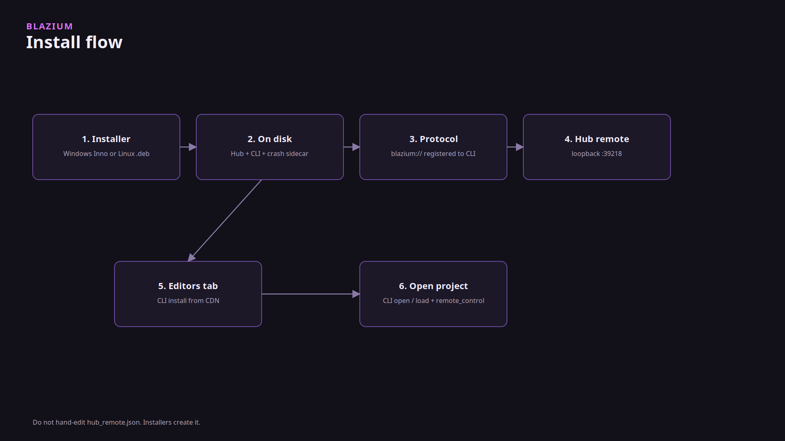

# Why Hub and the CLI are split

### One registry, two front doors

*By Bioblaze Payne, Co-Founder of [Blazium Games](https://blazium.games)*

---

Godot's project manager is inside the editor. That works when the editor you are running is the only editor. We publish `release`, `prerelease`, and `nightly`, and Hub's own binary is built from a different branch than the 0.6 editors it installs. Putting the launcher inside one of those editors would have made that editor responsible for downloading the others.

So the launcher is a window, and the mutations live in [blazium-cli](https://github.com/blazium-games/blazium-cli). Hub lists projects, fetches the CDN catalog, and shells the CLI for install, uninstall, open, and project registration. A CI job uses the same binary without ever opening the window. That is the whole design.

The installer is also why the CLI is the easy path on a desktop. Windows Setup and the Linux `.deb` from [blazium-hub](https://github.com/blazium-games/blazium-hub) put Hub, `blazium-cli`, and the crash sidecar on disk together, and they register `blazium://` to the CLI, not to Hub. You do not download the CLI as a second step unless the machine should not run Hub. npm, the GitHub release assets, and `https://cdn.blazium.app/cli/cli.json` are that second path.

## What they share

The project list is `%APPDATA%\blazium\hub.json` on Windows and `~/.config/blazium/hub.json` elsewhere. Both programs read it. Editors land in `{install-path}/{channel}/{version}`. If you never set a default, the CLI uses the latest installed editor on the `release` channel.

Hub does not download the editor zip itself. It will fetch JSON, RSS, and article BBCode from `cdn.blazium.app`, and it refuses any other host. Cerebro, the internal build service, is not something Hub calls.

Hub listens on loopback port 39218 so `blazium://hub` can focus the window. The installers write `hub_remote.json`. Do not edit it. A bad token fails closed.

The version dropdown on a project card is drawn and not wired. Open is `blazium-cli open` with the CLI default. That control is unfinished UI, not a version pin.

## What this is not

Hub is not the Blazium Games store. The store is [blazium.games](https://blazium.games). Store deep links (`blazium://game/`, `blazium://buy/`) go to the Games launcher on port 39220. `blazium-cli games`, also named `chauffeur`, uploads to that store's API. Steam and itch uploads are `blazium-cli deploy`, which is a different command. The older standalone uploader is still [games_cli](https://github.com/blazium-games/games_cli).

Published Hub and CLI binaries are Linux and Windows. There is no macOS Hub package in the packaging tree, and no Flatpak. [blazium#428](https://github.com/blazium-games/blazium/issues/428) asks for one.

Hub's executable tracks `blazium_4.8`. The editors on the CDN are `0.6.x` from `blazium-dev`. As of 11 October 2026 the release pointer is 0.6.838. Those are two binaries on purpose.

## Links

- Hub: https://github.com/blazium-games/blazium-hub
- CLI: https://github.com/blazium-games/blazium-cli
- Dev tools: https://blazium.app/dev-tools
- Release catalog: https://cdn.blazium.app/catalog/versions/release/latest.json
- Blazium Games: https://blazium.games

---

**[Jump into our Discord](https://blazium.app/chat)** for real-time chats, dev support and feedback

Or follow us everywhere else:

- **[GitHub](https://github.com/blazium-games)**
- **[IndieDB](https://www.indiedb.com/engines/blazium-engine)**
- **[X / Twitter](https://x.com/BlaziumGames)**
- **[YouTube](https://www.youtube.com/@blazium)**
- **[itch.io](https://blaziumengine.itch.io)**
