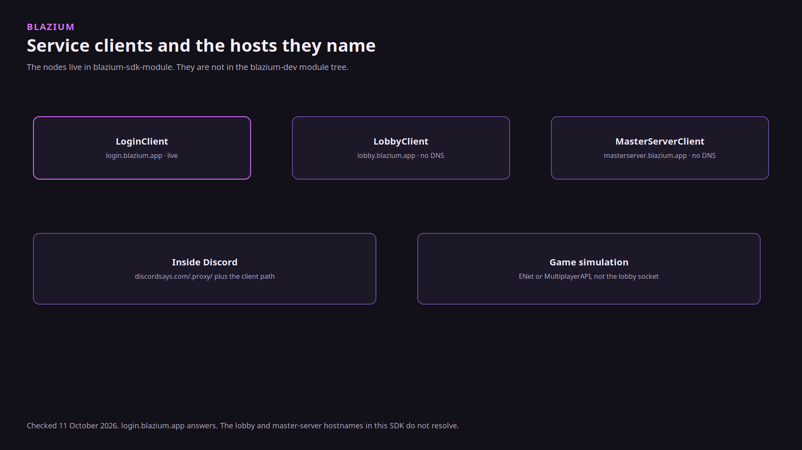
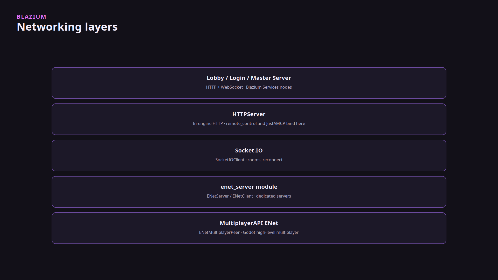

# Blazium Services

### Matchmaking clients that are not in the stock editor

*By Bioblaze Payne, Co-Founder of [Blazium Games](https://blazium.games)*

---

Hangman needed a lobby that did not hand every player everyone else's IP. The clients for that are `LoginClient`, `LobbyClient`, `ScriptedLobbyClient`, and `MasterServerClient`. They are C++ nodes. They are not in the `blazium-dev` module tree.

They live in [blazium-sdk-module](https://github.com/blazium-games/blazium-sdk-module), last touched in September 2025. A stock 0.6 editor does not register those classes. GDScript templates under `modules/gdscript/editor/script_templates/` still use the names. Those templates do not run until you compile the SDK in as a custom module. Discord embed, YouTube Playables, JWT, `.env`, and CSV used to sit in that same SDK. Those moved into the engine. The lobby stack did not.

## What is actually up

Checked on 11 October 2026:

| Client | Default in the SDK | DNS |
|---|---|---|
| `LoginClient` | host `login.blazium.app` | Resolves. `https://login.blazium.app/` returns `{"status":"ok","success":true}` |
| `LobbyClient` | `wss://lobby.blazium.app/connect` | Does not resolve |
| `MasterServerClient` | `https://masterserver.blazium.app/api/v1` | Does not resolve |

The login client stores the host without a scheme. It adds `wss://` for the socket (`/connect`) and `https://` for HTTP (`/api/v1/connect`, `/api/v1/auth`, `/api/v1/steam/auth`, `/api/v1/private/profile`). An older Hangman inspector showed `wss://login.blazium.app/connect` typed into the Server URL field. That is a scene value, not the current source default.

Inside a Discord activity the same clients rewrite the host to `{client_id}.discordsays.com/.proxy/` plus a path (`blazium/login`, `blazium/lobby/connect`, or `blazium/masterserver/api/v1`). That rewrite is in the SDK. It is not something `DiscordEmbeddedAppClient` in the engine does by itself.

`POGRClient` is also in the SDK. It posts to `https://api.pogr.io/v1/intake`. That is a third-party intake URL, not a Blazium host.

## Login, then a room

`LoginClient` can ask the login service for a Discord login URL (`request_login_info`) and can exchange a Steam token. The result you keep is a JSON Web Token. Do not print live tokens. The engine's own `JWT` / `JWTBuilder` classes, in `modules/jwttool`, are what you use to build and check tokens in game code. They are not this login node.

`LobbyClient.connect_to_server` opens the websocket. The server hands back a reconnection token. Store it yourself. The node does not write `user://` for you. Peers in the lobby are lobby peers. Their game-traffic addresses are not what this socket is for.

`ScriptedLobbyClient` is the same idea with server-side scripts. The lobby server docs in [lobby-template](https://github.com/blazium-games/lobby-template) describe a `lobby_service` binary, `config.ini`, `games.ini`, and Lua, AngelScript, or relay backends. That repository is documentation and a demo project. It is not a public hostname.

`MasterServerClient` registers and lists dedicated servers (`/server/create`, `/server/update/`, `/servers/recent`) against whatever `server_url` you set. The hostname baked as the default does not resolve, so set the URL to a server you run.

## Where this sits next to ENet

Lobby traffic is HTTP and WebSocket. World simulation stays on `enet_server` or MultiplayerAPI's ENet peer. Do not put ticks on the lobby node.

The engine's `Discord.create_or_join_lobby` is a Discord Social SDK lobby. It is a different object from `LobbyClient`.

## What you compile

Drop the SDK in as a Godot/Blazium custom module and build. `can_build` returns true on every platform the SDK's `config.py` sees. That does not mean the official editor zip already contains it. If `LobbyClient` is missing from the Create dialog, you are on a stock `blazium-dev` build.

Class reference pages for these nodes are not on `docs.blazium.app` today (the LobbyClient page 404s). Read the headers in the SDK repo. `services-docs` in the org is a stub.

## Links

- SDK module: https://github.com/blazium-games/blazium-sdk-module
- Lobby server notes: https://github.com/blazium-games/lobby-template
- Login host: https://login.blazium.app/
- Engine: https://github.com/blazium-games/blazium
- Blazium Games: https://blazium.games

---

**[Jump into our Discord](https://blazium.app/chat)** for real-time chats, dev support and feedback

Or follow us everywhere else:

- **[GitHub](https://github.com/blazium-games)**
- **[IndieDB](https://www.indiedb.com/engines/blazium-engine)**
- **[X / Twitter](https://x.com/BlaziumGames)**
- **[YouTube](https://www.youtube.com/@blazium)**
- **[itch.io](https://blaziumengine.itch.io)**
