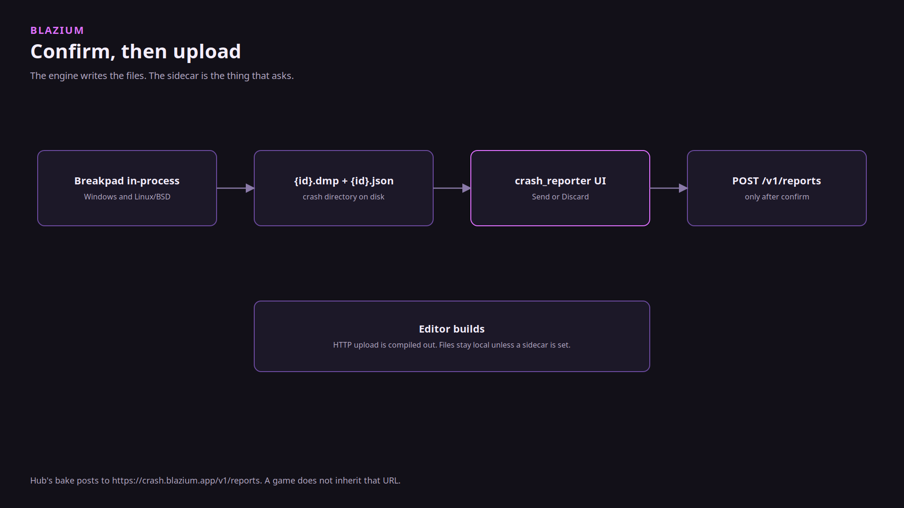
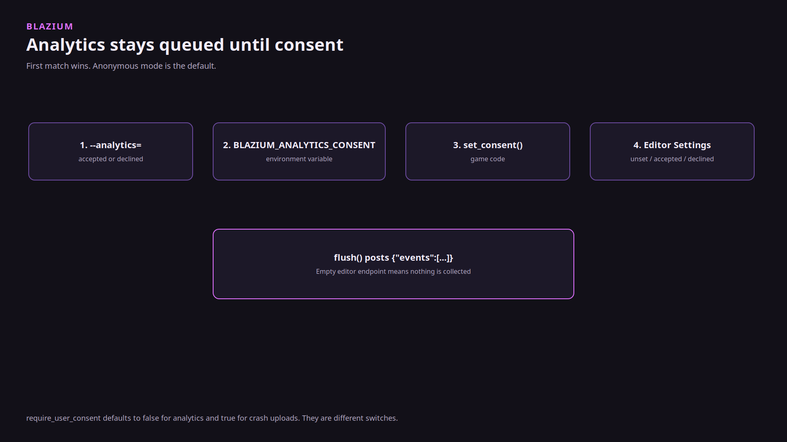

# Why crash reports and analytics are separate

### One is how we patch the engine. The other is a counter you opt into.

*By Bioblaze Payne, Co-Founder of [Blazium Games](https://blazium.games)*

---

We added both modules in the same stretch of engine work, and we gave them the same app id and build id so a report and an event from one binary can be lined up. That is as far as the sharing goes. A crash report is a minidump we read to find an engine fault and ship a patch. An analytics event is a counter. We do not patch the engine from analytics events.

Godot ships neither module. The crash path is opt-in upload with a confirm step, because a dump can contain more than a stack. The analytics path is opt-in because a counter should not leave the machine until someone says so.

## Crash reports

`modules/crash_reporter` writes `{id}.dmp` and `{id}.json`. Breakpad is compiled into the engine when `crash_reporter=yes` or `editor_crash_reporter=yes`. The sidecar UI in [blazium_crash_reporter](https://github.com/blazium-games/blazium_crash_reporter) does not contain Breakpad. It shows the two files. Send uploads. Discard does not. `--auto-send` exists and we do not use it for Hub.

The module builds on Windows and Linux/BSD only. Editor builds never HTTP-upload. `is_http_upload_available()` is false in the editor. `require_user_consent` defaults to true. Hub's bake posts to `https://crash.blazium.app/v1/reports`. A game does not inherit that URL.

We read the reports that are sent. Hangman shipping on Steam, Discord, Google Play, and the Apple App Store did not replace that. Crashes still show up after a title is out.

## Analytics

`modules/analytics` queues JSON events and posts them when you call `flush()`. The body is `{"events":[...]}`. Hub's bake uses `https://crash.blazium.app/v1/events` on the same host as crash reports, on a different path.

Consent, first match wins: `--analytics=accepted|declined`, then `BLAZIUM_ANALYTICS_CONSENT`, then `Analytics.set_consent`, then Editor Settings `blazium/analytics/consent`. There is no consent dialog. Anonymous mode is the default, and it omits `device_uid`.

`application/analytics/require_user_consent` defaults to **false**. The crash reporter's matching flag defaults to **true**. Do not treat them as one setting. An empty baked editor endpoint means the editor does not collect any data.

Built-in editor events are `editor_launched` and `editor_session_ended`. `flush()` is what POSTs. Quitting queues `session_end` and does not upload by itself.

We used the analytics module while building Hangman and Demon Lord: Clicker. Demon Lord: Clicker was also how we validated the newer tools and the 2D side. The example server at [example_analytics_server](https://github.com/blazium-games/example_analytics_server) says it is not a hosted product.

## What "same id" means

SCons `editor_app_id` defaults to `custom_blazium_engine`. Hub CI sets `blazium-hub`. A non-empty bake wins over project settings for both modules. That lets us see that a crash and a session came from the same binary. It does not merge the queues.

## Links

- Crash module: https://github.com/blazium-games/blazium/tree/blazium-dev/modules/crash_reporter
- Analytics module: https://github.com/blazium-games/blazium/tree/blazium-dev/modules/analytics
- Sidecar: https://github.com/blazium-games/blazium_crash_reporter
- Sidecar catalog: https://cdn.blazium.app/crash_reporter/crash_reporter.json
- Blazium Games: https://blazium.games

---

**[Jump into our Discord](https://blazium.app/chat)** for real-time chats, dev support and feedback

Or follow us everywhere else:

- **[GitHub](https://github.com/blazium-games)**
- **[IndieDB](https://www.indiedb.com/engines/blazium-engine)**
- **[X / Twitter](https://x.com/BlaziumGames)**
- **[YouTube](https://www.youtube.com/@blazium)**
- **[itch.io](https://blaziumengine.itch.io)**
