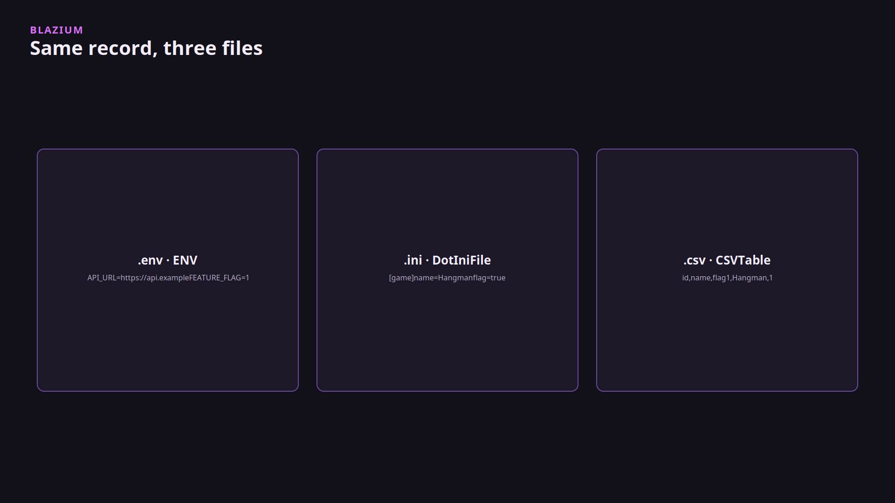

# ENV, INI, and CSV in Blazium

### Three files, three jobs, and ConfigFile stays

*By Bioblaze Payne, Co-Founder of [Blazium Games](https://blazium.games)*

---

A display name, an API URL, and a table of levels do not belong in the same file. Godot's `ConfigFile` already stores INI-shaped variants, and we kept it. `modules/dotenv`, `modules/dotini`, and `modules/dotcsv` are what we added when `.env` files, typed INI, and designer-edited tables kept getting jammed into that one class.

All three build on `blazium-dev` with no SCons opt-in. None of them registers the keys the engine itself reads. A script reads the file. Project Settings are where the engine looks.



## .env and ENV

`ENV` is an engine singleton. It loads `.env` files and can read them back as strings, bools, ints, floats, colors, and vectors. It is not a security boundary. Anyone with the file can read it.

The crash reporter does not read this file. A game's upload URL is `application/crash_reporter/endpoint`. Use `.env` for values your own scripts read.

`auto_config(dir, mode)` loads, in order, `.env`, `.env.local`, `.env.{mode}`, and `.env.{mode}.local` under `dir` (default `res://`). Mode defaults to `development` in the editor and `production` in an export. `config(file)` loads one file. OS environment wins when `get_prioritize_os_env` is on.

```gdscript
ENV.auto_config("res://")
var url := str(ENV.get_env("API_URL", ""))
var enabled := bool(ENV.get_env_bool("FEATURE_FLAG", false))
ENV.generate_example("res://.env.example")
```

`get_env` returns the default when the key is missing. It does not raise. Typed helpers are `get_env_bool`, `get_env_int`, `get_env_float`, `get_env_array`, and `get_env_dict`. `push_to_os_env` copies values into the process environment. Signals: `file_loaded`, `cleared`, `refreshed`.

Ship `.env.example` from `generate_example` and gitignore the real file. The example analytics server tells you to copy `.env.example` and not commit `.env`. That is the reference server's config, not a claim about how Hangman stores settings.

## .ini and DotIniFile

`DotIniFile` is a `RefCounted` INI with sections, includes, macros, and type constraints. The class reference calls it a more capable alternative to `ConfigFile`, not a replacement you must migrate to.

```gdscript
var ini := DotIniFile.new()
ini.load("res://game.ini")
var game_name := str(ini.get_value("game", "name", ""))
var flag := ini.get_value_bool("game", "flag", false)
```

`load` replaces the current document unless you pass append. `get_value` interpolates by default. `from_config_file` and `from_dictionary` exist when you already have a `ConfigFile` or a `Dictionary`. `get_section_as_dict` is the reverse. Includes and macros are optional. A short settings file does not need them.

## .csv and CSVTable

Release 0.4.90 already imported CSV for translations. `modules/dotcsv` is any other table. `CSV` is a resource (`load_file`, `load_string`, `save_to_string`). `CSVTable` is the query side. `ResourceImporterCSV` is the import dock. `CSVReader` and `CSVWriter` stream. `CSVAsyncTask` is the background path.

```gdscript
var table := CSVTable.from_file("res://data/levels.csv")
for row in table.where_equals("name", "Hangman").get_rows():
    print(row)
```

`from_file` and `where_equals` return a `CSVTable`, not an array. Also on the class: `select_columns`, `sort_by`, `group_by`, `inner_join`, `left_join`, and `limit`. Dialect sniffing is `CSVDialect.sniff`. Headers, delimiters, and true/false token lists are importer options, not Project Settings.

| Kind | Put it in |
|---|---|
| Secret or machine-local string a script reads | `.env` via `ENV` |
| Structured settings with sections | `DotIniFile`, or Project Settings when the engine must see the key |
| Bulk rows a designer edits | `.csv` via `CSVTable` or the import dock |
| Crash upload URL, app id | `application/crash_reporter/*`, not `.env` |

## Links

- dotenv: https://github.com/blazium-games/blazium/tree/blazium-dev/modules/dotenv
- dotini: https://github.com/blazium-games/blazium/tree/blazium-dev/modules/dotini
- dotcsv: https://github.com/blazium-games/blazium/tree/blazium-dev/modules/dotcsv
- Tests: https://github.com/blazium-games/dotenv_module_tests
- Godot ConfigFile: https://docs.godotengine.org/en/stable/classes/class_configfile.html
- Blazium Games: https://blazium.games

---

**[Jump into our Discord](https://blazium.app/chat)** for real-time chats, dev support and feedback

Or follow us everywhere else:

- **[GitHub](https://github.com/blazium-games)**
- **[IndieDB](https://www.indiedb.com/engines/blazium-engine)**
- **[X / Twitter](https://x.com/BlaziumGames)**
- **[YouTube](https://www.youtube.com/@blazium)**
- **[itch.io](https://blaziumengine.itch.io)**
