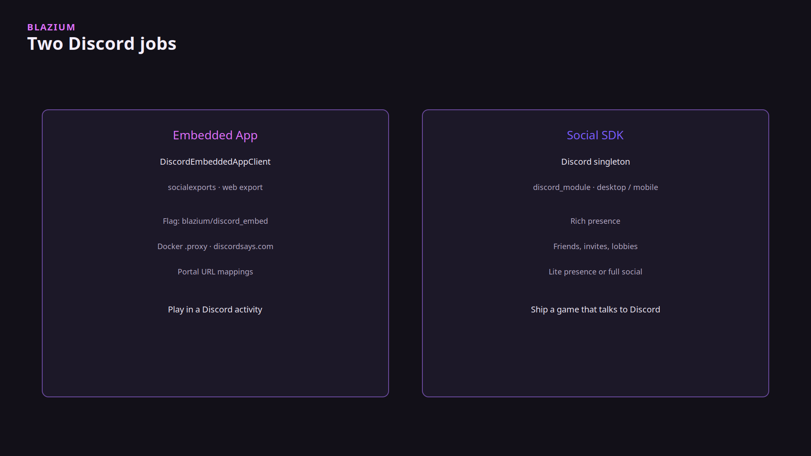

# Discord on Blazium

### Two jobs, two modules

*By Bioblaze Payne, Co-Founder of [Blazium Games](https://blazium.games)*

---

The embed work started in 2025 so Hangman could run inside a Discord voice channel without a separate install. Hangman has since shipped as a Discord app, and also on Steam, Google Play, and the Apple App Store. The Steam, Play, and Apple builds are not the thing that calls `DiscordEmbeddedAppClient`. The activity is.

A desktop build that shows presence and invites uses a different class, the `Discord` singleton, backed by the Discord Social SDK. The 0.6.725 notes describe that module as rich presence and social features. `initialize_presence_only` is auth-less RPC. `initialize` is the OAuth layer.



| | Embedded App | Social SDK |
|---|---|---|
| Where it runs | Web, inside the Discord client | Desktop game |
| Class | `DiscordEmbeddedAppClient` | `Discord` singleton |
| Module | `socialexports` | `discord_module` |
| Export | `Web` preset, `blazium/discord_embed/enabled` | Ordinary desktop export |
| Auth helper | `authorize` / `authenticate` | `authenticate_with_server` |

`socialexports` also registers `YoutubePlayablesClient` and `ReactClient`. Those are other host pages. They are not the Social SDK.

## Embedded Apps

`DiscordEmbeddedAppClient` bridges the Discord Embedded App SDK. The header notes SDK v1.9.0. It is a `Node`. `is_discord_environment()` is false unless the page is actually inside Discord. `is_ready` is the later gate.

The web export writes `{name}.discord.embed.js` when `blazium/discord_embed/enabled` is set, and substitutes `$BLAZIUM_DISCORD_AUTODETECT` from `blazium/discord_embed/autodetect`. Host the files with [docker-webbuild-template](https://github.com/blazium-games/docker-webbuild-template). Nginx answers `/.proxy/` and sends COOP and COEP. `docker compose up --build` serves `static/` on port 8080. In the Discord developer portal you create the application and set the URL mappings to that host. The engine does not create the application.


```gdscript
@export var discord: DiscordEmbeddedAppClient

func _ready() -> void:
    if not discord.is_discord_environment():
        return
    var ready: DiscordEmbeddedAppResult = await discord.is_ready().finished
    if ready.has_error():
        push_error(ready.error)
        return
    var auth: DiscordEmbeddedAppResult = await discord.authorize("code", "", "none", ["identify", "guilds"]).finished
    if auth.has_error():
        push_error(auth.error)
```

That `authorize` signature is the one in the class reference: response type, state, prompt, and the scope list as an `Array`. Other methods on the same class include `authenticate`, `get_channel`, `get_entitlements`, `get_instance_connected_participants`, `set_activity`, `open_invite_dialog`, `open_share_moment_dialog`, and `start_purchase`. You wait on `finished`.

`blazium-dev` does not register `LoginClient`. The screenshot below is from a Hangman scene in a build that compiled [blazium-sdk-module](https://github.com/blazium-games/blazium-sdk-module). A stock editor will not show that node. If the activity needs a session on your server, send the Discord token to an endpoint you run. The current SDK default host is `login.blazium.app`, which does answer. The Server URL string in this older inspector is not that default.


## Social SDK

- `initialize_presence_only` for rich presence without OAuth.
- `initialize(client_id)` when you need friends, invites, and `authenticate_with_server`.
- `run_callbacks()` pumps the SDK. After `initialize` the module also runs it once per frame.
- `authenticate_with_server(url, access_token, client_id)` returns `DiscordAuthResult`. `get_jwt()` is a JSON Web Token your backend minted. Build one with `JWTBuilder` (`set_issuer`, `set_subject`, `set_algorithm`, `set_expiration`, `sign`) and check it with `JWT.parse`. HS256 and RS256 are the documented algorithms.
- `create_or_join_lobby(secret)` is a Discord lobby. It is not `LobbyClient`.

```gdscript
func _ready() -> void:
    var err := Discord.initialize(client_id)
    if err != OK:
        push_error(err)
```

`get_auth_state`, `get_access_token`, and `get_username` are the reads after the player finishes OAuth.

Building both modules into one desktop binary does not make the embed SDK work, and the embed SDK does not replace `initialize` on desktop.

## Links

- Engine: https://github.com/blazium-games/blazium
- Web host template: https://github.com/blazium-games/docker-webbuild-template
- SDK module (LoginClient): https://github.com/blazium-games/blazium-sdk-module
- Blazium Games: https://blazium.games

---

**[Jump into our Discord](https://blazium.app/chat)** for real-time chats, dev support and feedback

Or follow us everywhere else:

- **[GitHub](https://github.com/blazium-games)**
- **[IndieDB](https://www.indiedb.com/engines/blazium-engine)**
- **[X / Twitter](https://x.com/BlaziumGames)**
- **[YouTube](https://www.youtube.com/@blazium)**
- **[itch.io](https://blaziumengine.itch.io)**
