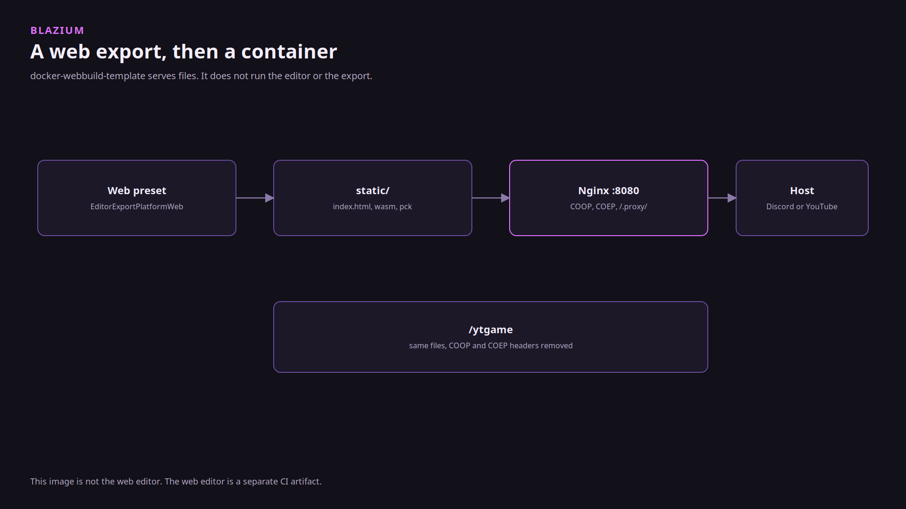
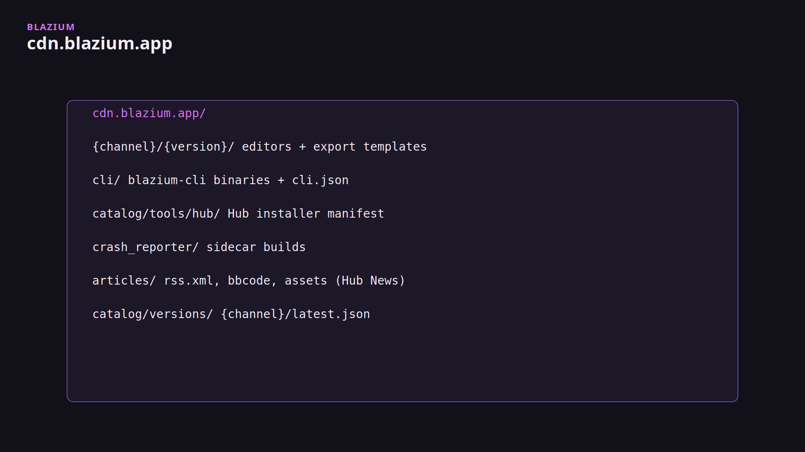

# Docker web export

### A container for the files the Web preset already wrote

*By Bioblaze Payne, Co-Founder of [Blazium Games](https://blazium.games)*

---

A Blazium web export is a folder: `index.html`, a `.wasm`, a `.pck`, and whatever the preset added for Discord or YouTube. [docker-webbuild-template](https://github.com/blazium-games/docker-webbuild-template) is Nginx in front of that folder. It does not install the engine and it does not run the export.

We needed it because a Discord activity is not a zip you hand someone. Discord loads the page through `*.discordsays.com` and requires a `/.proxy/` prefix on asset URLs, plus COOP and COEP. YouTube Playables wants the initial bundle under 15 MiB, which is YouTube's limit, so the template serves precompressed WASM. Hangman's `example.env` sets `PROJECT_NAME=hangman`. Hangman shipped as a Discord app. The sample registry in that file (`registry.digitalocean.com`, `REGISTRY_PATH=blazium`) is not a claim about the host Hangman runs on in production.

This image is not the web editor. CI builds a separate web-editor artifact. Do not conflate them.



## Local

1. Install export templates for the same Blazium version as the editor. The CLI pulls them from `cdn.blazium.app`. The editor's mirror list still points at GitHub.
2. Export the preset named `Web`. `EditorExportPlatformWeb.get_name()` returns that string.
3. Copy the export into the template's `static/` directory. The `.keep` file is not copied into the image.
4. From the template repo:

```text
docker compose up --build
```

5. Open `http://localhost:8080`.

`docker-compose.yaml` builds the Dockerfile and publishes `8080:8080`. Nginx serves `/usr/share/nginx/html`. The README's primary registry path is `make deploy-docker`, which runs `scripts/deploy.sh` and reads `.env` for `DOCKER_REGISTRY`, `REGISTRY_PATH`, and `TAG`. Do not commit a filled `.env`. The Makefile includes `.env` when it is present.

The clone URL in that README still says `blazium-engine/docker-webbuild-template`. The repository is `blazium-games/docker-webbuild-template`.

## Discord

`nginx/nginx.conf` has a `/.proxy/` location and sends:

```text
Cross-Origin-Opener-Policy: same-origin
Cross-Origin-Embedder-Policy: require-corp
```

On the Discord side you create the application and set URL mappings. On the engine side, `blazium/discord_embed/enabled` appends `{name}.discord.embed.js`. The node is `DiscordEmbeddedAppClient` in `modules/socialexports`. `is_discord_environment()` checks that the page is inside Discord.

The GitHub workflow that deploys an already-exported artifact is `deploy-docker.yml` in [deploy-blazium-game](https://github.com/blazium-games/deploy-blazium-game) at tag `v0.0.2`. It expects an artifact whose preset name is `Web`. Steam and itch workflows in that repo are deprecated. This Docker workflow is not.

## YouTube Playables

Check `blazium/youtube_playable/enabled` on the `Web` preset. WASM is precompressed. Nginx `gzip_static` serves `file.wasm.gz` as `file.wasm` when the browser accepts gzip, and falls back to the raw file otherwise. The `/ytgame` location drops the COOP and COEP headers the rest of the site sends. The handshake class is `YoutubePlayablesClient`, same module as the Discord embed client. This repo only hosts the files.

## What it does not do

Login and lobby clients are not in this image, and they are not in the `blazium-dev` module tree. They live in [blazium-sdk-module](https://github.com/blazium-games/blazium-sdk-module). If a game needs a backend, that is a separate host.

The CDN layout for editor and template zips is a different problem. Those files are what you export *with*. This container is what you export *into*.



## Links

- Template: https://github.com/blazium-games/docker-webbuild-template
- Deploy workflow: https://github.com/blazium-games/deploy-blazium-game
- Engine: https://github.com/blazium-games/blazium
- Blazium Games: https://blazium.games

---

**[Jump into our Discord](https://blazium.app/chat)** for real-time chats, dev support and feedback

Or follow us everywhere else:

- **[GitHub](https://github.com/blazium-games)**
- **[IndieDB](https://www.indiedb.com/engines/blazium-engine)**
- **[X / Twitter](https://x.com/BlaziumGames)**
- **[YouTube](https://www.youtube.com/@blazium)**
- **[itch.io](https://blaziumengine.itch.io)**
