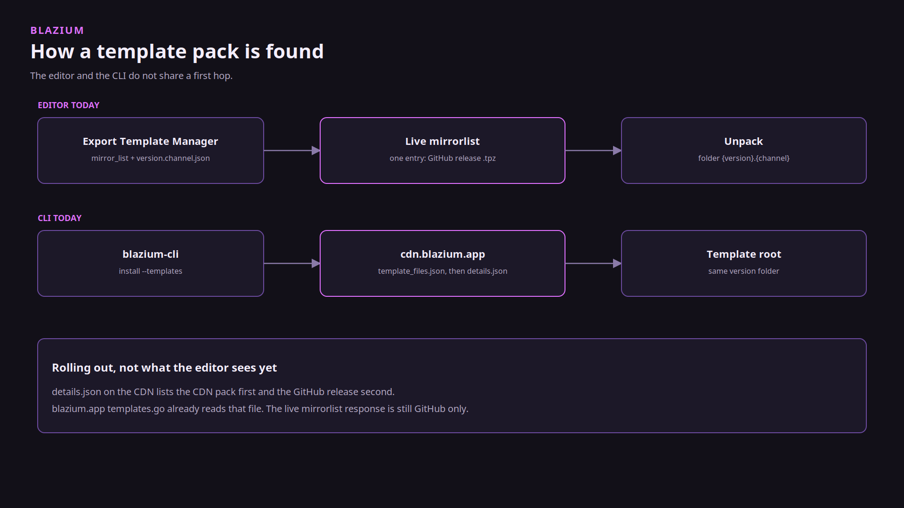

# Download Blazium and the dev tools

### One CDN, several pages, and a CLI that records what you installed

*By Bioblaze Payne, Co-Founder of [Blazium Games](https://blazium.games)*

---

Official editor builds are on [blazium.app/download](https://blazium.app/download). Hub and the CLI are on [blazium.app/dev-tools](https://blazium.app/dev-tools). Both pages point at files on `cdn.blazium.app`. We split them because the editor is the thing you make a game with, and Hub is the thing that installs that editor and, with it, the CLI and the crash sidecar.

The download page does not store binaries. It fills version lists from the CDN catalogs. When you pick a version, the button points straight at `https://cdn.blazium.app/{channel}/{version}/`. As of 11 October 2026 the release pointer is 0.6.838 and the nightly pointer is 0.6.924.


## What you are installing

The product version on the download page is Blazium `0.6.x`. That line is `blazium-dev`, compatible with Godot 4.3. Export templates follow the Blazium version, not a `4.3.2.stable` folder. Godot's download pages link at `downloads.godotengine.org`, and the editor asks `godotengine.org/mirrorlist/{version}.json`. Our download page and our CLI read the CDN. Our editor's template manager still asks `blazium.app/api/mirrorlist/`, and that live response is the GitHub release pack. The CDN mirror is the one the CLI uses, and it is what the site code is moving the editor toward.

Hub's own executable is a different binary, built from `blazium_4.8`. The editors it installs are the CDN builds. Published Hub installers and CLI binaries are Linux and Windows. There is no macOS installer in Hub's packaging tree, and no Flatpak. [blazium#428](https://github.com/blazium-games/blazium/issues/428) asks for one.



## Hub and CLI

Windows Inno, Linux `.deb`. The Hub installer also installs `blazium-cli` and `crash_reporter`, so you do not download those separately. Start at [the Hub download](https://blazium.app/dev-tools/download?tool=hub).

The CLI on its own is for a terminal or a runner: GitHub Releases, `npm install -g @blazium-engine/cli`, or `https://cdn.blazium.app/cli/cli.json`. Direct page: [the CLI download](https://blazium.app/dev-tools/download?tool=cli).


```text
asciinema play assets/cli-version.cast
```

You can unpack an editor zip by hand. The CLI is what records it in `hub.json` so Hub and `blazium-cli open` can find it. `blazium-cli install <version> --templates` pulls the template pack from the CDN into the Blazium template root.

## The rest of the dev tools

| Tool | Where it lives | When |
|---|---|---|
| Hub | installer | Making games on a desktop |
| CLI | [blazium-cli](https://github.com/blazium-games/blazium-cli) | Scripts, CI, `blazium://` |
| Docker web host | [docker-webbuild-template](https://github.com/blazium-games/docker-webbuild-template) | Serve a web export, including a Discord activity |
| setup-blazium-cli | [setup-blazium-cli](https://github.com/blazium-games/setup-blazium-cli) `v0.2.1` | Put the CLI on a runner |
| setup-blazium-engine | [setup-blazium-engine](https://github.com/blazium-games/setup-blazium-engine) `v0.3.0` | Install an editor on a runner |
| export-blazium-game | [export-blazium-game](https://github.com/blazium-games/export-blazium-game) `v0.3.2` | Export a preset |
| deploy-blazium-game | [deploy-blazium-game](https://github.com/blazium-games/deploy-blazium-game) `v0.0.2` | Push an already-exported artifact |
| Toolchain | [blazium-toolchain](https://github.com/blazium-games/blazium-toolchain) | PS1, PS2, N64, Interactive DVD |

The four Actions are separate repositories. They are not a folder inside the engine. Pin the tag. GitHub's Releases list lags the tags on setup-cli and setup-engine: the tags above exist, and the latest GitHub Release objects are older (`v0.2.0` and `v0.1.1`). `version: latest` on setup-engine tracks nightly. `latest-release` is the release channel.

Steam and itch reusable workflows inside deploy-blazium-game are deprecated. The replacement is `blazium-cli deploy steam` and `blazium-cli deploy itch`. Docker, Play, iOS, and macOS workflows in that repo are still the deploy path for those stores.


Internal game builds use the same CDN downloads the public gets. The store at [blazium.games](https://blazium.games) is not this page. Store uploads are `blazium-cli games` or the standalone games CLI, not the editor zip.

## Links

- Editor download: https://blazium.app/download
- Dev tools: https://blazium.app/dev-tools
- Release catalog: https://cdn.blazium.app/catalog/versions/release/latest.json
- CLI manifest: https://cdn.blazium.app/cli/cli.json
- Blazium Games: https://blazium.games

---

**[Jump into our Discord](https://blazium.app/chat)** for real-time chats, dev support and feedback

Or follow us everywhere else:

- **[GitHub](https://github.com/blazium-games)**
- **[IndieDB](https://www.indiedb.com/engines/blazium-engine)**
- **[X / Twitter](https://x.com/BlaziumGames)**
- **[YouTube](https://www.youtube.com/@blazium)**
- **[itch.io](https://blaziumengine.itch.io)**
