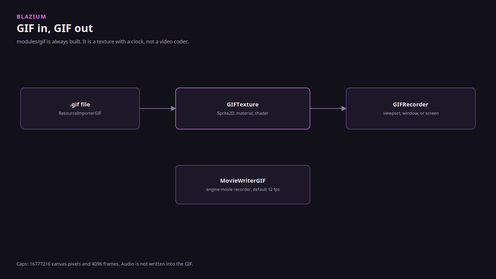

# Why the GIF module is a texture

### Drop it on a sprite. Do not expect a movie.

*By Bioblaze Payne, Co-Founder of [Blazium Games](https://blazium.games)*

---

The commit that added `modules/gif` was for reading, writing, and playing animated GIFs. The follow-up narrowed it: the thing you assign is `GIFTexture`, and it can sit anywhere a `Texture2D` sits. Sprite2D, Sprite3D, TextureRect, a material, a shader uniform. Godot does not have that class. We wanted it because 2D games, including Demon Lord: Clicker, keep using GIFs as art, and importing them as a pile of loose frames was the workaround.

A later editor change keeps GIF capture off the UI thread, in the same pass that keeps Steam ticket polling and remote Autowork from blocking the editor. Capture is allowed to be slow. It is not allowed to freeze the window.

## Always on

`can_build` and `is_enabled` return true. There is no SCons flag and no CDN package. The module is in the editor and in export templates.

`play` defaults to false, `loop` to true, `autoplay_on_load` to true. `resource_local_to_scene` defaults to true so two instances do not share a playhead unless you want them to. Netscape loop counts are honored.

`GIFRecorder.record_viewport` takes a viewport, a path, a duration, and an fps. The C++ default fps is 12. `MovieWriterGIF` is the engine movie-recorder target, same default. It drops audio. The encoder quantizes to a palette. That is the format. It is not RGBA video.

Project Settings cap the import: `blazium/gif/max_canvas_pixels` defaults to 16777216 and `blazium/gif/max_frames` defaults to 4096. Over the cap, import fails. A long full-screen capture will hit one of those and stop. Keep clips short and stay near 10 to 15 fps.

`blazium/gif/capture_hotkey` defaults to 0, which means no hotkey until you set one. Output goes to `user://` unless you change `blazium/gif/capture_output_dir`.

`GIFTexture.from_sprite_frames` and `to_sprite_frames` exist so an animation you already authored as SpriteFrames can become a GIF and the reverse. `ResourceImporterGIFFrames` is the importer that splits a file into frames instead of one texture.

We validated import, playback, and capture in-house. That pass does not name a title that ships GIF capture as a feature. The module is there because the art pipeline needed it.

Tests: [gif_module_tests](https://github.com/blazium-games/gif_module_tests).

## Links

- Module: https://github.com/blazium-games/blazium/tree/blazium-dev/modules/gif
- Tests: https://github.com/blazium-games/gif_module_tests
- Blazium Games: https://blazium.games

---

**[Jump into our Discord](https://blazium.app/chat)** for real-time chats, dev support and feedback

Or follow us everywhere else:

- **[GitHub](https://github.com/blazium-games)**
- **[IndieDB](https://www.indiedb.com/engines/blazium-engine)**
- **[X / Twitter](https://x.com/BlaziumGames)**
- **[YouTube](https://www.youtube.com/@blazium)**
- **[itch.io](https://blaziumengine.itch.io)**
