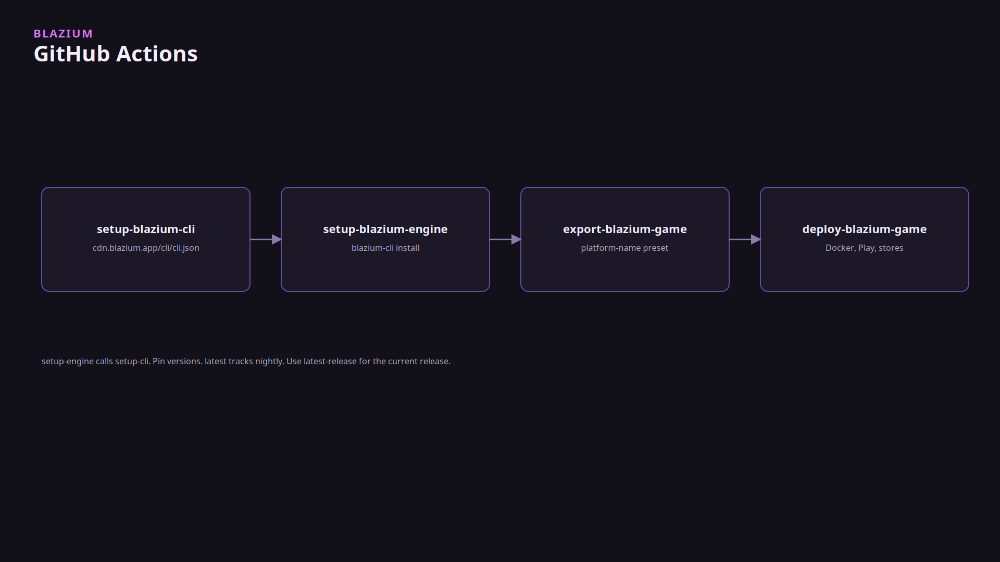

# GitHub Actions for Blazium

### Pin the tag you mean to run

*By Bioblaze Payne, Co-Founder of [Blazium Games](https://blazium.games)*

---

In 2025 we published the CLI, a deploy path, and a set of GitHub Actions next to Hangman. Hangman later shipped on Steam, Discord, Google Play, and the Apple App Store. Those storefronts are how export and deploy were checked. They do not mean each store build called the same workflow file.

The public actions are four repositories. They are not a folder in the engine. CI talks to the CDN through [blazium-cli](https://github.com/blazium-games/blazium-cli).



| Action | Tag to pin | Job |
|---|---|---|
| [setup-blazium-cli](https://github.com/blazium-games/setup-blazium-cli) | `v0.2.1` | Download the CLI from `cdn.blazium.app/cli/cli.json` and put it on `PATH` |
| [setup-blazium-engine](https://github.com/blazium-games/setup-blazium-engine) | `v0.3.0` | `blazium-cli install`, optional templates |
| [export-blazium-game](https://github.com/blazium-games/export-blazium-game) | `v0.3.2` | Export a preset |
| [deploy-blazium-game](https://github.com/blazium-games/deploy-blazium-game) | `v0.0.2` | Push an already-exported artifact |

`v0.2.1` and `v0.3.0` are git tags. The latest GitHub Release objects for those two repos are older (`v0.2.0` and `v0.1.1`). Pin the tag the action README uses, not whatever the Releases page calls Latest, until you have read the newer tag. Older examples that say `blazium-engine/export-blazium-game@master` use an org name that is not the repository.


```text
asciinema play assets/cli-help.cast
```

## A workflow

```yml
name: export
on: [push]
jobs:
  linux:
    runs-on: ubuntu-latest
    steps:
      - uses: actions/checkout@v4
      - uses: blazium-games/setup-blazium-engine@v0.3.0
        with:
          version: latest-release
          download_template: true
      - name: Autowork
        run: "${BLAZIUM_EDITOR} --headless --path . -s run_tests.gd"
      - uses: blazium-games/export-blazium-game@v0.3.2
        with:
          blazium-version: latest-release
          game-name: MyGame
          platform-name: Linux x86_64
```

`setup-blazium-engine` calls `setup-blazium-cli` for you. After a successful install it exports `BLAZIUM_EDITOR`, `BLAZIUM_INSTALLED_VERSION`, and `BLAZIUM_TEMPLATE`.

## Version input

`setup-blazium-engine` `version` defaults to `latest`.

| Input | Meaning |
|---|---|
| `0.6.838` | That release |
| `latest-release` | Highest version on the release channel |
| `nightly`, `latest`, `latest-nightly` | Nightly channel. `latest` is nightly |
| `0.6.924-nightly` | That nightly |
| `latest-0.6` | Highest 0.6.x across nightly and release |
| `latest-release-0.6` | Highest 0.6.x on release |

If you wanted a release and you wrote `latest`, you get a nightly. Templates install under the Blazium version, not Godot `4.3.2.stable`.

Other inputs: `download_template` (default false), `download_mono`, `platform`, `arch`, `use-cache`, `cli-version`. The cache key includes the resolved version, platform, arch, and whether Mono was requested. Changing only the game source does not invalidate that cache.

CLI only:

```yml
- uses: blazium-games/setup-blazium-cli@v0.2.1
- run: blazium-cli install 0.6.838 --templates --json --quiet
```

An empty `version` on setup-cli uses `.latest` from `cli.json`. The action checks SHA-256 when the manifest has one.

## Export and deploy

`platform-name` must match the export preset name. The web preset's `get_name()` is `Web`. Desktop presets are whatever is in `export_presets.cfg` (`Linux x86_64`, `Windows Desktop x86_64`, and the rest). The action rewrites `export_presets.cfg`. Apple and Android signing secrets stay empty until you export a store build.

Deploy runs on an artifact from export. Docker, Play, iOS, and macOS workflows in deploy-blazium-game are the ones to use for those targets. The Steam and itch reusable workflows in that repo are deprecated. The replacement named in the README is `blazium-cli deploy steam` and `blazium-cli deploy itch`. `deploy steam guard setup` is interactive. Do not put it in a job.

Do not paste secrets into the workflow file in a way that lands in the log. The kinds are Apple certificates, an Android keystore, a butler API key, a Docker token, and Steam publisher credentials.

Headless Autowork is `"$BLAZIUM_EDITOR" --headless --path . -s run_tests.gd`. If an editor is already up with remote control, `blazium-cli remote autowork run --wait` talks to `127.0.0.1:6508`. Eval stays off unless `blazium/remote_control/allow_eval` is set. Port 6507 is the game JustAMCP default. Do not point the CLI at it.

## Links

- setup-blazium-cli: https://github.com/blazium-games/setup-blazium-cli
- setup-blazium-engine: https://github.com/blazium-games/setup-blazium-engine
- export-blazium-game: https://github.com/blazium-games/export-blazium-game
- deploy-blazium-game: https://github.com/blazium-games/deploy-blazium-game
- CLI: https://github.com/blazium-games/blazium-cli
- Blazium Games: https://blazium.games

---

**[Jump into our Discord](https://blazium.app/chat)** for real-time chats, dev support and feedback

Or follow us everywhere else:

- **[GitHub](https://github.com/blazium-games)**
- **[IndieDB](https://www.indiedb.com/engines/blazium-engine)**
- **[X / Twitter](https://x.com/BlaziumGames)**
- **[YouTube](https://www.youtube.com/@blazium)**
- **[itch.io](https://blaziumengine.itch.io)**
