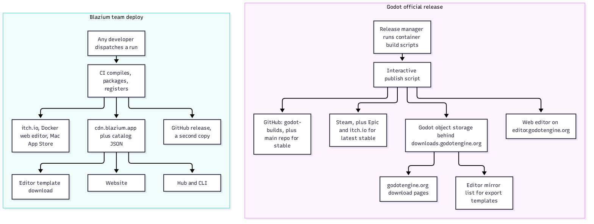
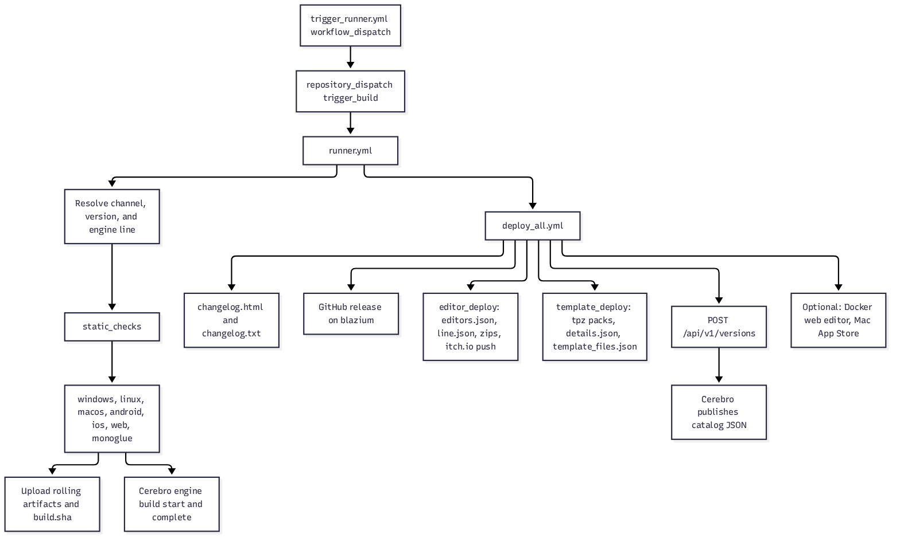
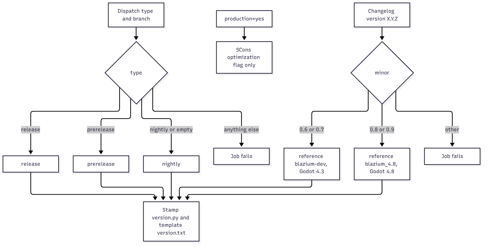
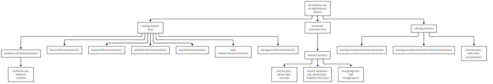
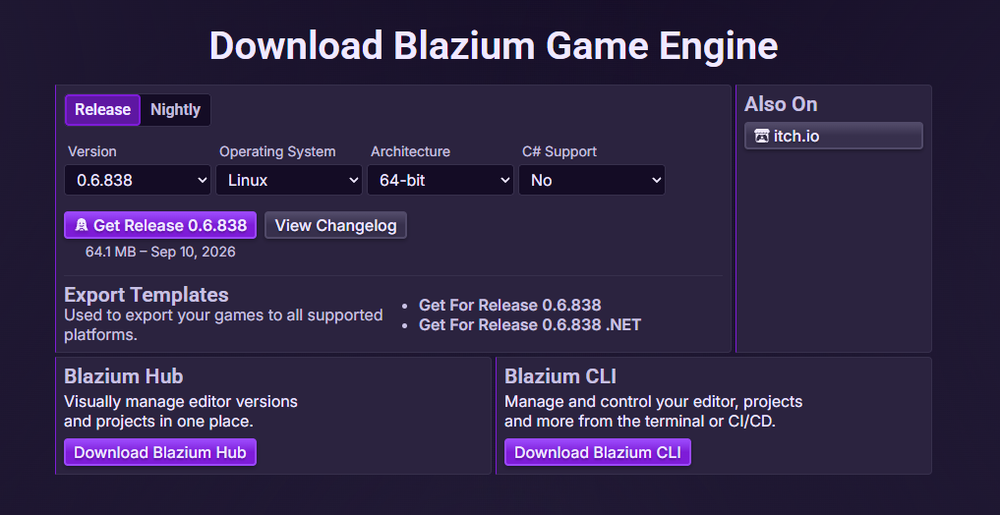
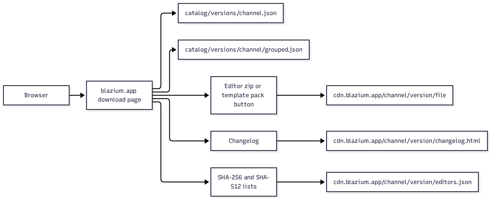
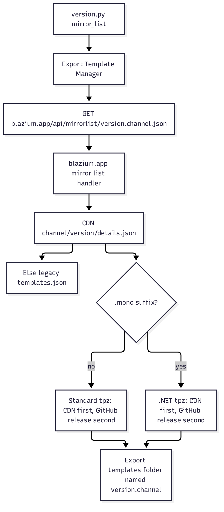
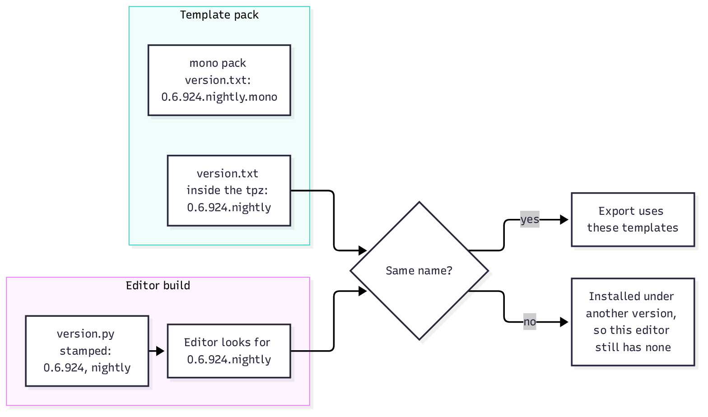
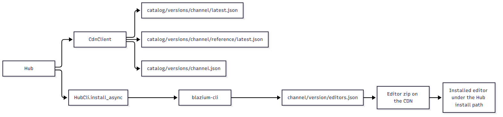

# One Deploy, Every Download: How We Ship Blazium Engine

### How a single CI run puts the editor, export templates, Hub installs and the GitHub release on the same files, and how that compares to the way Godot ships

*By Randolph Aarseth II, Co-Founder of [Blazium Games](https://blazium.games) and Lead Developer of [Blazium Engine](https://github.com/blazium-games/blazium)*

---

On October 11, 2026, Blazium 0.6.924 went out on the nightly channel. It started as a form in GitHub Actions. When the run finished, the same build was on [cdn.blazium.app](https://cdn.blazium.app), listed on the [download page](https://blazium.app/download), visible to Hub and the CLI, offered by the editor's export template manager, and attached to a [GitHub release](https://github.com/blazium-games/blazium/releases).

This article walks through how that works: what triggers a deploy, how a build gets its channel and version, what lands on the CDN, and how each download path finds it. Where Godot does something differently, we say so, and we link to the source.



## Why we built it this way

A full engine deploy takes a long time. When that job lived on one person's machine, only that person could ship, and a crash or a closed laptop stopped the run halfway. We wanted anyone on the development team to be able to trigger a deploy and walk away while runners compile, upload and register the build.

The second goal was one source of truth for downloads. The website, Hub, the CLI and the editor all read from the CDN. The GitHub release gets the same files, but nothing depends on it. If GitHub is having a bad day, or something happens to the repository, the CDN still serves every build.

## How Godot ships, for comparison

Godot's official builds come from [godot-build-scripts](https://github.com/godotengine/godot-build-scripts), container-based scripts that the project describes as "intended for release managers." After the builds finish, a release manager runs an interactive [publish script](https://github.com/godotengine/godot-build-scripts/blob/main/publish-release.sh) that pushes the same files to a lot of places:

- Every release goes to [godotengine/godot-builds](https://github.com/godotengine/godot-builds/releases), which holds dev snapshots, betas, release candidates and stables. Stable releases are also mirrored to the [main repository](https://github.com/godotengine/godot/releases).
- Files go to Godot's own object storage, which sits behind `downloads.godotengine.org`. That is what the [download pages](https://godotengine.org/download/windows/) link to today.
- Stable releases go to [Steam](https://store.steampowered.com/app/404790/Godot_Engine/), with export templates bundled in. The latest stable also goes to the [Epic Games Store](https://store.epicgames.com/p/godot-engine) and [itch.io](https://godotengine.itch.io/godot).
- The web editor is published to [editor.godotengine.org](https://editor.godotengine.org/releases/latest/).

Godot's history explains part of that setup. Downloads used to live on TuxFamily. When TuxFamily went down for a week in October 2023, the team [made godot-builds the reference](https://github.com/godotengine/godot-website/issues/608#issuecomment-1763350429). Then in 2025, [GitHub release downloads started failing](https://github.com/orgs/community/discussions/169381) when a large file took more than a few minutes to download, which broke the roughly 1 GB export template pack for people on slower connections. Godot [moved the website's downloads to its own mirror](https://github.com/godotengine/godot/issues/108952) in late September 2025.

So the difference between us is not that Godot only ships to GitHub. It doesn't. Godot's process is run by a release manager from scripts. Blazium's is a CI pipeline anyone on the team can start, with three channels, nightly included, and a JSON catalog that our own tools read to find builds. Both projects ended up with the same answer for big files: serve them from storage you control.

## From a button to a published version

A deploy starts in our [ci_cd repository](https://github.com/blazium-games/ci_cd) as a manual workflow dispatch. `trigger_runner.yml` turns the form into a `trigger_build` repository dispatch, and `runner.yml` is the only workflow that listens for it.

The payload picks:

- the channel (`release`, `prerelease` or `nightly`)
- the engine branch
- which platforms to compile
- what to deploy: editors, templates, the web editor, or the Mac App Store package
- whether to force a full rebuild, or reuse an earlier run's builds and only redeploy them

The version number is not an input. The runner reads `version.py`, then asks Cerebro, our build backend, whether this commit already has completed assets on this channel. If it does, the version is frozen at that number. If not, the changelog script bumps it. Once a commit has finished assets on a channel, re-running the deploy doesn't mint a second version for the same bits.

Static checks run first. Then the platform workflows compile Windows, Linux, macOS, Android, iOS, web and the Mono glue. Each job tells Cerebro it started, uploads its output to the CDN, and tells Cerebro it finished.

`deploy_all.yml` runs once those jobs pass. It writes the changelog, creates the GitHub release, packages editors and export templates into the versioned CDN folder, pushes desktop editors to [itch.io](https://blaziumengine.itch.io/blazium-engine), and posts the version to Cerebro so the public catalog updates.



The GitHub tag is `v{version}` for a release and `v{version}-{channel}` otherwise, so 0.6.924 nightly is tagged `v0.6.924-nightly`. Nightlies and prereleases are marked as prereleases on GitHub. The editor and template jobs attach the same files to that release after they land on the CDN.

## Channel and engine line

The version banner the editor prints comes from `external_status` in `version.py`. The runner resolves it once from the dispatch type and passes it to every compile and deploy job. `release` stamps `release`, `prerelease` stamps `prerelease`, and `nightly` or an empty type stamps `nightly`. Anything else fails the run. The separate `production` switch only turns on SCons production build settings. It never relabels a nightly as a release.

Godot uses a different set of labels. Its builds are `devN` snapshots, `betaN`, `rcN` and `stable`, all listed on the [preview builds page](https://godotengine.org/download/preview/) until they go stable. Godot doesn't publish official nightlies. Blazium does, as its own channel next to release and prerelease.

The Blazium version also decides which Godot generation a build belongs to:

- `0.6` and `0.7` build from `blazium-dev`, the Godot 4.3 line.
- `0.8` and `0.9` build from `blazium_4.8`, the Godot 4.8 line.
- Any other minor version fails the run.

The two lines must never overwrite each other's "latest" files, so the engine line is part of every rolling CDN key and gets its own catalog pointer. This split landed in the pipeline this week, so the per-line files show up as new builds go out.



## What lands on the CDN

Storage is DigitalOcean Spaces, served at `https://cdn.blazium.app`. There are three kinds of keys.

**Rolling keys** are how one build finds the last compile for its platform and line. They look like `windows/blazium-dev/nightly/`, with the same shape for `linux`, `macos`, `android`, `ios`, `web-editor` and `monoglue`. Each folder holds the platform archive and a `build.sha`. On the next run, a platform skips compiling when that SHA still matches, unless the dispatch sets `force`. Platform builds that need Mono glue download it from `monoglue/{line}/{channel}/`. These keys carry no version number, so the line segment is what stops a 4.8 nightly from replacing a 4.3 nightly.

**Versioned keys** are what people download. They follow `/{channel}/{version}/`, for example `release/0.6.838/`. That folder holds:

- the editor zips and `editors.json`, with SHA-256 and SHA-512 for each file
- two export template packs, `Blazium_v{version}_export_templates.tpz` and `Blazium_v{version}_mono_export_templates.tpz`
- `details.json`, which describes both packs
- `template_files.json`, which lists every template file on its own
- `line.json`, which records the version, channel, engine line and Godot line
- `changelog.html` and `changelog.txt`

**Catalog keys** are the index. After the version is posted, Cerebro writes `catalog/versions/{channel}/latest.json` for the newest build on that channel and `catalog/versions/{channel}.json` and `catalog/versions/{channel}/grouped.json` for version lists. Each engine line also gets `catalog/versions/{channel}/{line}/latest.json`. The website spells the prerelease channel `pre-release`, so the catalog publishes that alias next to `prerelease`.

Here is the live release pointer as of this writing, from [catalog/versions/release/latest.json](https://cdn.blazium.app/catalog/versions/release/latest.json):

```json
{
  "version": "0.6.838",
  "channel": "release",
  "editors_url": "https://cdn.blazium.app/release/0.6.838/editors.json",
  "templates_url": "https://cdn.blazium.app/release/0.6.838/details.json",
  "changelog_url": "https://cdn.blazium.app/release/0.6.838/changelog.txt"
}
```



When a deploy includes the web editor, a Docker image is built from the rolling `web-editor` archive, not the versioned zip, and tagged `blazium_web-editor-{line}-{channel}` at both `:latest` and the version number.

## How the website serves a download

The [download page](https://blazium.app/download) doesn't store binaries. It fills its version lists from the CDN catalogs, `catalog/versions/{channel}.json` for each channel and `grouped.json` for version history. When you pick a version, OS, architecture and C# support, the button points straight at the file in `cdn.blazium.app/{channel}/{version}/`. The export template links do the same for the standard and .NET packs.

The changelog comes from `changelog.html` in the same versioned folder, and the SHA lists come from that folder's `editors.json`. The "Also On" box links to our [itch.io page](https://blaziumengine.itch.io/blazium-engine), which gets its desktop editors from the same deploy.





## How the editor gets export templates

This part works the same way in Godot and Blazium, but with different endpoints, so it's worth spelling out.

In Godot, the Export Template Manager requests `https://godotengine.org/mirrorlist/{version}.json`, for example [4.7.2.stable.json](https://godotengine.org/mirrorlist/4.7.2.stable.json). Today that list has one entry, "Official Releases mirror," which points at `downloads.godotengine.org`. .NET builds ask for the `.mono` variant of the same file. Since [Godot 4.7](https://github.com/godotengine/godot/pull/117072), the manager can also download individual templates instead of the whole pack.

In Blazium, `version.py` sets `mirror_list` to `https://blazium.app/api/mirrorlist/`, and the manager requests `{mirror_list}{version}.{channel}.json`, for example `https://blazium.app/api/mirrorlist/0.6.924.nightly.json`. A `.mono` suffix selects the .NET pack. Today that list points the editor at the GitHub release copy of the pack. We're rolling out a site update that reads `details.json` from the matching CDN folder instead, falling back to the older `templates.json` when it's missing. `details.json` lists the CDN copy first and the GitHub release copy second, so once that update is live the editor pulls from the CDN with GitHub kept as a backup mirror. The manager downloads the `.tpz` from the chosen URL and unpacks it into the local export templates folder.



Version matching is strict in both engines. Godot's editor looks for templates in a folder named after its full version, like `4.7.2.stable` or `4.7.2.stable.mono`. Blazium's looks for its own version and channel, like `0.6.924.nightly`, and the template job writes that exact string into `version.txt` inside the pack, with `.mono` added for the .NET pack. A pack from another build installs under its own name, and the editor you're running still has no templates.



Both engines turn the download button off for unnumbered development builds. Godot hides it when the status is exactly `dev`, `beta` or `rc`, which official numbered betas like `beta1` don't trigger, and also for double-precision builds and in offline mode. Blazium inherits this check, and it reads the Godot-side `status` field in `version.py`, not the channel stamp. On the `blazium-dev` line that field says `stable`, so release, prerelease and nightly builds all offer the download.

The CLI can also install templates one file at a time from `template_files.json`, checking each file's SHA-256, for example with `blazium-cli install nightly --templates`.

## How Hub and the CLI install an editor

[Blazium Hub](https://github.com/blazium-games/blazium-hub) talks to the CDN directly and never calls Cerebro. Its `CdnClient` reads `/catalog/versions/{channel}/latest.json` for the newest build, or `/catalog/versions/{channel}/{line}/latest.json` when asked for `blazium-dev` or `blazium_4.8`, so a 4.3 install never follows a 4.8 nightly. The version list is `/catalog/versions/{channel}.json`, and a `prerelease` request falls back to the `pre-release` alias.

Hub doesn't download editors itself. It runs [blazium-cli](https://github.com/blazium-games/blazium-cli) with `--json`. The CLI reads `/{channel}/{version}/editors.json`, picks the zip for the current OS, and installs it under the Hub install path. Installs, uninstalls and project actions in Hub all go through the CLI, so the same commands work in a terminal or a CI job.



## Where else a build goes

The CDN is the copy everything reads. A deploy also writes a few more:

- **GitHub release.** Same files, same tag scheme, attached after the CDN upload. It's also the second mirror in `details.json`, and the editor's current template source while the CDN mirror rolls out.
- **itch.io.** Desktop editors are pushed with butler to [blaziumengine.itch.io/blazium-engine](https://blaziumengine.itch.io/blazium-engine), with the channel in the itch channel name.
- **Docker.** The web editor image, tagged per line and channel.
- **Mac App Store.** When requested, a separate job signs a macOS installer and uploads it to App Store Connect.

Godot's equivalents are Steam, Epic, itch.io and its hosted web editor. One detail we like in Godot's Steam build: export templates come bundled, so Steam users never open the template manager. Godot's store versions don't include .NET support. Its .NET editor and templates come from the download pages.

## What this gets us

- **Anyone can ship.** A deploy is a form in GitHub Actions, not a long night on one person's machine.
- **One set of bits.** The website, Hub, CLI, editor, GitHub and itch.io all serve files from the same run, and every file has a checksum in its manifest.
- **Fast nightlies.** Unchanged platforms skip compiling, and re-running a commit keeps its version number.
- **Two engine lines without collisions.** The 4.3 and 4.8 lines keep separate rolling keys and catalog pointers.
- **No single point of failure on GitHub.** If GitHub goes down, downloads keep working.

Everything in this pipeline is public. If you run your own fork or build server, the workflows are in [blazium-games/ci_cd](https://github.com/blazium-games/ci_cd), the website handlers are in [blazium-games/blazium.app](https://github.com/blazium-games/blazium.app), and the template manager is in [the engine repository](https://github.com/blazium-games/blazium/blob/blazium-dev/editor/export/export_template_manager.cpp).

## Links

- Download Blazium Engine: https://blazium.app/download
- Blazium Engine on GitHub: https://github.com/blazium-games/blazium
- CI/CD workflows: https://github.com/blazium-games/ci_cd
- Blazium Hub: https://github.com/blazium-games/blazium-hub
- Blazium CLI: https://github.com/blazium-games/blazium-cli
- Blazium Engine on itch.io: https://blaziumengine.itch.io/blazium-engine
- Blazium Games: https://blazium.games
- Randolph Aarseth II on X: https://x.com/BioblazePayne
