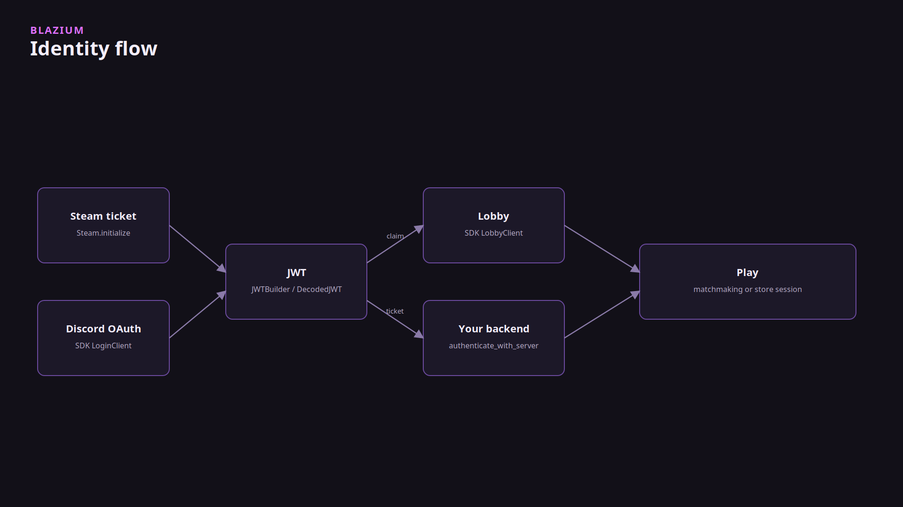
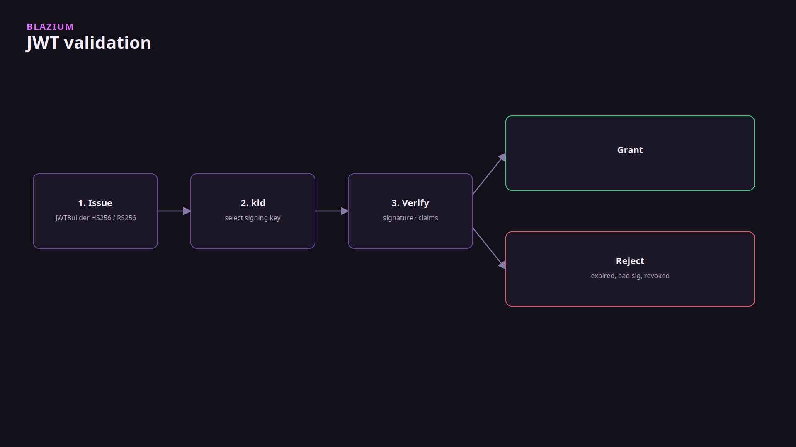
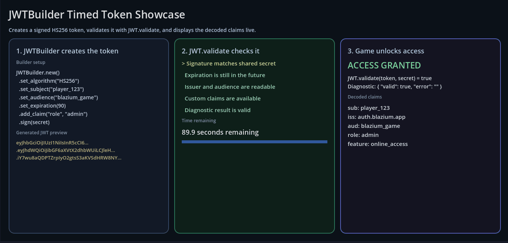
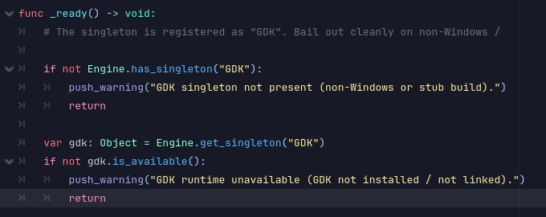

# Identity, Steam, and Xbox

### A platform ticket is not a session

*By Bioblaze Payne, Co-Founder of [Blazium Games](https://blazium.games)*

---

GodotSteam left the tree in 0.5.246. We replaced the pieces we actually ship with: achievements, stats, inventory, workshop items, and a web API ticket the game can exchange with a backend. The Discord Social SDK covers desktop presence and invites. Microsoft GDK is in the tree for Xbox-shaped export, and it does not build unless you turn it on. Tokens are JSON Web Tokens (JWTs), built and checked in the engine.

Hangman shipped on Steam, Discord, Google Play, and the Apple App Store. That is how export and store upload were checked end to end. It does not mean every one of those builds called `Steam.initialize` or `GDK.initialize`. The Blazium Games store at [blazium.games](https://blazium.games) is a different product. A game on that store does not have to be made with this engine. Uploads there are `blazium-cli games` or the standalone games CLI, not the Steam module.



`LoginClient` and `LobbyClient` on that diagram are the SDK module, not classes in a stock `blazium-dev` editor. The engine path is `Steam.authenticate_with_server` and `Discord.authenticate_with_server`, both of which return a token your backend minted.

## JWT

`modules/jwttool` registers `JWT`, `JWTBuilder`, and `DecodedJWT`. The class reference documents HS256 and RS256. `kid` is the header key id. `JWT.validate_with_map` picks the key by that `kid`.

```gdscript
var builder := JWTBuilder.new().set_issuer("auth.local").set_subject(user_id)
builder.set_algorithm("HS256")
builder.set_expiration(3600)
var token := builder.sign(secret)
var decoded := JWT.parse(token)
if decoded.is_expired():
    return
```

`sign` takes a `String` secret for HS256 or a `CryptoKey` for RS256. Expiry on the way in is `is_expired` and `validate_timing(jwt, leeway_seconds)`. `revoke_jti`, `is_revoked`, and `clear_revoked` are an in-process list. They die with the process. `JWT.create_jwt_timed` is deprecated. Use the builder.





## Steam

`modules/steam` loads the Steamworks library at runtime. Methods fail without crashing the editor when the library or the client is missing.

```gdscript
func _ready() -> void:
    if Steam.initialize(480) != OK:
        push_warning("Steam unavailable")
        return
    Steam.web_api_ticket_ready.connect(_on_ticket)
    Steam.request_web_api_ticket("blazium")

func _on_ticket(hex_ticket: String, auth_ticket_handle: int) -> void:
    var result := Steam.authenticate_with_server(backend_url, hex_ticket, 480)
    if result.is_success():
        print(result.get_jwt().length())
```

`480` is Spacewar, Steam's test app id. `request_web_api_ticket` emits `web_api_ticket_ready`. `authenticate_with_server` is synchronous and returns `SteamAuthResult`.

Achievements, stats, inventory, and workshop items are on this singleton. Leaderboards are not. [blazium#807](https://github.com/blazium-games/blazium/issues/807) asks for `ISteamUserStats` leaderboard calls. The issue is open. There is no leaderboard method in `modules/steam`.

## Discord on the desktop

`Discord.initialize_presence_only` is auth-less rich presence. `Discord.initialize(client_id)` is the OAuth path: friends, invites, and `authenticate_with_server`, which returns `DiscordAuthResult`. `get_jwt()` on that result is the token your backend minted, not Discord's access token. `create_or_join_lobby` is a Discord SDK lobby, not the Blazium lobby client.

The Embedded App client is a different module and a web export. It does not replace `initialize` in a desktop build.

## Xbox / GDK

`xbox_module` is present and `is_enabled` defaults to false. Turn it on with `module_xbox_module_enabled=yes`, on Windows, with the GDK installed. The script surface in the class reference is `GDK`: `initialize`, `shutdown`, `is_available`, `is_initialized`, `dispatch`. C++ getters for users, achievements, stats, leaderboards, store, and presence are in `modules/xbox_module/gdk/gdk.h`. Most of those sub-objects do not have class-reference XML yet. Read the header before calling them.

`EditorExportPlatformXbox` needs a GDK install on the machine doing the export. Signed-in tests need `LIVE_TESTS=1`. This is not a retail console-kit guide.



## Links

- Steam module: https://github.com/blazium-games/blazium/tree/blazium-dev/modules/steam
- JWT: https://github.com/blazium-games/blazium/tree/blazium-dev/modules/jwttool
- Leaderboards issue: https://github.com/blazium-games/blazium/issues/807
- Blazium Games: https://blazium.games

---

**[Jump into our Discord](https://blazium.app/chat)** for real-time chats, dev support and feedback

Or follow us everywhere else:

- **[GitHub](https://github.com/blazium-games)**
- **[IndieDB](https://www.indiedb.com/engines/blazium-engine)**
- **[X / Twitter](https://x.com/BlaziumGames)**
- **[YouTube](https://www.youtube.com/@blazium)**
- **[itch.io](https://blaziumengine.itch.io)**
