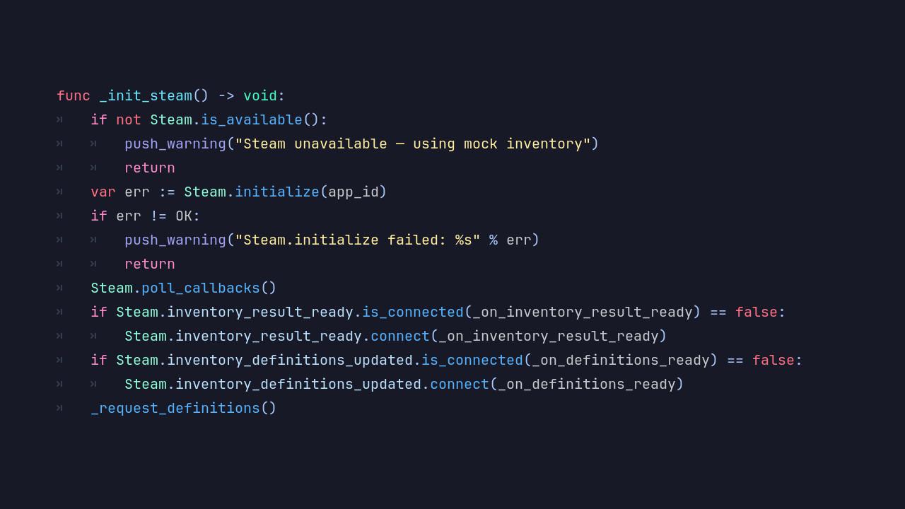
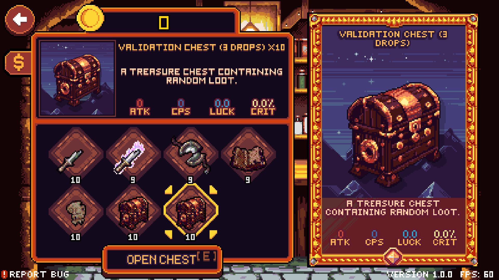
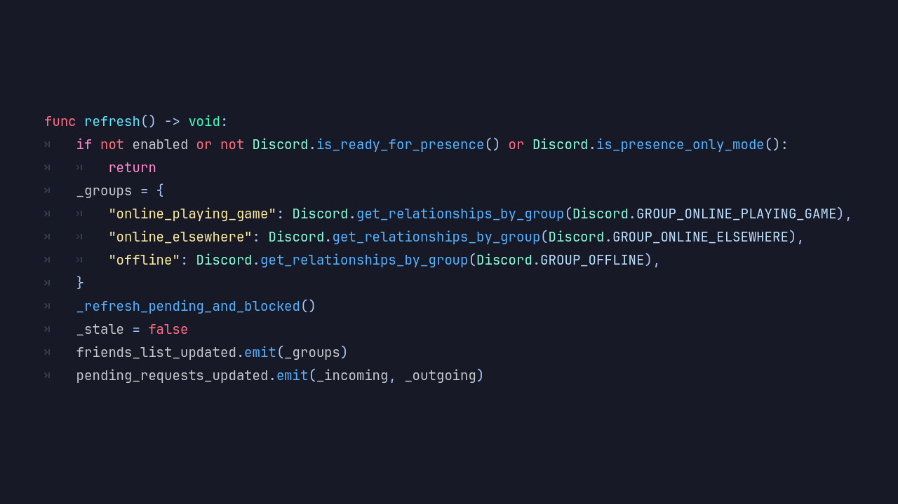
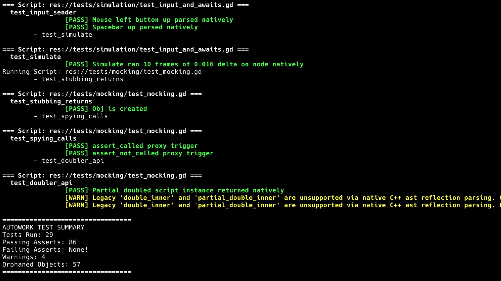
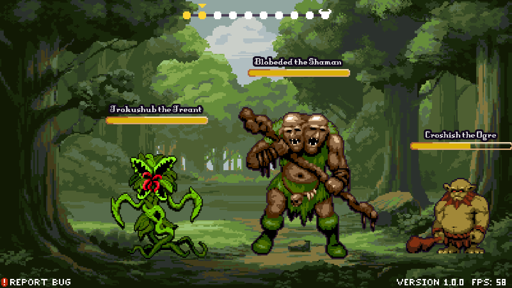

# Proving the Engine by Shipping a Game: What Demon Lord: Clicker Validated in Blazium

*By Randolph Aarseth II, Co-Founder of Blazium Games (https://blazium.games)*

Blazium Engine is an open-source, MIT-licensed fork of Godot, and since the fork in October 2024 its contributors have been adding first-party modules at a steady pace: Steam, Discord, a testing framework, crash reporting, opt-in analytics, an MCP server for the editor and more. Each of those modules has unit tests. None of those tests can tell you what happens when a thousand people on a thousand different PCs launch a game built on it.

So we built one. Demon Lord: Clicker is a high-fantasy, 2D pixel-art clicker that launched on Steam on October 3, 2026. It was built on Blazium's `blazium-dev` line by the same contributors who write the engine modules it uses. This article is about the engine side of that work: which tools and modules the game needed, why they were built the way they were, and how shipping a 2D game put the engine's 2D side and its recent modifications under real load.

## Why a real game, and not a demo

Every feature in the Blazium ecosystem has been validated in-house. Our first proof was Hangman, a small example game that shipped on Steam, on Discord as an Embedded App, on Google Play and on the Apple App Store. Hangman proved that export and deployment worked end to end across very different stores.

Hangman's job was to prove export and deployment. Demon Lord: Clicker's job is live operations: a Steam inventory economy, server-saved runs, Discord presence and a steady stream of item drops. Since launch it has passed 4,000 licensed users and about 1,000 players, and we shipped five updates between October 4 and October 6, from 1.0.334 to 1.0.352. That is exactly the kind of pressure you want on a new module before anyone else bets a project on it.

The rule we hold ourselves to is simple: a module isn't done until we've validated it in-house, and for live-operations modules that means shipping a game on it.

## The modules the game needed

### Steam: built because the game needed inventory, not a wrapper

When the GodotSteam integration was removed from Blazium in release 0.5.246, we had a choice: wait for someone else's extension, or write our own. We wrote our own. The Steam module landed on `blazium-dev` in June 2026 as a native Steamworks layer exposed through a `Steam` singleton, covering initialization with a graceful fallback when Steam isn't running, achievements, stats, inventory, and web API tickets for authenticating against your own backend.

That list lines up with what Demon Lord: Clicker needed on day one. The game signs players in by exchanging a Steam ticket with its backend. Every item, chest and reward is a Steam inventory item, and chests open through Steam item exchanges. The game's Steam store page lists Steam Achievements and Stats, and achievements are unlocked through the module.

*Initializing the Steam module and listening for inventory updates through the `Steam` singleton.*

The engine history shows what real integration turns up. In the days after the module was merged, contributors fixed Steam callback dispatch so it couldn't hang a thread, fixed how asynchronous ticket results were dispatched, and made sure inventory definition updates with an empty payload still got delivered. None of those show up in a unit test that mocks Steam. All of them show up in a game that polls inventory, refreshes definitions and authenticates on every launch.

*Opening a chest. Behind this button is a Steam inventory item exchange driven through the engine's Steam module.*

### Discord: presence that stays quiet

The Discord module followed a few days after Steam. It loads Discord's SDK at runtime instead of linking it in, and it exposes Rich Presence, OAuth, invites and relationships. Demon Lord: Clicker uses it for Rich Presence, so your Discord profile shows what you're doing in the game.

One lesson came straight out of shipping. An engine API should let a game update presence whenever it likes, but a game shouldn't spam it. The module's own debug logging was put behind a setting shortly after it landed, and on the game side our first update made presence more reliable and cut unnecessary background activity by skipping identical updates and spacing sends out. That split is deliberate: the engine provides the capability, and the game owns the cadence.

*The Discord module exposes presence and relationships through a `Discord` singleton.*

### Autowork: tests a game can actually run

Autowork is Blazium's built-in testing framework. It was enabled on editor builds in June, and in September contributors closed the remaining gaps in test discovery, JUnit output, the command-line runner and port handling, so a project's tests run without extra scripts.

Demon Lord: Clicker keeps a dedicated production-validation suite that Autowork runs, writing JUnit-format results. Some of those tests exist because players found a bug first. After a handful of items turned out to have icons that Steam Community Market pages couldn't load, the game gained a test that fails if any item icon isn't served over HTTPS. That's the loop we want: a live bug becomes a test, and the test framework has to be good enough to hold it.

*An Autowork run. The same runner executes the game's production-validation suite.*

### GDScript style checks

In July a contributor added an opt-in GDScript style guide to the engine: warnings for naming conventions, trailing commas, hexadecimal case and similar rules. Demon Lord: Clicker turns those checks on. A large GDScript codebase written by several people under launch pressure is a fair test of whether opt-in style warnings help or just add noise.

### Crash reporting and analytics

Two more modules landed in August. The crash reporter writes a Breakpad minidump and hands it to a small companion app that asks the user before anything is uploaded. It was built for the engine ecosystem, and we read the reports that are sent to find and patch engine crashes. Analytics is a separate, opt-in module that stays silent until consent is given. It was built with our own games in mind, Hangman and Demon Lord: Clicker. The two modules share an app ID and a build ID but never a consent switch.

## Validating the 2D side

Demon Lord: Clicker is a 2D game from top to bottom. Its base viewport is 800 by 450, scaled up with viewport stretching and nearest-neighbor texture filtering so the pixel art stays sharp at 1080p and above. It runs on the GL Compatibility renderer. Most of what you see is UI: inventory grids, item cards, popups, the adventure map, health bars, floating combat numbers and a parallax background behind each fight.

*A fight in the forest: pixel art at a low base resolution, scaled up, with UI-driven health bars and names.*

That makes it a direct test of the parts of the engine Blazium contributors have been changing.

### GUI and theming

A large share of Blazium's own engine work this year has been GUI. Contributors worked on the Blazium default theme and added a theme template structure. They fixed text editing styles and redraws, CheckButton icon tinting, OptionButton icon alignment, scroll bars that moved after being reparented, and a crash when the theme scale was set to zero. They also brought in a long run of upstream fixes for popup menus and for menu keyboard and controller navigation.

A menu-heavy game is the best stress test those changes can get. Update 1.0.352 made every menu and popup in Demon Lord: Clicker usable with a controller or keyboard, including target cycling with a selection marker and consistent Back and Cancel on B or Escape. That work was done in the game, on top of the engine's focus and navigation system.

### Rendering on hardware we don't own

On the rendering side, contributors fixed texture repeat modes in the GLES3 renderer, the code path the GL Compatibility renderer relies on, and the one Demon Lord: Clicker runs on. Other 2D additions this year, which the game doesn't use yet, include a `mask_parent` option on Sprite2D, an animated GIF texture type that can be used anywhere a texture can, and a fix for pixel-opacity checks on compressed textures in Sprite2D. Those are next in line for in-house validation.

Launch week then did what no internal test pass could. Players on AMD integrated graphics got a black screen. Others found that some window, fullscreen, borderless and resolution combinations could lock up the game or push it off screen. The fixes were game-side configuration and code: 1.0.352 switched the game to the ANGLE backend on Windows, fit the first-launch window to the screen, greyed out resolutions larger than the display, labelled full screen as "Full Screen (Borderless)", and added `--reset-display` and `-windowed` launch options.

For engine contributors, that's useful knowledge. It tells us that on Windows, GL Compatibility through ANGLE is the safer default for a 2D game that has to run on integrated graphics, and that a game needs a command-line way back when its saved display settings go wrong.

### Combat readability

Some 2D lessons are about presentation rather than rendering. In 1.0.352, clicks-per-click hits that used to stack on top of each other now fan out to one side in blue, clicks-per-second hits appear on the other side in purple, and normal clicks stay white at the cursor. Earlier, 1.0.340 smoothed out combat so there's less stutter when new enemies arrive. The engine draws exactly what it's told. Making a build readable at a glance is game design, and it's a reminder that 2D validation isn't only about whether pixels reach the screen.

## What comes back to the engine

Shipping Demon Lord: Clicker gave the engine three things.

**Proof under load.** Steam inventory, ticket authentication, Discord presence and Autowork have all run in a public Steam release with real players. When we tell developers these modules are ready, we have shipped on them ourselves.

**Fixes found by integration.** The Steam callback and dispatch fixes are exactly the kind of fault that only appears when a real game drives the module the way players do. Those fixes are in the open-source engine for everyone.

**Clear boundaries.** Running a game showed us where the line between engine and game belongs. Presence cadence, retry policy, inventory refresh timing and display fallbacks are game decisions. Reliable callbacks, quiet default logging, tests that run without extra scripts and a renderer that holds up on cheap hardware are engine responsibilities.

Blazium contributors build tools for a living. Building a game with them is how we find out if those tools are any good. Demon Lord: Clicker is our answer for this round, and every patch note it gets is another data point for the engine.

## Links

- Demon Lord: Clicker on Steam: [Store.steampowered.com](https://store.steampowered.com/app/1742110/)
- Support tracker: [Github.com](https://github.com/blazium-games/support/issues)
- Blazium Engine on GitHub: [Github.com](https://github.com/blazium-games/blazium)
- Blazium Games: [Blazium.games](https://blazium.games/)
- Randolph Aarseth II on X: [X.com](https://x.com/BioblazePayne)
