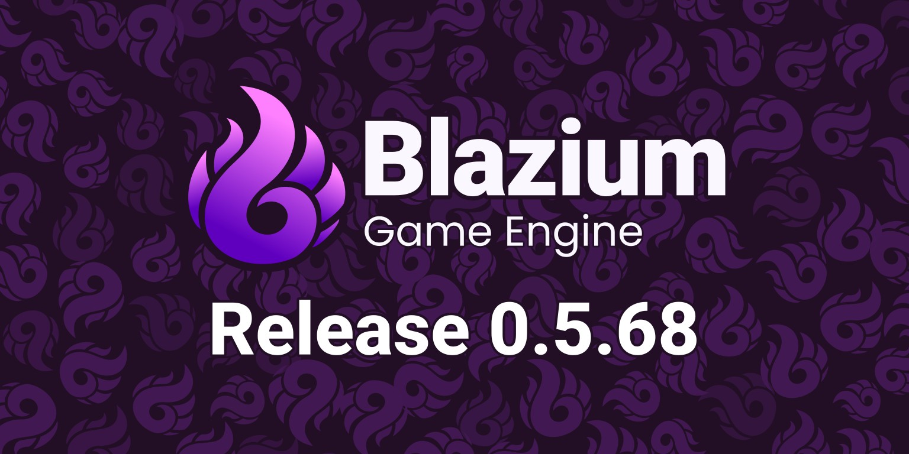
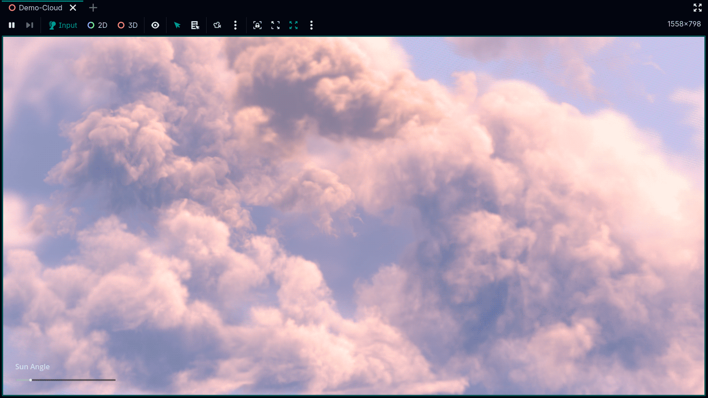

# Blazium Release 0.5.68

This release brings us up-to-date with Godot 4.4.1 minus compatibility breaking features and we also added some new interesting features.

- [Pre Built binaries on the website](https://blazium.app/download)
- [Digital stores](https://blazium.app/download/digital-store)

## Release Features

Imlpemented a new material type, a **Volumetric Lighting Shader** using a **Six-Directional Lighting Model (SDLM)** designed to simulate realistic light interaction within semi-transparent volumes like cloud, smoke, fog and fire. [GitHub Pull Request](https://github.com/blazium-engine/blazium/pull/441). By **[TheAenema](https://github.com/TheAenema).**

Added project setting to change parsing of json numbers behavior to return int or double instead of treating all numbers as double. [GitHub Pull Request](https://github.com/blazium-engine/blazium/pull/440). By **[Ughuuu](https://github.com/Ughuuu)**.

Updated SQLiteQueryResult.get_result() to return an Array[Dictionary] instead of an Array[Array], simplifying data access after executing a SQLite query. [GitHub Pull Request](https://github.com/blazium-engine/blazium/pull/465). By **[Ughuuu](https://github.com/Ughuuu)**.

Implemented OS.get_unique_id() for web exports. [GitHub Pull Request](https://github.com/blazium-engine/blazium/pull/425). By **[sshiiden](https://github.com/sshiiden)**.

Added better error messages for:

- Missing commas in a dictionary.
- Two consecutive periods in an if condition.
- Match statement case “_:” wrong indent.

[GitHub Pull Requests](https://github.com/blazium-engine/blazium/pulls?q=442+443+447). By **[TheKingScott](https://github.com/TheKingScott)**.

Fixed Steam.get_ticket_for_web_api() not retrieving Web API ticket data correctly. [GitHub Pull Request](https://github.com/blazium-engine/blazium/pull/460). By **[Ughuuu](https://github.com/Ughuuu)**.

Fixed OS.get_video_adapter_driver_info() on windows sometimes crashing or returning garbage data. [GitHub Pull Request](https://github.com/blazium-engine/blazium/pull/448). By **[jss2a98aj](https://github.com/jss2a98aj)**.

## Features from upstream

We finished cherry-picking what we could from Godot 4.4 without breaking compatibility with 4.3 projects. [GitHub Pull Requests](https://github.com/blazium-engine/blazium/issues?q=is:pr%20merged:2025-04-01..2025-05-03%20label:cherry-pick)

- Async navigation
- Full Navigation system refactor
- UID converter tool

The complete list of changes can be found at the [changelog page](https://blazium.app/changelog?v=release_0.5.68).
