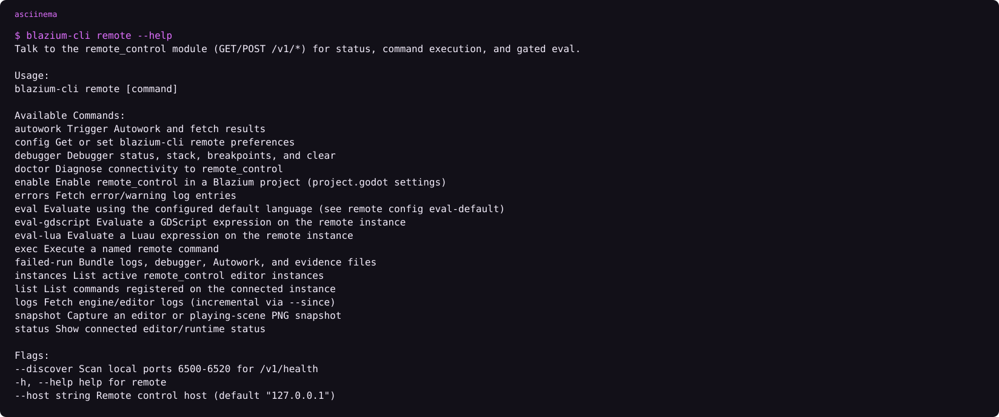
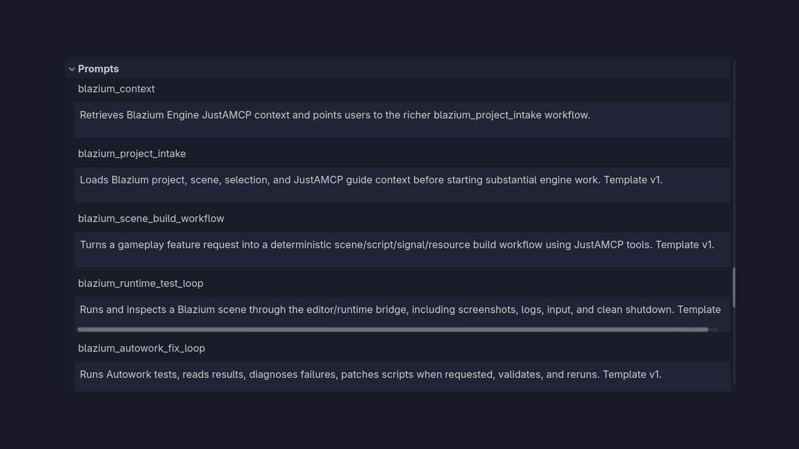

# Remote control and MCP

### Two loopback servers, and a test runner that does not need a third

*By Bioblaze Payne, Co-Founder of [Blazium Games](https://blazium.games)*

---

Driving the editor by clicking it does not survive CI, and it does not survive an agent that has to read the scene tree. We added an HTTP server so the CLI can check health, logs, play state, snapshots, and Autowork without a UI script. JustAMCP is the MCP server agents use to create and modify a project. They are different ports on purpose.

Godot does not ship either one. Both default to off in Project Settings and come up when you ask.


## remote_control

`modules/remote_control` is always in the editor. Export templates get it only when `hub_build=yes`. The default bind is `127.0.0.1:6508`. `blazium/remote_control/server_enabled` defaults to false. `blazium-cli open` and `load` pass `--enable-remote-control` because `remote.enable_on_open` defaults to true.

`allow_eval` defaults to false. Eval runs GDScript or Luau in the editor process. `allow_runtime` defaults to false. A token, when set, is `Authorization: Bearer` or `X-Remote-Control-Token`.

| Route | Job |
|---|---|
| `GET /v1/health` | Liveness |
| `GET /v1/status` | Project, pid, instance id |
| `POST /v1/instance` | Assign the short instance id |
| `GET /v1/commands` | What `exec` accepts |
| `POST /v1/exec` | Built-in commands |
| `POST /v1/eval` | Expression, if `allow_eval` |
| `GET /v1/logs` | Engine log |

Built-in exec names include `play_main_scene`, `play_current_scene`, `stop_playing`, `pause_playing`, `resume_playing`, `play_status`, `snapshot_editor`, `snapshot_scene`, `get_logs`, `debugger_info`, `autowork_run`, `mcp_status`, and `focus_window`. Snapshots return a PNG as `png_base64`. Play, pause, stop, and the snapshot are deferred onto the main thread so they do not block the server thread.

```text
blazium-cli open ./MyProject
blazium-cli remote status --format json
blazium-cli remote doctor
blazium-cli remote exec ping
blazium-cli remote autowork run --wait
```

`open` waits until `/v1/health` responds, then `POST /v1/instance` stores a 6-character id. One editor is selected for you. Two editors: the newest is the default, and the CLI warns unless `--quiet`. Select with `--instance` or `--project`.

`remote eval-gdscript` returns nothing useful until `allow_eval` is true.



```text
asciinema play assets/cli-remote-help.cast
```

`blazium-cli remote config set enable-mcp-on-load true` turns JustAMCP on when the CLI loads a project. `blazium-cli remote config set enable-on-open false` keeps later opens from starting remote control.

SCons `hub_register=yes` registers a freshly built editor with Hub after the build, through `blazium-cli`. That is a build step, not a runtime call.

## JustAMCP

`modules/justamcp` is the native MCP server. Streamable HTTP is `POST /mcp`, `GET /mcp`, and `DELETE /mcp`, plus the legacy `/sse` and `/message` routes and the OAuth discovery paths under `/.well-known/`. `JustAMCPRuntime` stays up across scene changes.

Editor settings: `blazium/justamcp/server_enabled` (default false), `server_port` (default **6506**), `project_mcp_dir` (default `res://mcp`). OAuth (`oauth_enabled`) defaults to false. Game export: `export_port` defaults to **0**, which means editor port plus one, **6507**. CLI flags are `--enable-mcp`, `--mcp-port`, `--mcp-client-id`, and `--mcp-client-secret`.

Tool names are prefixed `blazium_` for the editor surface: project info, scene tree, scripts, resources, docs, Autowork, export. Asset tags are `blazium_tags_*`. Semantic search is `semantic_search` and the related index tools. The prompt `blazium_asset_tagging_workflow` is the tagging walk. Those tag tools are how an agent edits the project's tag dictionary without a sidecar database.




## Two owners of blazium://

The OS handler is the CLI. `blazium://open?path=` starts an editor. Hub's remote port for `blazium://hub` is **39218**.

JustAMCP uses the same scheme for resources inside the editor: `blazium://docs/...`, `blazium://tags/...`, `blazium://semantic/...`, `blazium://scene/...`. Older `godot://` resource URIs are rewritten to `blazium://`. That rewrite does not register an OS protocol.

Do not point `blazium-cli remote` at 6507. That port is the game MCP default, not remote control.

## Links

- remote_control: https://github.com/blazium-games/blazium/tree/blazium-dev/modules/remote_control
- JustAMCP: https://github.com/blazium-games/blazium/tree/blazium-dev/modules/justamcp
- CLI: https://github.com/blazium-games/blazium-cli
- Blazium Games: https://blazium.games

---

**[Jump into our Discord](https://blazium.app/chat)** for real-time chats, dev support and feedback

Or follow us everywhere else:

- **[GitHub](https://github.com/blazium-games)**
- **[IndieDB](https://www.indiedb.com/engines/blazium-engine)**
- **[X / Twitter](https://x.com/BlaziumGames)**
- **[YouTube](https://www.youtube.com/@blazium)**
- **[itch.io](https://blaziumengine.itch.io)**
