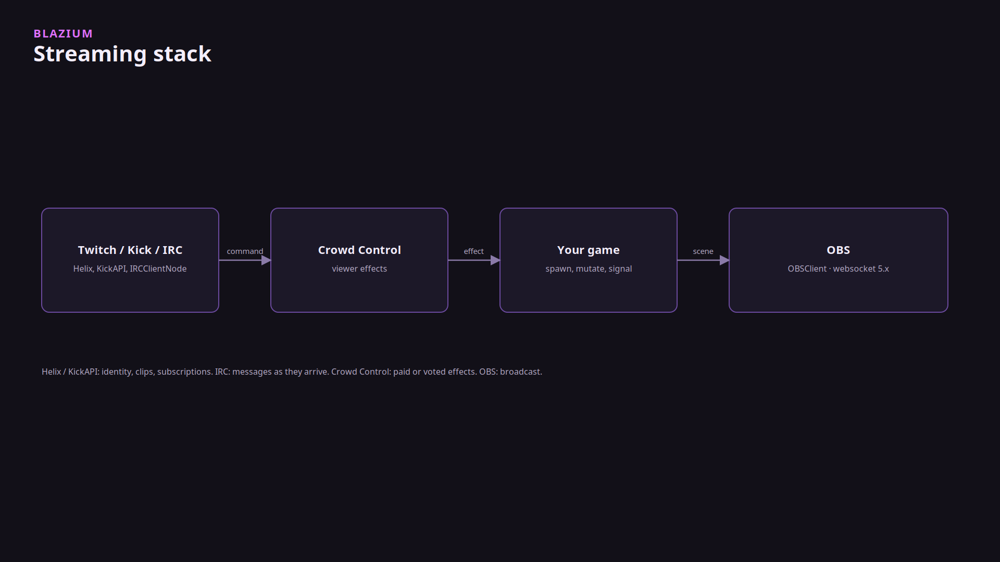
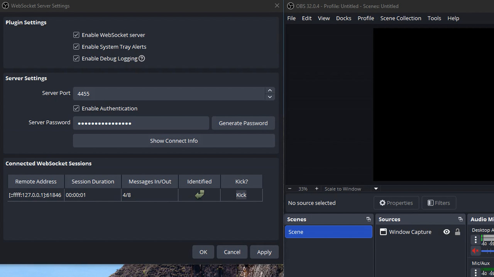

# Streaming tools in Blazium

### Chat, effects, and the broadcast are three sockets

*By Bioblaze Payne, Co-Founder of [Blazium Games](https://blazium.games)*

---

Godot does not ship a Twitch client, a Kick client, or an OBS websocket. We added them because a live game is a pile of HTTP and sockets that every project was binding by hand. They do not share a base class. You wire them.

We used `TwitchAPI`, `KickAPI`, IRC, Crowd Control, and `OBSClient` in-house to validate those clients. That pass does not name a channel or a shipped overlay. Hangman's public releases are Steam, Discord, Google Play, and the Apple App Store, not a claim that the Steam build is an OBS scene.

## What is in the tree

`twitchapi`, `kickapi`, `ircclient`, `crowdcontrol`, and `obsclient` are modules on `blazium-dev`. Each has its own test repository. There is no scene that connects all five, and no Blazium service that holds your tokens. Put tokens in a `.env` file and read them with `ENV` from `modules/dotenv`. That file is plain text. It is not a security boundary.

`CrowdControl` and `OBSClient` are `Object`, not `Node`. Both need `poll()` from `_process`. Crowd Control has no `trigger()` method. The viewer starts the effect on Crowd Control's side. The game answers.

| Need | Class | Module |
|---|---|---|
| Twitch Helix | `TwitchAPI` | `twitchapi` |
| Twitch chat | `TwitchIRCClient` / `TwitchIRCClientNode` | `ircclient` |
| Kick HTTP | `KickAPI` | `kickapi` |
| IRC | `IRCClient` / `IRCClientNode` | `ircclient` |
| Viewer effects | `CrowdControl` | `crowdcontrol` |
| Scenes, record, stream | `OBSClient` | `obsclient` |

`TwitchIRCClient` does not inherit `IRCClient`. It is a parallel `RefCounted` with `connect_to_twitch(username, oauth_token)`. `TwitchAPI.configure(client_id, access_token)` is Helix and polls responses every physics frame. `KickAPI.configure(access_token)` is the Kick HTTP API.

## IRC

`IRCClient` speaks RFC 1459, RFC 2812, and IRCv3. `connect_to_server(host, port, use_ssl, nick, ...)` opens the socket. `IRCClientNode` is the node wrapper.

## Crowd Control

The commits that added it are the websocket client and a follow-up that made effect responses work. The class reference says streamers can let viewers trigger in-game effects, instant or timed. You answer with `respond_to_effect_instant` or `respond_to_effect_timed`. You do not start the effect from the game.

## OBS

`connect_to_obs(url, password, event_subscriptions)` returns an `Error` when the attempt starts. Call `poll()` until the handshake finishes. `set_current_program_scene` switches the program scene. The class also covers inputs, filters, record, and stream. `get_connection_state` is how you know the socket came up. The protocol is obs-websocket 5.x.

A loop that is actually useful looks like this: Helix or IRC delivers a message, the game mutates something, then `OBSClient` changes a scene if you asked it to. Nothing in the engine does the middle step for you.

## Links

- Engine: https://github.com/blazium-games/blazium
- OBS tests: https://github.com/blazium-games/obsclient_module_tests
- IRC tests: https://github.com/blazium-games/irc_module_tests
- Twitch tests: https://github.com/blazium-games/twitchapi_module_tests
- Kick tests: https://github.com/blazium-games/kickapi_module_tests
- Blazium Games: https://blazium.games

---

**[Jump into our Discord](https://blazium.app/chat)** for real-time chats, dev support and feedback

Or follow us everywhere else:

- **[GitHub](https://github.com/blazium-games)**
- **[IndieDB](https://www.indiedb.com/engines/blazium-engine)**
- **[X / Twitter](https://x.com/BlaziumGames)**
- **[YouTube](https://www.youtube.com/@blazium)**
- **[itch.io](https://blaziumengine.itch.io)**
