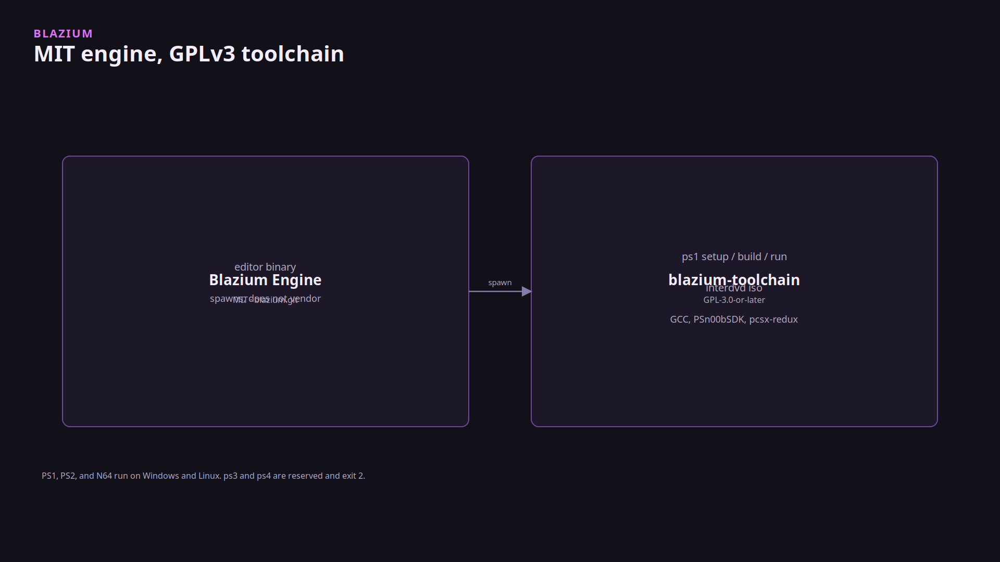
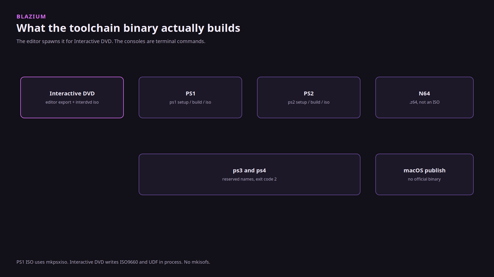

# Why the console compilers are not in the engine

### MIT for the editor, GPL for the binary that fetches GCC

*By Bioblaze Payne, Co-Founder of [Blazium Games](https://blazium.games)*

---

The Blazium engine is MIT. No royalty, no seat fee. That only stays true if we do not merge in trees that are not MIT. GCC, PSn00bSDK, pcsx-redux, mkpsxiso, the ps2dev SDK, and libdragon are the compilers and kits a PS1, PS2, or N64 build needs. They live in [blazium-toolchain](https://github.com/blazium-games/blazium-toolchain), which is GPL-3.0-or-later, so it is allowed to fetch them. The editor looks up `blazium-toolchain` on `PATH` (or `export/inter_dvd/toolchain`, or `BLAZIUM_TOOLCHAIN`) and runs it. The process that stays MIT never links those libraries.

The engine README lists PS1, PS2, N64, and Interactive DVD as something Blazium adds, used with the toolchain. The code is narrower than that sentence. Interactive DVD has an export platform. The editor runs `blazium-toolchain interdvd iso` and `blazium-toolchain interdvd ffmpeg`. There is no PS1, PS2, or N64 `EditorExportPlatform`. Those are terminal commands after `setup`. Godot does not ship this toolchain either.

## What "no mkisofs" means

Interactive DVD mastering writes ISO9660 and UDF 1.02 inside the Go process. It does not shell out to `mkisofs` or `oscdimg`. You do not install those tools. The folder you pass already has `VIDEO_TS/`. Language and region fields in `disc.interdvd.json` are metadata for that JSON file. They are not written into the IFO.

PS1 is a different command. `ps1 iso` uses mkpsxiso, which `ps1 setup` downloads into the toolchain cache. Saying the toolchain never calls an external ISO tool would be wrong. The Interactive DVD path is the one that does not.

## What does not ship

`ps3` and `ps4` are reserved names. Commands exit `2`. There is no date. Published binaries are Linux and Windows. A macOS build of the CLI can master an Interactive DVD. PS1, PS2, and N64 setup and build exit `2` on that host. CI does not publish a macOS binary.

Compilers are downloaded on `setup` into `%LOCALAPPDATA%\Blazium\blazium-toolchain` or `~/.local/share/blazium-toolchain`. They are not inside the Go binary. The MIT guest stub is. Third-party licenses are in `THIRDPARTY.md` in the toolchain repo. Those SDKs link into the exported guest, not into the editor.

We used the CLI in-house to validate the four targets. That is not a shipped console title. Catalog: `https://cdn.blazium.app/toolchain/toolchain.json`.

## Links

- Toolchain: https://github.com/blazium-games/blazium-toolchain
- Catalog: https://cdn.blazium.app/toolchain/toolchain.json
- Engine: https://github.com/blazium-games/blazium
- Blazium Games: https://blazium.games

---

**[Jump into our Discord](https://blazium.app/chat)** for real-time chats, dev support and feedback

Or follow us everywhere else:

- **[GitHub](https://github.com/blazium-games)**
- **[IndieDB](https://www.indiedb.com/engines/blazium-engine)**
- **[X / Twitter](https://x.com/BlaziumGames)**
- **[YouTube](https://www.youtube.com/@blazium)**
- **[itch.io](https://blaziumengine.itch.io)**
