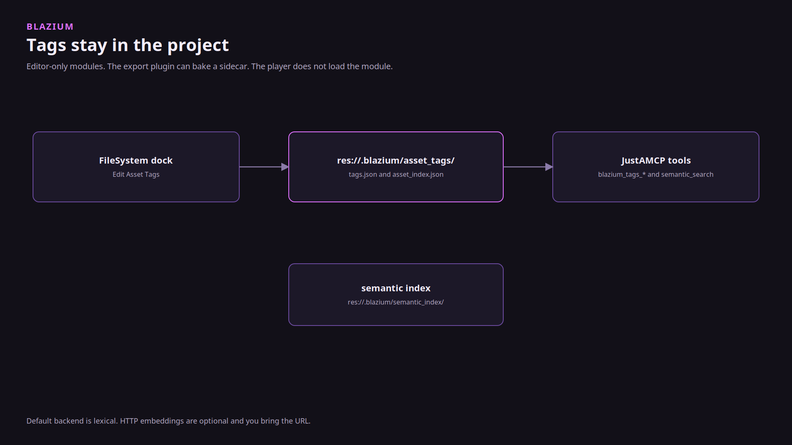

# Asset tags and search

### The dictionary lives in the project, not in a sidecar database

*By Bioblaze Payne, Co-Founder of [Blazium Games](https://blazium.games)*

---

An agent that cannot find the tree texture will invent a path. We added asset tags so the dictionary is JSON in the project, the filesystem dock can edit it, and JustAMCP can search it. `semanticsearch` sits on top of that index. Both modules are editor-only. A shipped game does not load them.

Godot has no equivalent in core. We validated the pair in-house to confirm the dock, the JSON, and the MCP tools stayed in sync. Demon Lord: Clicker separately put the newer tools and 2D side under load; it does not run these editor-only search modules in the shipped player.




## Use it

1. Project Settings, tab **Asset Tags**. Add a name. The placeholder in the editor is `Environment.Nature.Tree`. Comment, rename, and remove are on that tab. **Cleanup Unused** drops dictionary names nothing references.
2. FileSystem dock, select the file, context menu **Edit Asset Tags...**. Apply writes the assignment. Multi-select applies only the tags you add or remove, to every selected file.
3. Commit `res://.blazium/asset_tags/tags.json` and `asset_index.json` if the tags belong to the project. They are not an editor cache.
4. For an agent, enable JustAMCP and call the tools below. Search goes through the semantic tools, not a raw file read.

`config.py` limits both modules to editor builds. `semanticsearch` does not build unless `assettags` does. `EditorExportAssetTags` can bake tag data into the export under `.blazium/asset_tags/`. That bake is a file the export plugin writes. It is not the editor module running in the player. Treat the Project Settings **Asset Tags** tab as the source of truth for dictionary edits, and the FileSystem context menu as the source of truth for per-file assignments — both write the same JSON the agent will later search.

## Tag naming and query behavior

Tags are hierarchical with `.` separators. Querying `Environment` matches `Environment.Nature.Tree`. Querying the child does not match the parent alone. `AssetTagManager.matches_tag` and `container_has_tag` encode that rule. Renaming a parent remaps children (`Environment` → `Env` turns `Environment.Nature.Tree` into `Env.Nature.Tree`).

| Setting | Default | Effect |
|---|---|---|
| `blazium/assettags/strict_paths` | `false` | Reject tagging paths that do not exist on disk |
| `blazium/assettags/strict_tags` | `false` | Reject unknown dictionary names |
| `blazium/assettags/taggable_extensions` | `glb,gltf,obj,fbx,blend,png,jpg,...` | Comma-separated allow-list |

`find_assets_by_tag(tag, match_parent=true)` returns paths. `search_assets(tags, type_filter, path_glob, path_regex, require_all)` combines filters; `require_all` defaults to true for AND semantics. `get_unused_tags()` is what **Cleanup Unused** uses.

## Classes you touch from the dock

`AssetTagManager` is the dictionary (add, rename, comment, batch, save). `AssetTagRegistry` is the path-to-tags index (`add_tags_to_asset`, `find_assets_by_tag`, `search_assets`, `prune_removed_paths`). `AssetTagCoordinator` wraps a change so the filesystem dock can undo it. They are created in the editor init callback, not as `Engine` singletons you grab from gameplay code. `AssetTagRuntime` is registered so the export plugin can call `bake_tags_for_export` and `read_tags_for_export_bake`.

You do not need those class names for day-to-day work. The Project Settings tab and **Edit Asset Tags...** are the workflow. Agents use the MCP names below.

## Search backends

Backends that exist today are `lexical` (the default), `embedding`, and `hybrid`. Embedding providers are `hash_vector` (the default), `ngram`, and `http`. HTTP uses `blazium/semanticsearch/embedding_http_url` and falls back to `hash_vector` when the URL is empty, the request fails, the provider is still locked during startup, or the call is off the main thread. There is no hosted embedding service in the Blazium repos. If you set `http`, you bring the URL.

| Setting | Default |
|---|---|
| `blazium/semanticsearch/backend` | `lexical` |
| `blazium/semanticsearch/embedding_provider` | `hash_vector` |
| `blazium/semanticsearch/embedding_http_url` | empty |
| `blazium/semanticsearch/embedding_http_timeout_ms` | `30000` |
| `blazium/semanticsearch/async_job_ttl_ms` | `1800000` |
| `blazium/semanticsearch/max_concurrent_async_jobs` | `8` |

HTTP embedding is deferred off the startup path so the editor stays responsive. Async search rejects the HTTP provider off the main thread. Changing `backend` or `embedding_provider` needs an editor restart (`set_restart_if_changed`).

The index file is `res://.blazium/semantic_index/index.json`. `blazium_semantic_index_stats` reports `configured_backend`, `effective_backend`, embedding readiness, and stale embedding counts.

## MCP tools for tagging and search

JustAMCP exposes the public names with a `blazium_` prefix on the tag set: `blazium_tags_list`, `blazium_tags_get_info`, `blazium_tags_add`, `blazium_tags_remove`, `blazium_tags_rename`, `blazium_tags_update_comment`, `blazium_tags_set_on_asset`, `blazium_tags_get_on_asset`, `blazium_tags_add_to_asset`, `blazium_tags_remove_from_asset`, `blazium_tags_batch_set_on_assets`, `blazium_tags_find_assets`, `blazium_tags_search_assets`, `blazium_tags_get_unused`, `blazium_tags_rescan`, `blazium_tags_can_undo`, and `blazium_tags_undo_last_change`. Mutating tools require explicit confirmation (`confirmed=true` after elicitation), including both dictionary changes and asset assignments.

Semantic tools are advertised with the same prefix: `blazium_semantic_search`, `blazium_semantic_find_similar`, `blazium_semantic_index_stats`, `blazium_semantic_rebuild_index`, plus `blazium_semantic_search_enqueue` / `blazium_semantic_search_poll` / `blazium_semantic_search_cancel` for async jobs. The prompt `blazium_asset_tagging_workflow` is the tagging walk. Those tools are how your agents organize and search assets without leaving the editor.

The server listens on port 6506 when `blazium/justamcp/server_enabled` is on, or when the CLI passes `--enable-mcp`.

## Export bake

`EditorExportAssetTags` runs at export begin/end. `AssetTagRuntime.bake_tags_for_export(export_output_dir)` writes per-asset sidecars under the export tree's `.blazium/asset_tags/`. `read_tags_for_export_bake` reads them back. That data can travel with a pack. The editor search modules still do not load in a player build.

## Query examples agents should prefer

Tag search (AND by default):

- `blazium_tags_find_assets` with `tag_name=Environment.Nature` and `match_parent=true` returns every asset under that branch.
- `blazium_tags_search_assets` with `tags=["Environment","Props"]`, `require_all=false`, and an optional `path_glob` or `path_regex` narrows by location.
- `blazium_tags_get_on_asset` with a `res://` path verifies an assignment after a dock edit.

Semantic search:

- `blazium_semantic_search` with a caption-like query uses the active backend (`lexical` / `embedding` / `hybrid`).
- `blazium_semantic_find_similar` takes a `res://` path and returns near neighbors.
- `blazium_semantic_rebuild_index` after a large tag rename; `blazium_semantic_index_stats` before you blame the agent.

Mutating tools (`blazium_tags_add`, `blazium_tags_set_on_asset`, `blazium_tags_update_comment`, …) require explicit user confirmation. Retry with `confirmed=true` after the elicitation form. That is intentional: agents should not rewrite the project's dictionary or asset assignments unattended.

## Workflow checklist

```text
1. Open Project Settings → Asset Tags
2. Add Environment.Nature.Tree (or your hierarchy)
3. FileSystem → Edit Asset Tags... on selected files
4. Commit res://.blazium/asset_tags/tags.json and asset_index.json
5. Optional: set blazium/semanticsearch/backend if lexical is not enough
6. Enable JustAMCP; call blazium_tags_search_assets or blazium_semantic_search
```

## When search returns nothing

If an agent invents a path, check these before opening a bug: the index files were never committed; the tag exists in the dictionary but was never assigned; `strict_tags` rejected an unknown name; the semantic backend is `embedding` with a stale index (run `blazium_semantic_rebuild_index`); or the agent read a resource URI instead of calling the search tools. Hierarchical match is prefix-based from parent toward child — querying the leaf will not return assets tagged only with the parent.

After a mass rename in the FileSystem dock, call `blazium_tags_rescan` or wait for the deferred prune if paths disappeared. Similarity search needs an indexed path that still exists; a deleted `res://` target returns empty neighbors even when the dictionary is healthy. Prefer `lexical` until you have confirmed embeddings are populated via `blazium_semantic_index_stats`. Commit tag JSON with the feature that introduced the assets; regenerating tags on every clone is how agents invent paths again. Keep JustAMCP enabled only while you want agents writing the dictionary — the dock workflow does not require the MCP server.

## Links

- assettags: https://github.com/blazium-games/blazium/tree/blazium-dev/modules/assettags
- semanticsearch: https://github.com/blazium-games/blazium/tree/blazium-dev/modules/semanticsearch
- JustAMCP: https://github.com/blazium-games/blazium/tree/blazium-dev/modules/justamcp
- Blazium Games: https://blazium.games

---

**[Jump into our Discord](https://blazium.app/chat)** for real-time chats, dev support and feedback

Or follow us everywhere else:

- **[GitHub](https://github.com/blazium-games)**
- **[IndieDB](https://www.indiedb.com/engines/blazium-engine)**
- **[X / Twitter](https://x.com/BlaziumGames)**
- **[YouTube](https://www.youtube.com/@blazium)**
- **[itch.io](https://blaziumengine.itch.io)**
