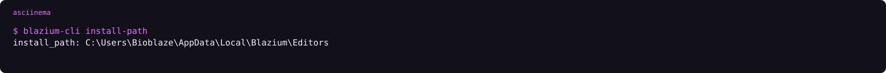
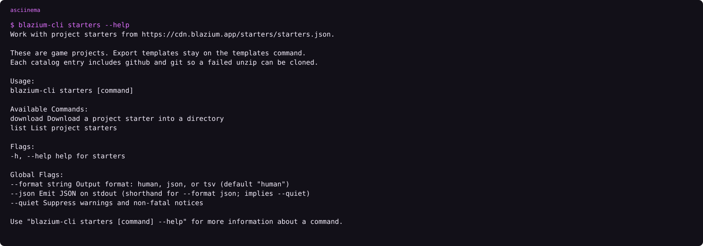
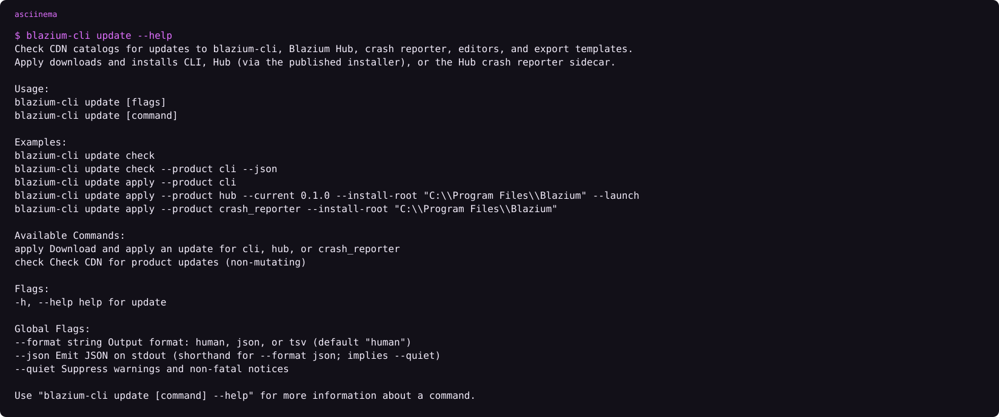
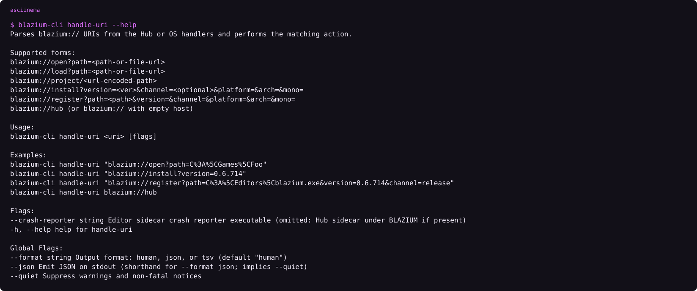
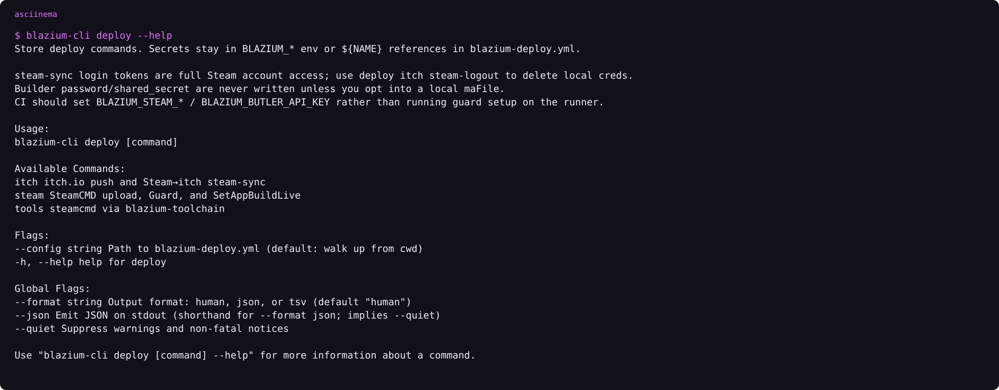
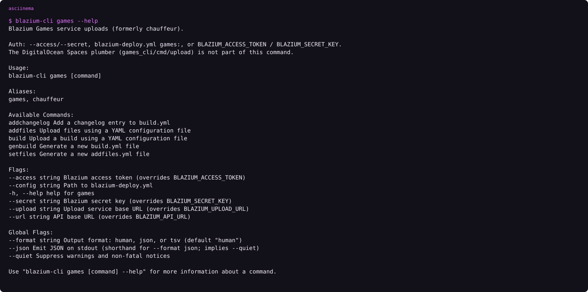

# Blazium CLI

### The binary Hub shells, CI calls, and the OS points blazium:// at

*By Bioblaze Payne, Co-Founder of [Blazium Games](https://blazium.games)*

---

Hub is a window. This is the program that actually moves files. [blazium-cli](https://github.com/blazium-games/blazium-cli) installs editors from `cdn.blazium.app`, keeps the project registry Hub reads, fetches export templates, updates itself, talks to a running editor on localhost, and can push a finished build to Steam or itch.io. We built it so a script and a desktop launcher would not grow two install paths.

Installing Hub is the path that also installs the CLI. The other paths are for machines that should not run Hub: npm, a GitHub release asset, or the CDN manifest.


## Get it

Published binaries are Linux and Windows, x86_64 and x86_32. CI does not publish a macOS CLI. A CLI you compile on macOS can still install a macOS editor. Go 1.25 or later. `go build` without the CI stamp prints `0.0.0-dev` until `data/cliBuild.txt` exists.

1. **Hub bundle.** Inno on Windows and the `.deb` on Linux put `blazium-cli` next to Hub and on `PATH`.
2. **npm.** `npm install -g @blazium-engine/cli` or `npx @blazium-engine/cli`. Optional packages are `@blazium-engine/cli-linux-x64`, `cli-linux-ia32`, `cli-win32-x64`, and `cli-win32-ia32`. If that package is present, nothing is downloaded from the CDN.
3. **GitHub Releases.** `blazium-cli-windows-x86_64.exe`, `blazium-cli-windows-x86_32.exe`, `blazium-cli-linux-x86_64`, `blazium-cli-linux-x86_32`. Non-Windows assets may ship a matching `.sig`.
4. **CDN manifest.** `https://cdn.blazium.app/cli/cli.json`. Files live at `https://cdn.blazium.app/cli/{os}/{arch}/{version}/`.

There is no official Flatpak. [blazium#428](https://github.com/blazium-games/blazium/issues/428) asks for one.


```text
asciinema play assets/cli-help.cast
```

`--json` and `--quiet` are global flags, and `--json` implies quiet output. CI should use `--json` when a later step parses stdout.

## Install an editor

```text
blazium-cli install 0.6.838
blazium-cli install nightly --templates
blazium-cli install 0.6.924 --channel nightly
blazium-cli uninstall 0.6.838
blazium-cli uninstall 0.6.924 --channel nightly
```

`EditorInstallDir` puts editors in `{install-path}/{channel}/{version}`. Channels are `release`, `prerelease`, and `nightly`. An empty channel is `release`. As of 11 October 2026, [release latest](https://cdn.blazium.app/catalog/versions/release/latest.json) is 0.6.838 and nightly latest is 0.6.924.

`--templates` pulls the `.tpz` for that version from the CDN. Template metadata is resolved as `template_files.json`, then `templates.json`, then `details.json`, all under `https://cdn.blazium.app/{channel}/{version}/`. The CLI only asks Cerebro when `BLAZIUM_CEREBRO_URL` is set. An empty value means no Cerebro call; there is no silent default to `https://blazium.app`.

Template channel handling is narrower than editor installs. The template resolver treats a build as nightly or release. A prerelease version is fetched from the `release` CDN folder unless you are on the nightly flag. Editor installs do keep a real `prerelease` directory.

On Windows the template root is `%LOCALAPPDATA%\Blazium\export_templates`. On Unix, including macOS, it is `~/.local/share/blazium/export_templates`. Override with `BLAZIUM_EXPORT_TEMPLATES_DIR`. The folder name is the Blazium version and channel, such as `0.6.838.release`, not Godot's `4.3.2.stable`.

The editor's own template manager does not use this CLI path. It asks `https://blazium.app/api/mirrorlist/`, and that live list currently points at the GitHub release copy of the pack. The CDN copy is what the CLI downloads.



`blazium-cli install-path` prints the root. `blazium-cli install-path D:\Blazium\Editors` changes it. `--move` relocates editors already on disk.

## Templates without a full install

```text
blazium-cli templates list 0.6.838
blazium-cli templates list nightly --platform web
blazium-cli templates download 0.6.838 --tpz
blazium-cli templates download nightly --runtime --variant release
blazium-cli templates download 0.6.838 --platform android
blazium-cli templates download nightly --file web_nothreads_release.zip
blazium-cli templates path
```

Exactly one download mode is required: `--tpz`, `--file`, `--platform`, `--runtime`, or `--all`. `--runtime` is web plus linux plus windows for the chosen variant. `--variant` is `debug` or `release`; the default is `BLAZIUM_TEMPLATE_VARIANT` or `release`. `--mono` selects the .NET pack. `--only-missing` skips files already on disk. `--dest` overrides the OS template root.


```text
asciinema play assets/cli-templates-help.cast
```

## List, default, projects

```text
blazium-cli editors
blazium-cli editors add C:\path\to\blazium.exe --version 0.6.838
blazium-cli editors default
blazium-cli editors default --channel release --version latest
blazium-cli editors default 0.6.838
blazium-cli editors path 0.6.838
blazium-cli projects add ./MyProject
blazium-cli projects remove MyProject
blazium-cli open ./MyProject
blazium-cli load ./MyProject
blazium-cli run ./MyProject
blazium-cli project-manager
```

Unset policy is the latest installed editor on the `release` channel. A hard pin (`editors default 0.6.838`) wins when that build is installed. `editors add` registers a binary you unpacked by hand so Hub and `open` can find it.

`open` and `load` start the editor with `--editor --path`. They do not run the game. `load` also prints a project profile: JustAMCP, remote control, editor version, features. Both attach remote control by default (`remote.enable_on_open` is true). After `GET /v1/health` responds, the CLI assigns a 6-character instance id with `POST /v1/instance`. Turn that attach off with `blazium-cli remote config set enable-on-open false`.

`run` (alias `play`) starts the game with `--path` and without `--editor`. If `application/run/main_scene` is empty, the CLI returns an error and does not start the binary. Remote control stays off for `run`. `project-manager` starts the default editor with `--project-manager` and no project path.

The registry file is the same one Hub uses: `%APPDATA%\blazium\hub.json` or `~/.config/blazium/hub.json`.


## Starters

Project starters are not export templates. The catalog is `https://cdn.blazium.app/starters/starters.json`. Each entry includes a zip URL, sha256, size, pinned commit, and GitHub clone URL (`github` / `git`) so a failed unzip can be cloned instead.



```text
asciinema play assets/cli-starters-help.cast
```

```text
blazium-cli starters list
blazium-cli starters download template_2d_empty -dir D:\games\my_game
```

`download` creates the destination when it is missing and refuses a directory that already has files. The zip is capped at 64 MiB and checked against the catalog sha256 before unpack. Hub's Projects tab calls the same commands. Export templates stay on `templates`.

As of 11 October 2026 the catalog `latest` field is `0.1.0` and includes starters such as `template_2d_empty`, `template_3d_empty`, and `template_android`. List with `--json` when a script needs the names.

## Projects create and registry

```text
blazium-cli projects add ./MyProject
blazium-cli projects create ./FreshGame --name "Fresh Game"
blazium-cli projects remove FreshGame
blazium-cli projects --json
```

`projects add` registers a directory that already has `project.blazium` or `project.godot` (Blazium preferred). `projects create` writes a minimal `project.blazium` with `config/name` set to `--name` or the folder name, then registers it. It fails if either settings file already exists. `remove` only unregisters; it does not delete the tree. The registry is local-only in `hub.json` — there is no cloud sync.

## Upgrade and update

```text
blazium-cli upgrade --dry-run
blazium-cli upgrade
blazium-cli upgrade --target 1.2.3
blazium-cli update check
blazium-cli update apply --product cli
blazium-cli update apply --product hub --install-root "C:\Program Files\Blazium"
blazium-cli update apply --product crash_reporter
blazium-cli update apply --product toolchain
blazium-cli update apply --product launcher --install-root "C:\Program Files\Blazium\Games"
```

`upgrade` only replaces this binary from `cli.json`, with sha256 verification. `update apply` knows `cli`, `hub`, `crash_reporter`, `toolchain`, and `launcher`. `--product launcher` installs the Games launcher and, on Windows, starts setup with `/NOCLI` so an existing `blazium://` handler is left alone. Under Program Files, apply may raise a UAC prompt. `update check` is non-mutating and can filter with `--product`.



## Remote

The editor module listens on `127.0.0.1:6508` by default. Routes include `GET /v1/health`, `GET /v1/status`, `POST /v1/exec`, and `POST /v1/eval`. Eval stays off until `blazium/remote_control/allow_eval` is true. JustAMCP, the editor MCP server, is port 6506. Its export port setting defaults to `0`, which resolves to the editor port plus one—6507 with the defaults. Do not point this CLI at 6507.

| Command | Job |
|---|---|
| `remote status` | Health, instance id, project |
| `remote instances` | Live editor instances |
| `remote list` | Commands registered on the selected instance |
| `remote exec` | Execute a registered command |
| `remote eval` / `eval-gdscript` / `eval-lua` | Expressions, if `allow_eval` is on |
| `remote logs` / `errors` | Engine log |
| `remote debugger info` / `clear` | Debugger state |
| `remote failed-run` | Bundle logs, debugger, Autowork, and evidence files from the last failure |
| `remote autowork run --wait` | Run Autowork |
| `remote snapshot editor` | PNG of the editor |
| `remote doctor` | Diagnose connectivity and configuration |
| `remote enable --path ./MyProject` | Write remote settings into a project |


One live instance is used automatically. Two or more: the newest is the default, and the CLI prints a warning unless you pass `--quiet`. Select with `--instance <id>` or `--project <path>`.

Env overrides: `BLAZIUM_REMOTE_HOST`, `BLAZIUM_REMOTE_PORT`, `BLAZIUM_REMOTE_TOKEN`, `BLAZIUM_REMOTE_EVAL_DEFAULT`. CLI prefs live in `%APPDATA%\blazium\cli.json` or `~/.config/blazium/cli.json`.

## URI handler and deploy

OS installers point `blazium://` at `handle-uri`. `blazium://hub` focuses Hub on port 39218. `blazium://open`, `load`, `install`, and `register` stay in this binary. `blazium://game/<uuid>`, `blazium://buy/<uuid>`, `blazium://install/<uuid>`, and the other Games hosts are forwarded to the Games launcher on port 39220. `blazium-cli hub-remote ensure` creates a missing `hub_remote.json` and does not rotate a token that is already valid.



Steam and itch.io deploys live here. Optional `blazium-deploy.yml` sits next to the game. Secrets come from flags, then the YAML after `${NAME}` expansion, then `BLAZIUM_*` environment variables. `--config` overrides the walk-up search for that YAML.



```text
asciinema play assets/cli-deploy-help.cast
```

```text
blazium-cli deploy tools status
blazium-cli deploy tools ensure
blazium-cli deploy steam guard totp
blazium-cli deploy steam dry-run
blazium-cli deploy steam upload --dry-run
blazium-cli deploy steam set-live --build-id ID --beta-key beta
blazium-cli deploy itch login
blazium-cli deploy itch push ./build --target user/game:windows
blazium-cli deploy itch steam-sync --dry-run
```

| Subcommand | Job |
|---|---|
| `deploy tools` | steamcmd via blazium-toolchain (`status` / `ensure`) |
| `deploy steam guard` | In-process TOTP, setup, maFile |
| `deploy steam login` | Test steamcmd login with builder credentials |
| `deploy steam dry-run` | Print a VDF plan without steamcmd login |
| `deploy steam upload` | Generate VDFs and run steamcmd `+run_app_build` |
| `deploy steam set-live` | `ISteamApps/SetAppBuildLive/v2/` |
| `deploy itch` | butler push and Steam→itch steam-sync |

`deploy steam guard setup` is interactive. Do not run it on a CI runner. Write down the Steam revocation code before Finalize. CI should set `BLAZIUM_STEAM_*` / `BLAZIUM_BUTLER_API_KEY` rather than running guard setup on the runner. itch.io push uses butler as a Go module. It does not download broth. Steam Guard is in-process; there is no steamguard-cli step. steam-sync login tokens are full Steam account access — use `deploy itch steam-logout` to delete local creds when you are done.

## Games store uploads

`blazium-cli games` (alias `chauffeur`) uploads to the Blazium Games store API. That is not Steam and it is not itch. Auth is `--access` / `--secret`, the `games:` block in `blazium-deploy.yml`, or `BLAZIUM_ACCESS_TOKEN` / `BLAZIUM_SECRET_KEY`. Optional `--url` and `--upload` override the API and upload bases.



```text
asciinema play assets/cli-games-help.cast
```

```text
blazium-cli games genbuild
blazium-cli games build --asset ./build.yml
blazium-cli games addfiles --asset ./addfiles.yml
blazium-cli games addchangelog
blazium-cli games setfiles
```

| Command | Job |
|---|---|
| `games genbuild` | Generate a new `build.yml` |
| `games build` | Upload a build from YAML (`--os` / `--arch` / `--channel` overrides) |
| `games setfiles` | Generate a new `addfiles.yml` |
| `games addfiles` | Upload files from that YAML |
| `games addchangelog` | Add a changelog entry to `build.yml` |

The DigitalOcean Spaces plumber from the older `games_cli/cmd/upload` path is not part of this command. The standalone uploader still lives in [games_cli](https://github.com/blazium-games/games_cli) if you need that separate tool.

## CI

A runner starts with [setup-blazium-cli](https://github.com/blazium-games/setup-blazium-cli) at tag `v0.2.1`, or with [setup-blazium-engine](https://github.com/blazium-games/setup-blazium-engine) at tag `v0.3.0`, which installs this binary and then an editor. `version: latest` on setup-engine tracks the nightly channel. `latest-release` is the release channel. Empty `version` on setup-cli uses `.latest` from `cli.json` and checks SHA-256 when the manifest has one.


## Limits that are real

- No published macOS CLI binary. Build from source if you need the tool on macOS; editor installs for macOS still work from that binary.
- Template channel is release-or-nightly, not a third CDN prefix for prerelease.
- Cerebro is opt-in through `BLAZIUM_CEREBRO_URL`. Public machines should leave it unset.
- `deploy steam guard setup` and interactive Steam Guard flows belong on a trusted workstation, not a shared runner.
- `games` / chauffeur is a different product surface from `deploy steam` and `deploy itch`.

## Links

- CLI repository: https://github.com/blazium-games/blazium-cli
- CDN manifest: https://cdn.blazium.app/cli/cli.json
- Starters catalog: https://cdn.blazium.app/starters/starters.json
- Dev tools: https://blazium.app/dev-tools
- Hub: https://github.com/blazium-games/blazium-hub
- Blazium Games: https://blazium.games

---

**[Jump into our Discord](https://blazium.app/chat)** for real-time chats, dev support and feedback

Or follow us everywhere else:

- **[GitHub](https://github.com/blazium-games)**
- **[IndieDB](https://www.indiedb.com/engines/blazium-engine)**
- **[X / Twitter](https://x.com/BlaziumGames)**
- **[YouTube](https://www.youtube.com/@blazium)**
- **[itch.io](https://blaziumengine.itch.io)**
