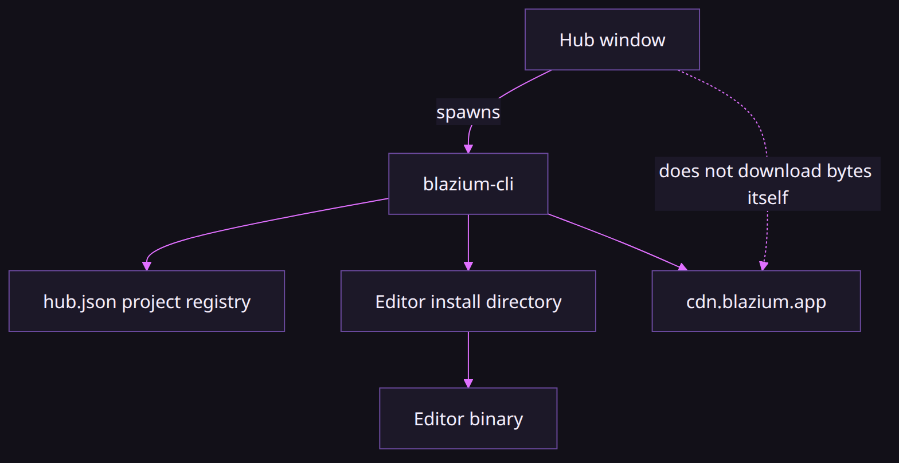
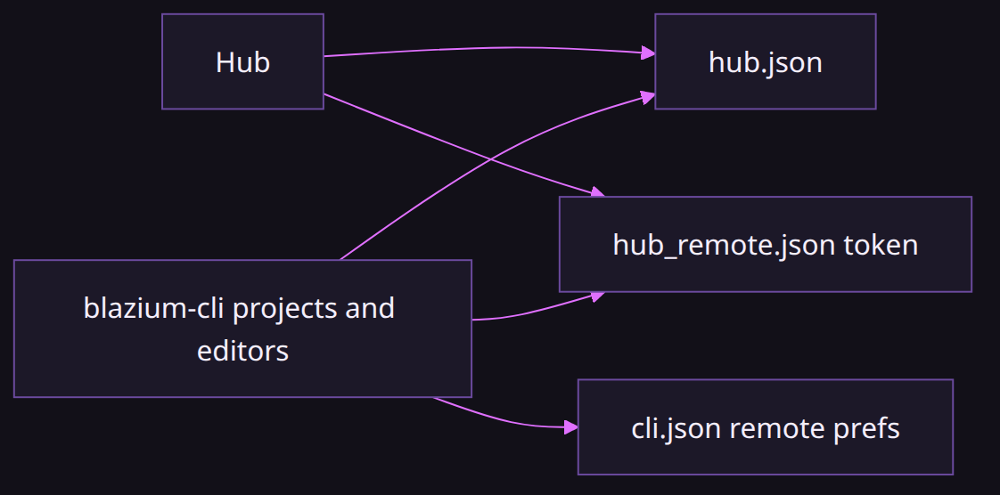
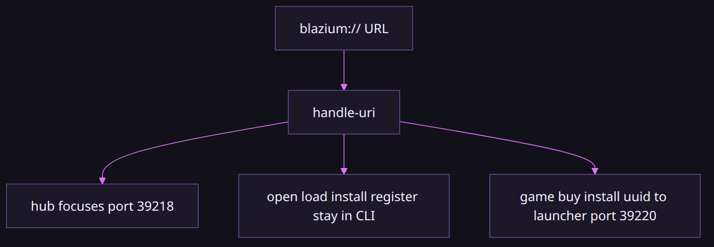
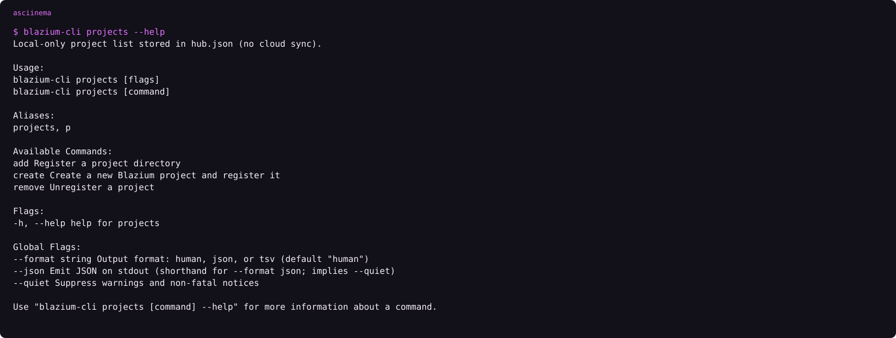

# Why Hub and the CLI are split

### One registry, two front doors

*By Bioblaze Payne, Co-Founder of [Blazium Games](https://blazium.games)*

---

Godot's project manager is inside the editor. That works when the editor you are running is the only editor. We publish `release`, `prerelease`, and `nightly`, and Hub's own binary is built from a different branch than the 0.6 editors it installs. Putting the launcher inside one of those editors would have made that editor responsible for downloading the others.

So the launcher is a window, and the mutations live in [blazium-cli](https://github.com/blazium-games/blazium-cli). Hub lists projects, fetches the CDN catalog, and shells the CLI for install, uninstall, open, and project registration. A CI job uses the same binary without ever opening the window. That is the whole design.


The installer is also why the CLI is the easy path on a desktop. Windows Setup and the Linux `.deb` from [blazium-hub](https://github.com/blazium-games/blazium-hub) put Hub, `blazium-cli`, and the crash sidecar on disk together, and they register `blazium://` to the CLI, not to Hub. You do not download the CLI as a second step unless the machine should not run Hub. npm, the GitHub release assets, and `https://cdn.blazium.app/cli/cli.json` are that second path.


## Contract: who mutates what

| Concern | Owner | Boundary |
|---|---|---|
| Draw projects, editors, news, settings | Hub | Reads CDN JSON/RSS; never writes editor zips |
| Install / uninstall / open / run / registry | CLI | Hub shells with `--json`; parses stdout |
| `blazium://` OS handler | CLI (`handle-uri`) | Hub is a client on port 39218 |
| Editor and template bytes | CDN (`cdn.blazium.app`) | Hub refuses any other host |
| Internal build service (Cerebro) | CLI only, opt-in | `BLAZIUM_CEREBRO_URL` must be set; Hub never calls it |
| Games store deep links | Games launcher (39220) | Not Hub; not an editor install |

If a mutation can be done from a terminal, Hub is not allowed a private path for the same job. That is why Settings changes the install root by calling `blazium-cli install-path`, and why Open is `blazium-cli open` even when you click a card.

## Shared state on disk

The project list is `%APPDATA%\blazium\hub.json` on Windows and `~/.config/blazium/hub.json` elsewhere. Both programs read and write through the CLI's project commands. Editors land in `{install-path}/{channel}/{version}`. If you never set a default, the CLI uses the latest installed editor on the `release` channel.

CLI prefs that are not the project registry live in `cli.json` next to that directory. Hub remote auth is a different file: `hub_remote.json`. Mixing those files by hand is how you get a window that focuses and an open that fails, or the reverse.

Hub does not download the editor zip itself. It will fetch JSON, RSS, and article BBCode from `cdn.blazium.app`, and it refuses any other host. Cerebro, the internal build service, is not something Hub calls. The CLI's template metadata path may call Cerebro only when `BLAZIUM_CEREBRO_URL` is set; public desktops leave that unset.

## Auth and failure boundaries

Hub listens on loopback port 39218 so `blazium://hub` can focus the window. The installers write `hub_remote.json`. Do not edit it. Load order is user path, then machine path. A missing file can be created with `blazium-cli hub-remote ensure` or Hub's headless ensure. Neither path rotates a token that is already valid.

Failure modes that are intentional:

- **Bad token or non-loopback host.** Hub forces the bind back to loopback and fails closed. The CLI cannot talk to a Hub that accepted a poisoned config.
- **CLI path wrong or missing.** Hub still paints News and the CDN catalog. Install, Uninstall, Open, and Run fail in the console. There is no in-process fallback downloader.
- **CDN unreachable.** Catalog and News fail. Local registry and already-installed editors still open through the CLI.
- **Two Hubs.** Single-instance IPC only accepts `SHOW` or `blazium:` messages. A second process does not become a second protocol handler; the OS still points at the CLI.
- **URI meant for Games.** `blazium://game/`, `blazium://buy/`, and `blazium://install/<uuid>` leave this pair and go to port 39220. Treating them as editor installs is a category error in the contract, not a Hub bug.

## What the UI does not promise

The version dropdown on a project card is drawn and not wired. Open is `blazium-cli open` with the CLI default. That control is unfinished UI, not a version pin. Pinning belongs in `blazium-cli editors default` until Hub passes a version through.

Hub's update queue can apply hub, cli, crash_reporter, toolchain, editor, and templates. It does not prompt for the Games launcher even though `blazium-cli update apply --product launcher` exists. Bundled CLI and crash-reporter prompts are suppressed while a Hub update is outstanding, because the Hub installer is the vehicle for those binaries.

## What this is not

Hub is not the Blazium Games store. The store is [blazium.games](https://blazium.games). Store deep links go to the Games launcher on port 39220. `blazium-cli games`, also named `chauffeur`, uploads to that store's API. Steam and itch uploads are `blazium-cli deploy`, which is a different command. The older standalone uploader is still [games_cli](https://github.com/blazium-games/games_cli).

Published Hub and CLI binaries are Linux and Windows. There is no macOS Hub package in the packaging tree, and no Flatpak. [blazium#428](https://github.com/blazium-games/blazium/issues/428) asks for one.

Hub's executable tracks `blazium_4.8`. The editors on the CDN are `0.6.x` from `blazium-dev`. As of 11 October 2026 the release pointer is 0.6.838. Those are two binaries on purpose. Hub's module allowlist is a launcher budget; the editor you install is the full product.

## Installer as the glue, not a third owner

Windows Setup and the Linux postinst are the only places allowed to invent machine-wide state for this pair: `{autopf}\Blazium` vs `/opt/blazium`, `PATH` entries, `blazium://` → `handle-uri`, and the machine `hub_remote.json`. Hub itself never re-registers the protocol. The CLI never writes the Inno/nfpm package. That keeps "how did this binary get on disk" out of both product codebases.

On Windows, Setup records `HKLM\SOFTWARE\Blazium\Hub` with `InstallKind` (`fresh` or `upgrade`), `InstallVersion`, and on upgrade `PreviousVersion` when available. Uninstall wipes user and machine `blazium` secret dirs. Those registry keys are installer bookkeeping; Hub does not read them to decide which editor to open.

## Why the split stays

A CI runner needs install, templates, export, and deploy without a GUI. A desktop needs a project list and a News pane. One binary can serve the first. The second needs a window. Sharing `hub.json`, the channel-scoped install tree, and `handle-uri` means the desktop never invents a second truth for "which editor opens this project." When something fails, the question is which side of the contract broke: CDN reachability, CLI path, remote token, or URI owner — not which of two downloaders raced.

The cost of the split is real: Hub cannot open a project if Settings points at the wrong CLI, and a CI job never gets News for free. The win is that every install path — desktop card, deep link, npm binary, GitHub Action — ends in the same `blazium-cli` code that writes `hub.json` and the channel-scoped editor tree.

## Who owns what at a glance

The split is easier to debug when you treat each surface as a single owner. Hub draws state. The CLI mutates disk. The CDN owns bytes. Cerebro stays opt-in and CLI-only.



| You clicked / ran | Binary that runs | State that changes |
|---|---|---|
| Editors → Install | `blazium-cli install` | `{install-path}/{channel}/{version}`, `hub.json` editors |
| Projects → Open | `blazium-cli open` | launches editor; may attach remote_control |
| Projects → Run | `blazium-cli run` / `play` | launches game; needs `main_scene` |
| Projects → Remove | `blazium-cli projects remove` | `hub.json` only |
| Settings → install path | `blazium-cli install-path` | CLI install root pref |
| `blazium://hub` | CLI `handle-uri` → Hub :39218 | focuses window |
| `blazium://install?version=` | CLI install path | same as Editors → Install |
| News article open | Hub HTTPS fetch | `user://news-cache.json` |

Hub never writes an editor zip. The CLI never paints News. If you need a mutation that Hub's button does not expose yet, the terminal command is the supported path — not a private Hub API.

## Shared JSON on disk

Three files sit under the Blazium config roots. Mixing them by hand is how focus and open diverge.



| File | Windows user path | Unix user path | Writer |
|---|---|---|---|
| `hub.json` | `%APPDATA%\blazium\hub.json` | `~/.config/blazium/hub.json` | CLI project/editor commands (Hub shells them) |
| `cli.json` | `%APPDATA%\blazium\cli.json` | `~/.config/blazium/cli.json` | CLI prefs (remote, defaults that are not the project list) |
| `hub_remote.json` | `%APPDATA%\blazium\` then `%ProgramData%\blazium\` | `~/.config/blazium/` then `/etc/blazium/` | Installer / `hub-remote ensure` / Hub headless ensure |

`hub-remote ensure` creates a missing token file and does not rotate a token that is already valid. Load order is always user path, then machine path. Editor installs land outside these files: `{install-path}/{channel}/{version}` with the root from `install-path`.

## How `blazium://` is routed

The OS handler is the CLI. Hub is a client. Games is a different client on a different port. JustAMCP reuses the scheme for editor resources and is not an OS handler.



```text
blazium-cli handle-uri "blazium://hub"
blazium-cli handle-uri "blazium://open?path=C:/games/MyProject"
blazium-cli hub-remote ensure
```

| URI family | Destination |
|---|---|
| `blazium://hub` | Hub :39218 (`show_hub` / focus) |
| `blazium://open`, `load`, `project/…` | CLI opens the project |
| `blazium://install?version=` | CLI editor install |
| `blazium://register?path=` | CLI registers a local editor binary |
| `blazium://game/`, `buy/`, `install/<uuid>` | Games launcher :39220 |
| `blazium://scene/…`, `tags/…` | JustAMCP inside a running editor (not Hub) |

A poisoned `hub_remote.json` host is forced back to loopback. A Games UUID on the install path never lands in the Editors list. Those are contract boundaries, not retry loops.

## Project registry from the CLI

Hub's Projects tab is a view over commands you can run without the window. The registry is local-only; there is no cloud sync.



```text
asciinema play assets/cli-projects-help.cast
```

```text
blazium-cli projects add ./MyProject
blazium-cli projects create ./FreshGame --name "Fresh Game"
blazium-cli projects remove FreshGame
blazium-cli open ./MyProject
blazium-cli run ./MyProject
```

Detection prefers `project.blazium`, then `project.godot` — the same rule Hub uses on import. `create` writes a minimal `project.blazium` and fails if a project file already exists. `add` requires one of those files. `remove` unregisters only. Open resolution after that is CLI policy: project `blazium/editor_version`, then features match, then the `hub.json` default (latest installed release unless pinned).

## Links

- Hub: https://github.com/blazium-games/blazium-hub
- CLI: https://github.com/blazium-games/blazium-cli
- Dev tools: https://blazium.app/dev-tools
- Release catalog: https://cdn.blazium.app/catalog/versions/release/latest.json
- CLI manifest: https://cdn.blazium.app/cli/cli.json
- Blazium Games: https://blazium.games

---

**[Jump into our Discord](https://blazium.app/chat)** for real-time chats, dev support and feedback

Or follow us everywhere else:

- **[GitHub](https://github.com/blazium-games)**
- **[IndieDB](https://www.indiedb.com/engines/blazium-engine)**
- **[X / Twitter](https://x.com/BlaziumGames)**
- **[YouTube](https://www.youtube.com/@blazium)**
- **[itch.io](https://blaziumengine.itch.io)**
