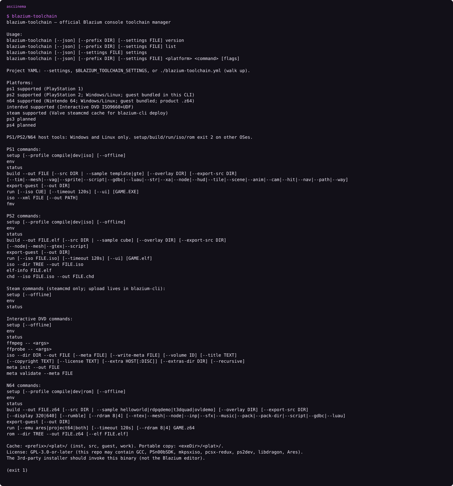
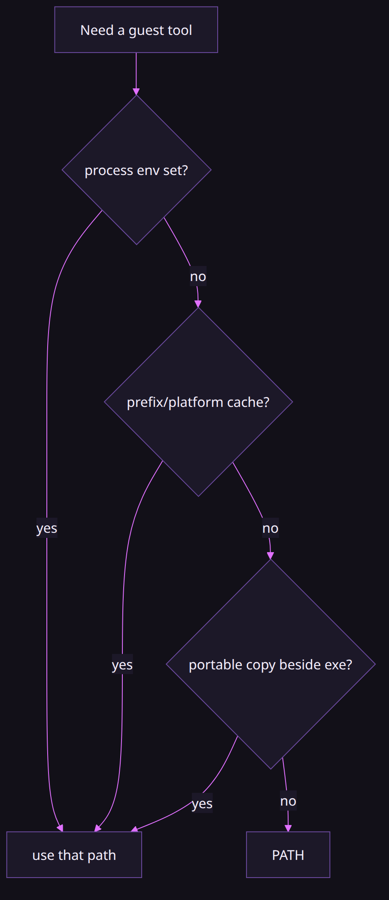
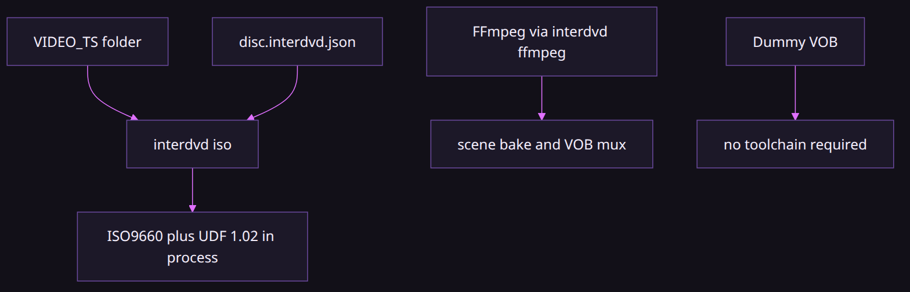

# Blazium console toolchain

### The compilers stay out of the MIT editor

*By Bioblaze Payne, Co-Founder of [Blazium Games](https://blazium.games)*

---

The Blazium engine stays under the MIT license. GCC, PSn00bSDK, pcsx-redux, the ps2dev toolchain, and libdragon are not MIT, and dropping those trees into `blazium.git` would drag their licenses onto the editor. [blazium-toolchain](https://github.com/blazium-games/blazium-toolchain) is GPL-3.0-or-later so it can fetch them. The editor looks up the binary and runs it. It does not vendor the compilers.

We used that split in-house to validate PS1, PS2, N64, and Interactive DVD exports. That validation is not a shipped console title. Godot does not ship an official PS1, PS2, or N64 toolchain. We do not pretend the editor has export platforms for those three. Only Interactive DVD has an export platform class. The others are commands you run yourself after `setup`.




```text
asciinema play assets/toolchain-help.cast
```

Running the binary with no arguments prints that help text and exits `1`. That is usage exit, not a crash. Platforms listed there include supported `ps1`, `ps2`, `n64`, `interdvd`, and `steam`, plus planned `ps3` and `ps4`.

## Install

Published binaries are Linux and Windows, x86_64 and x86_32. Catalog: `https://cdn.blazium.app/toolchain/toolchain.json` (latest `0.1.9` when this was checked). npm:

```text
npm install -g @blazium-engine/toolchain
npx @blazium-engine/toolchain
```

Optional platform packages supply the binary without a CDN download: `@blazium-engine/toolchain-linux-x64`, `toolchain-linux-ia32`, `toolchain-win32-x64`, and `toolchain-win32-ia32`. The command name is always `blazium-toolchain`.

Or build it. Go 1.23.8 or later.

```text
git clone https://github.com/blazium-games/blazium-toolchain.git
cd blazium-toolchain
go test ./...
go build -o blazium-toolchain ./cmd/blazium-toolchain
```

Drop `.exe` on Windows. A local macOS build can master an Interactive DVD. PS1, PS2, and N64 setup and build exit `2` on that host. CI does not ship a macOS binary.

Cache: `%LOCALAPPDATA%\Blazium\blazium-toolchain` on Windows, `~/.local/share/blazium-toolchain` elsewhere. Override with `--prefix` or `BLAZIUM_TOOLCHAIN_PREFIX`. SHA pins live in the embedded `pins.json`. Lookup order for tools: process env, then `<prefix>/<plat>/`, then a portable copy next to the executable, then `PATH`.



Stdout is one verb per line (`fetching`, `installing`, `skip`, `wrote`, `ready`, `error`). `--json` emits the same fields as one object. Exit `2` means a reserved platform or a host that cannot compile. Exit `3` means a host tool is missing.

Project settings load from `--settings FILE`, then `$BLAZIUM_TOOLCHAIN_SETTINGS`, then `blazium-toolchain.yml` / `.blazium-toolchain.yml` walking up from cwd. `blazium-toolchain settings` prints the resolved settings and their source path; `--json settings` is the machine-readable form.

The editor preset key is `export/inter_dvd/toolchain` (also mirrored from the Interactive DVD export option `inter_dvd/toolchain`). Empty means `BLAZIUM_TOOLCHAIN`, then `PATH`. Dummy-VOB export works without the CLI. ISO export and scene bake that need FFmpeg do not.

## Common commands

```text
blazium-toolchain [--json] [--prefix DIR] version
blazium-toolchain [--json] list
blazium-toolchain [--json] [--prefix DIR] ps1|ps2|n64|interdvd|steam env
blazium-toolchain [--json] [--prefix DIR] ps1|ps2|n64|interdvd|steam status
```

Plain `version` reports the name and version; `--json version` also includes the license field. `list` prints the platform catalog from the embedded `manifest.json`. `env` and `status` work even on hosts that cannot compile console guests.

## PS1

| Profile | Contents |
|---|---|
| `compile` | gcc 12.3.0, PSn00bSDK 0.24, elf2x |
| `dev` | compile, plus OpenBIOS and the pcsx-redux CLI |
| `iso` | dev, plus mkpsxiso |

```text
blazium-toolchain ps1 setup --profile dev
blazium-toolchain ps1 build --out GAME.EXE --sample template
blazium-toolchain ps1 run --timeout 120s GAME.EXE
blazium-toolchain ps1 iso --xml FILE [--out PATH]
blazium-toolchain ps1 export-guest --out DIR
blazium-toolchain ps1 fmv
```

`--offline` skips the network. `ps1 run` is headless unless you pass `--ui`. `ps1 build` without `--src` uses the MIT guest stub embedded in the CLI. `--overlay DIR` layers replacement `*.cpp` on top; `--export-src DIR` writes the resolved tree. Cook flags such as `--tim`, `--mesh`, `--vag`, `--node`, `--script`, `--gdbc`, and `--luau` read the paths you name; the CLI does not sandbox those paths. Sony BIOS images are not fetched. The PS1 ISO step uses mkpsxiso, which `setup` downloads. That is not the Interactive DVD path.

## PS2

`ps2` ships. It does not exit 2 on Windows or Linux.

| Profile | Contents |
|---|---|
| `compile` | ps2dev EE gcc and the PS2SDK |
| `dev` | compile, plus your `PCSX2_EXE` (BIOS is not fetched) |
| `iso` | dev, plus `ps2 iso --dir TREE` |

```text
blazium-toolchain ps2 setup --profile compile
blazium-toolchain ps2 build --out hello.elf --sample cube
blazium-toolchain ps2 iso --dir ./tree --out game.iso
blazium-toolchain ps2 elf-info FILE.elf
blazium-toolchain ps2 chd --iso FILE.iso --out FILE.chd
blazium-toolchain ps2 run [--iso FILE.iso] [--timeout 120s] [--ui] GAME.elf
```

Set `PCSX2_EXE` (and `PS2_BIOS_DIR` if you have a legal BIOS) before `ps2 run`. Size gates `ps2.elf_text_max` (default 512 KiB) and `ps2.elf_file_max` (default 3 MiB) apply to `ps2 build` and `ps2 elf-info`. `ps2 chd` wraps an ISO with `chdman` when that tool is on `PATH`. Cook flags include `--node`, `--mesh`, `--gtex`, and `--script`. Sample `cube` comes from ps2sdk. CI builds `hello.elf` on Ubuntu and Windows.

## N64

There is no ISO command. `n64 iso` is rejected. The product is a big-endian `.z64` (magic `80 37 12 40`).

| Profile | Contents |
|---|---|
| `compile` | libdragon preview: `N64_INST`, `mips64-elf-gcc`, `libdragon.a` |
| `dev` | compile, plus Ares and/or Project64 |
| `rom` | compile, plus `mkdfs` / `n64tool` |

```text
blazium-toolchain n64 setup --profile compile
blazium-toolchain n64 build --out hello.z64 --display 320
blazium-toolchain n64 run --emu ares --rdram 8 hello.z64
blazium-toolchain n64 rom --dir TREE --out FILE.z64 [--elf FILE.elf]
```

| Flag | Effect |
|---|---|
| `--display 320\|640` | Framebuffer; default 320 |
| `--rumble` | Drive a Rumble Pak when present |
| `--rdram 8\|4` | 8 MiB Expansion Pak (default) or 4 MiB |
| `--sample helloworld\|rdpqdemo\|t3dquad\|ovldemo` | libdragon / Tiny3D samples |
| `--emu ares\|project64\|both` | Validators for `n64 run` (default `both`) |

`C:\ultra` is ignored. PIF dumps are not fetched. A missing single emulator is a `skip`. `n64 run` uses Parallel-RDP or Angrylion, not Jabo. Cart size gate `n64.cart_max` defaults to 64 MiB. CI builds `hello.z64` on Ubuntu and Windows.

## Interactive DVD



```text
blazium-toolchain interdvd setup [--offline]
blazium-toolchain interdvd meta init --out disc.interdvd.json
blazium-toolchain interdvd meta validate --meta disc.interdvd.json
blazium-toolchain interdvd iso --dir ./disc --out disc.iso --meta disc.interdvd.json
blazium-toolchain interdvd ffmpeg -- <args>
blazium-toolchain interdvd ffprobe -- <args>
```

The folder must already contain `VIDEO_TS/`. `AUDIO_TS/` is optional. **No mkisofs** means this command writes ISO9660 and UDF 1.02 itself. It does not shell out to `mkisofs` or `oscdimg`. Extra host files sit beside the video folders via `--extra HOST[:DISC]` and `--recursive`. The engine's `InterDVDIfoWriter.toolchain_iso_args` documents the same argument list shape: `--dir`, `--out`, `--meta`, `--write-meta`, and `--json`.

`menu_language`, `audio_language`, `subtitle_language`, `region_mask`, and `parental_level` are stored in the CLI's `disc.interdvd.json`; the CLI ISO path does not write those values into the IFO. The engine's separate `InterDVDIfoWriter` authoring path can write its own region, parental, menu, and audio options. Validation messages for `region_mask` and `parental_level` say those fields are stored in the JSON only.

`interdvd setup` can fetch a pinned FFmpeg on Windows and Linux. The editor's scene baker and VOB mux run `blazium-toolchain interdvd ffmpeg` to encode a cell. If the CLI is missing, the editor reports that the toolchain is not ready and tells you to run `interdvd setup` or set `export/inter_dvd/toolchain`. Dummy-VOB paths that never call FFmpeg still work without it.

## SteamCMD cache

`steam` is a supported platform with `setup`, `env`, and `status` only. It caches Valve `steamcmd` under the prefix for `blazium-cli deploy steam upload`. It does not log in and does not push builds. `steam build`, `steam run`, and `steam iso` print usage and fail.

```text
blazium-toolchain steam setup
blazium-toolchain steam status
```

## Reserved and limits

`ps3` and `ps4` are names the CLI accepts so scripts fail clearly. Every command exits `2`. Manifest status is `planned`. There is no date on them.

Compilers are downloaded into the cache on `setup`. They are not inside the Go binary. The MIT guest sources are. `export-guest --out DIR` writes that stub. Third-party licenses are in `THIRDPARTY.md` in the toolchain repo. libpsn00b, ps2sdk, and libdragon link into the exported guest, not into the editor.

Hosts: PS1, PS2, and N64 setup/build/run/iso/rom are Windows and Linux. Other hosts exit `2` for those compile paths. `env`, `status`, and `export-guest` still work. Published release binaries are Linux and Windows only.

## Exit codes

| Code | When |
|---|---|
| `0` | Command succeeded |
| `1` | Usage error, unknown platform, or no arguments (help printed) |
| `2` | Planned platform (`ps3`, `ps4`) or unsupported compile host |
| `3` | Missing required host tool, or offline when a fetch is required |
| `4` | Other failure after the command was understood |

Failures print kind, message, suggested fix, command, host, version, and prefix. `--json` collapses the same fields into one object. There is no rotating session log file beside stdout.

## Command quick reference

| Goal | Command |
|---|---|
| Show version / license JSON | `blazium-toolchain version` / `--json version` |
| List platforms | `blazium-toolchain list` |
| Resolve project YAML | `blazium-toolchain settings` |
| Cache SteamCMD only | `blazium-toolchain steam setup` |
| PS1 smoke | `ps1 setup --profile dev` then `ps1 build` / `ps1 run` |
| PS2 ELF | `ps2 setup --profile compile` then `ps2 build --out hello.elf` |
| N64 ROM | `n64 setup --profile compile` then `n64 build --out hello.z64` |
| Interactive DVD ISO | `interdvd setup` then `interdvd iso --dir … --out …` |
| Editor bake encode | editor spawns `interdvd ffmpeg` after discovery |

Cook flags (`--tim`, `--node`, `--luau`, and the rest) read the paths you name. The CLI does not sandbox those paths. Cook ABI constants (`BLAZIUM_PS1_COOK_ABI`, `BLAZIUM_PS2_COOK_ABI`, `BLAZIUM_N64_COOK_ABI`) live in the toolchain guest code and are not shared across platforms. They are not an editor cooker on `blazium-dev`.

## Failure cases

| Symptom | Cause | Fix |
|---|---|---|
| No-arg run exits `1` | Usage path after printing help | Pass `version`, `list`, or `<platform> <command>` |
| `ps3` / `ps4` exit `2` | Reserved / planned | Do not schedule a ship date from the name alone |
| macOS `ps1 build` exit `2` | Console compile hosts are Windows/Linux | Use those hosts; Interactive DVD mastering can still run from a local macOS build |
| `interdvd iso` looks for `mkisofs` | Wrong tool expectation | This path writes ISO9660+UDF in-process |
| Region / language absent from IFO | CLI meta is JSON-only for those fields | Author IFO options through engine `InterDVDIfoWriter` |
| Editor cannot bake a cell | Binary missing or encode not ready | `interdvd setup` or set `export/inter_dvd/toolchain` / `BLAZIUM_TOOLCHAIN` / `PATH` |
| `ps2 run` cannot find emulator | `PCSX2_EXE` unset | Point at your PCSX2; BIOS is never fetched |
| `n64 iso` rejected | No ISO product on N64 | Build or `rom` a `.z64` |
| SHA / pin fetch fails | `pins.json` and network disagree | Fix pins via the toolchain repo process; do not hand-edit a broken cache URL without updating embeds |

## Typical workflows

**Terminal console guest (Windows or Linux):** `setup` for the platform profile you need → `build --out …` (optionally `--sample` or `--src`) → `run` against a cached emulator → optional `iso` / `rom` / `chd` when that platform supports it → `export-guest` when you want the MIT stub on disk.

**Interactive DVD from the editor:** set toolchain discovery → export or bake triggers `interdvd setup` if encode is not ready → `interdvd ffmpeg` for cells → `interdvd iso` for the disc image. Dummy-VOB-only export can skip the CLI.

**SteamCMD cache only:** `blazium-toolchain steam setup` then let `blazium-cli deploy steam upload` use the cached tool. This binary does not log in and does not push builds.

## Settings and discovery notes

Project YAML loads from `--settings FILE`, then `$BLAZIUM_TOOLCHAIN_SETTINGS`, then `blazium-toolchain.yml` / `.blazium-toolchain.yml` walking up from the working directory. `blazium-toolchain settings` prints the resolved file and values; `--json settings` is the machine-readable form. Size gates such as `ps2.elf_text_max` (default 512 KiB), `ps2.elf_file_max` (default 3 MiB), and `n64.cart_max` (default 64 MiB) apply on the commands that check them.

Editor discovery for Interactive DVD is independent of the guest-tool lookup diagram: the engine checks `export/inter_dvd/toolchain`, then `BLAZIUM_TOOLCHAIN`, then `PATH`. Guest compilers inside a `setup` cache still follow env → `<prefix>/<plat>/` → portable copy beside the executable → `PATH`. Confusing those two layers is how operators set a PATH that finds FFmpeg but never the `blazium-toolchain` binary the editor needs to spawn.

Published catalog latest when checked: `0.1.9` at `https://cdn.blazium.app/toolchain/toolchain.json`. npm optional platform packages (`@blazium-engine/toolchain-linux-x64`, `toolchain-linux-ia32`, `toolchain-win32-x64`, `toolchain-win32-ia32`) supply the binary without a CDN download; the command name remains `blazium-toolchain`.

## Links

- Toolchain: https://github.com/blazium-games/blazium-toolchain
- Catalog: https://cdn.blazium.app/toolchain/toolchain.json
- Engine: https://github.com/blazium-games/blazium
- Blazium Games: https://blazium.games

---

**[Jump into our Discord](https://blazium.app/chat)** for real-time chats, dev support and feedback

Or follow us everywhere else:

- **[GitHub](https://github.com/blazium-games)**
- **[IndieDB](https://www.indiedb.com/engines/blazium-engine)**
- **[X / Twitter](https://x.com/BlaziumGames)**
- **[YouTube](https://www.youtube.com/@blazium)**
- **[itch.io](https://blaziumengine.itch.io)**
