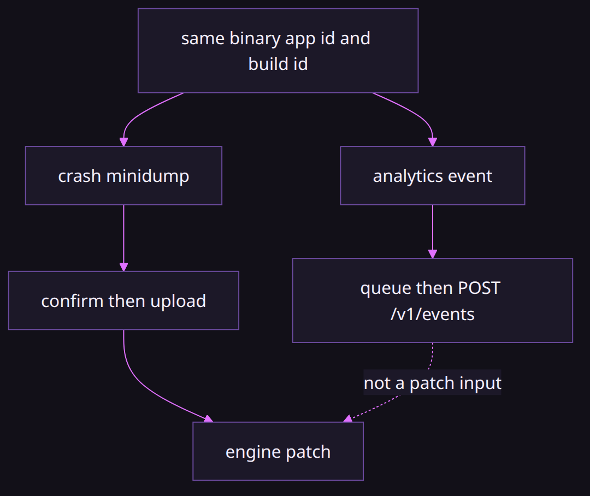
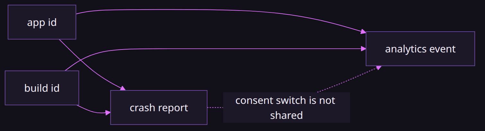

# Why crash reports and analytics are separate

### One is how we patch the engine. The other is a counter you opt into.

*By Bioblaze Payne, Co-Founder of [Blazium Games](https://blazium.games)*

---

We added both modules in the same stretch of engine work, and we gave them the same app id and build id so a report and an event from one binary can be lined up. That is as far as the sharing goes. A crash report is a minidump we read to find an engine fault and ship a patch. An analytics event is a counter. We do not patch the engine from analytics events.

Godot ships neither module. The crash path is opt-in upload with a confirm step, because a dump can contain more than a stack. The analytics path is opt-in because a counter should not leave the machine until someone says so.




## Two problems, two modules

| | Crash reporter | Analytics |
|---|---|---|
| Module | `modules/crash_reporter` | `modules/analytics` |
| Artifact | `{id}.dmp` + `{id}.json` | JSONL event queue |
| Ingest path | `/v1/reports` (multipart) | `/v1/events` (`{"events":[...]}`) |
| Headers | `X-App-Id`, `X-Build-Id` | same |
| Default `require_user_consent` | **true** | **false** |
| Editor HTTP upload | never (`is_http_upload_available` false) | after consent + non-empty bake |
| Platforms (module) | Windows, Linux/BSD | all (HTTP-only) |
| Template SCons | `crash_reporter=yes` | `analytics=yes` |
| Editor SCons | `editor_crash_reporter=yes` | `editor_analytics=yes` |

Hub CI bakes both endpoints on the same host: `https://crash.blazium.app/v1/reports` and `https://crash.blazium.app/v1/events`, with `editor_app_id=blazium-hub` / `template_app_id=blazium-hub`. Same host is convenience. It is not one consent switch. A local engine bake that leaves both endpoints empty is equally intentional: nothing leaves the machine until you point the modules somewhere yourself.

## Crash reports: evidence

`modules/crash_reporter` writes Breakpad minidumps when the matching SCons flag is on. The sidecar UI in [blazium_crash_reporter](https://github.com/blazium-games/blazium_crash_reporter) does not contain Breakpad. It shows the two files. Send uploads. Discard does not. `--auto-send` exists and we do not use it for Hub.

The module builds on Windows and Linux/BSD only. Editor builds never HTTP-upload. `require_user_consent` defaults to true. Spawn passes `--crash-dir`, `--report-id`, `--endpoint`, `--app-id`, `--build-id`, `--contact-url`, and `--privacy-url` so the dialog can show who will receive the dump before Send.

We read the reports that are sent. Hangman shipping on Steam, Discord, Google Play, and the Apple App Store did not replace that. Crashes still show up after a title is out. The dump is what we stackwalk. The analytics counter is not.


## Analytics: a counter

`modules/analytics` queues JSON events and posts them when you call `flush()`. The body is `{"events":[...]}`. Hub's bake uses `https://crash.blazium.app/v1/events` on the same host as crash reports, on a different path.

Consent, first match wins: `--analytics=accepted|declined`, then `BLAZIUM_ANALYTICS_CONSENT`, then `Analytics.set_consent`, then Editor Settings `blazium/analytics/consent`. There is no consent dialog. Anonymous mode is the default, and it omits `device_uid`.

`application/analytics/require_user_consent` defaults to **false**. The crash reporter's matching flag defaults to **true**. Do not treat them as one setting. An empty baked editor endpoint means the editor does not collect any data. Quitting queues `session_end` / `editor_session_ended` and does not upload by itself.

We used the analytics module while building Hangman and Demon Lord: Clicker. Demon Lord: Clicker was also how we validated the newer tools and the 2D side. The example server at [example_analytics_server](https://github.com/blazium-games/example_analytics_server) says it is not a hosted product.


## What "same id" means

SCons `editor_app_id` defaults to `custom_blazium_engine`. Hub CI sets `blazium-hub`. A non-empty bake wins over project settings for both modules. `get_app_id` / `get_build_id` on either singleton are documented as shared. That lets us see that a crash and a session came from the same binary. It does not merge the queues, the consent flags, the endpoints, or the upload UIs.

```gdscript
# Different modules. Different decisions.
print(CrashReporter.get_app_id(), " ", CrashReporter.get_build_id())
print(Analytics.get_app_id(), " ", Analytics.get_build_id())
print(CrashReporter.get_resolved_config())
print(Analytics.get_resolved_config())
```



Equal ids mean correlation is possible after the fact. They do not mean one `flush` or one sidecar Send moves both payloads. A crash can upload while analytics consent is declined; an analytics flush can succeed while pending dumps stay on disk.

## Analytics API sketch

Class XML methods: `track`, `flush`, `set_consent`, `set_anonymous`, `identify`, `set_user_properties`, plus getters for consent, queue size, endpoint fields via `get_resolved_config`. Signals: `flush_succeeded(count)`, `flush_failed(message)`.

```gdscript
func _ready() -> void:
    if not Analytics.is_available():
        return
    # Games: require_user_consent defaults false. Editors still need accepted + endpoint.
    if Analytics.is_enabled():
        Analytics.track("level_start", {"level": 1})
        Analytics.flush()

func on_privacy_accept() -> void:
    Analytics.set_consent(true)
    Analytics.set_anonymous(true)
    Analytics.track("session_start", {})
    Analytics.flush()
```

| Analytics gate | Editor | Game template |
|---|---|---|
| SCons send flag | `editor_analytics=yes` | `analytics=yes` |
| Endpoint | bake non-empty or nothing queues | bake or Project Settings |
| Consent | must be `accepted` | only if `require_user_consent` true |
| `require_user_consent` default | n/a (editor gate) | **false** |
| Quit behavior | queues end events; no auto POST | same — call `flush()` |

Empty editor bake disables collection entirely. Empty template bake means "read Project Settings," not "off."

## Privacy defaults that disagree on purpose

Crash dumps can hold stack memory and nearby process state. Defaults push toward an explicit human confirmation: sidecar dialog, `require_user_consent=true`, no editor in-process POST, `--auto-send` unused on Hub.

Analytics events are structured counters. Games default `require_user_consent` to false so a title that sets `enabled` and owns its own privacy UI is not forced through a second engine gate. Editors still need `accepted` consent and a non-empty baked URL before anything queues. Anonymous mode is on by default so identified device ids are opt-in.

If you ship both, configure both. Turning analytics on does not start crash upload. Declining analytics does not discard a pending minidump.

## Reference servers stay separate

| Piece | Crash | Analytics |
|---|---|---|
| Example ingest | [example_crash_reporter_server](https://github.com/blazium-games/example_crash_reporter_server) | [example_analytics_server](https://github.com/blazium-games/example_analytics_server) |
| Module tests | [crash_reporter_module_tests](https://github.com/blazium-games/crash_reporter_module_tests) | [analytics_module_tests](https://github.com/blazium-games/analytics_module_tests) |
| Sidecar / UI | [blazium_crash_reporter](https://github.com/blazium-games/blazium_crash_reporter) | none (flush from game/editor) |
| CDN catalog | https://cdn.blazium.app/crash_reporter/crash_reporter.json | n/a |

Neither example README claims to be the hosted Hub product. Point local games at localhost; point Hub builds at the baked URLs.

## Consent checklist (do not merge these)

Crash path:

1. Template/editor compiled with Breakpad flag.
2. `enabled` true (or editor env override).
3. `upload_mode` not Disabled if you want leave-machine behavior.
4. Human hits Send on the sidecar, or your game calls `upload_pending` after its own consent UI when `require_user_consent` is true.
5. Never rely on `--auto-send` for Hub.

Analytics path:

1. Template/editor compiled with analytics send flag (`analytics=yes` / `editor_analytics=yes`).
2. Non-empty endpoint (bake for editor; Project Settings for empty template bake).
3. Consent accepted when the editor gate or `require_user_consent` demands it.
4. Explicit `flush()` — quit alone does not POST.
5. Anonymous unless you chose identified mode.

If either list is incomplete, nothing should leave the machine. Completing one list never completes the other.

## What we do with the data

Crash reports: read, stackwalk, patch the engine. That is the contract behind the confirm dialog.

Analytics: understand editor demographics and optional game events after opt-in. That is a product counter. It is not a substitute for a minidump, and it is not how we decide which engine crash to fix first.

Hangman and Demon Lord: Clicker used analytics while we were building and validating. They do not redefine the crash pipeline. A minidump from an editor Hub launched, or from a game that opted into crash upload, is still the input for an engine patch.

If a studio asks for "telemetry," make them pick which module. A single privacy policy paragraph that names both paths is fine. A single Project Setting that claims to master both is not — the engine does not ship one. Ship templates with the SCons flags you mean; an empty bake is safer than a shared master switch that never existed. Sidecar catalog updates (`blazium-cli update apply --product crash_reporter`) refresh the UI binary only — they do not flip analytics consent or empty an events queue.

## Hub launch pairing

Hub can attach the crash sidecar and pass analytics CLI flags in the same editor launch without merging the modules. Accepted/anonymous data collection yields `--analytics=accepted` and `--analytics-mode=anonymous` plus `--crash-reporter <path>` when the binary exists. Declined yields `--analytics=declined` and `--no-crash-reporter`. Undecided still attaches the crash sidecar so a dump can prompt later; that is intentional asymmetry with analytics, which stays inert without `accepted` and a non-empty editor endpoint.

Local example servers stay separate processes: [example_crash_reporter_server](https://github.com/blazium-games/example_crash_reporter_server) on `/v1/reports`, [example_analytics_server](https://github.com/blazium-games/example_analytics_server) on `/v1/events`. Point each module at its own URL even when you host both on one machine. Multipart dumps and JSONL event batches do not share a request body.

### Failure cases that mix the two

| Observation | Wrong conclusion | Actual check |
|---|---|---|
| Analytics flush works | crash upload is on | `CrashReporter.get_upload_mode` / sidecar Send |
| Crash Send works | analytics consented | `Analytics.get_consent` / `is_enabled` |
| Same `X-App-Id` | same queue | separate pending dump folder vs JSONL |
| Hub declined collection | dumps disabled in engine | `--no-crash-reporter` only skips attach |
| `flush` after quit hook | auto-upload on exit | quit queues end events; still need `flush` |

```gdscript
func debug_both_pipelines() -> void:
    print(CrashReporter.get_resolved_config())
    print(Analytics.get_resolved_config())
    print(CrashReporter.has_pending_reports(), " ", Analytics.get_queue_size())
```

Use that pair in a support build before filing "telemetry is broken." One non-empty config never repairs the other module's empty endpoint.

### Game analytics options that are easy to misread

| Key | Default | Misread |
|---|---|---|
| `application/analytics/require_user_consent` | **false** | "same as crash reporter" — crash defaults **true** |
| `application/analytics/enabled` | off until you enable | enabling does not upload dumps |
| `application/analytics/endpoint` | empty or bake | empty template bake falls back to settings; empty editor bake disables |
| anonymous mode | on | `identify` / `set_user_properties` are no-ops until you leave anonymous |

Editor smoke: confirm `Analytics.get_consent() == "accepted"`, confirm `get_resolved_config()` shows a non-empty endpoint, `track` once, then `flush`. If `flush_failed` reports an empty endpoint, the bake is empty — Project Settings will not override a locked empty editor URL. Game smoke: enable the setting, set endpoint, `track`, `flush`, and ignore crash pending folders unless you also configured `CrashReporter`.

Consent precedence for analytics is fixed: CLI `--analytics=accepted|declined`, then `BLAZIUM_ANALYTICS_CONSENT`, then `Analytics.set_consent`, then Editor Settings `blazium/analytics/consent`. Crash upload consent is the sidecar dialog (or your game UI before `upload_pending`), not that CLI flag. Passing `--analytics=declined` from Hub also adds `--no-crash-reporter`; that pairing is a Hub launch policy, not an engine Project Setting that couples the modules inside a custom game binary.

When both example servers run locally, keep ports and paths distinct in Project Settings so a mistaken shared URL fails loudly instead of posting multipart dumps to an events parser. Headers `X-App-Id` and `X-Build-Id` match across modules when bakes match; body shapes never do.

## Links

- Crash module: https://github.com/blazium-games/blazium/tree/blazium-dev/modules/crash_reporter
- Analytics module: https://github.com/blazium-games/blazium/tree/blazium-dev/modules/analytics
- Sidecar: https://github.com/blazium-games/blazium_crash_reporter
- Sidecar catalog: https://cdn.blazium.app/crash_reporter/crash_reporter.json
- Blazium Games: https://blazium.games

---

**[Jump into our Discord](https://blazium.app/chat)** for real-time chats, dev support and feedback

Or follow us everywhere else:

- **[GitHub](https://github.com/blazium-games)**
- **[IndieDB](https://www.indiedb.com/engines/blazium-engine)**
- **[X / Twitter](https://x.com/BlaziumGames)**
- **[YouTube](https://www.youtube.com/@blazium)**
- **[itch.io](https://blaziumengine.itch.io)**
