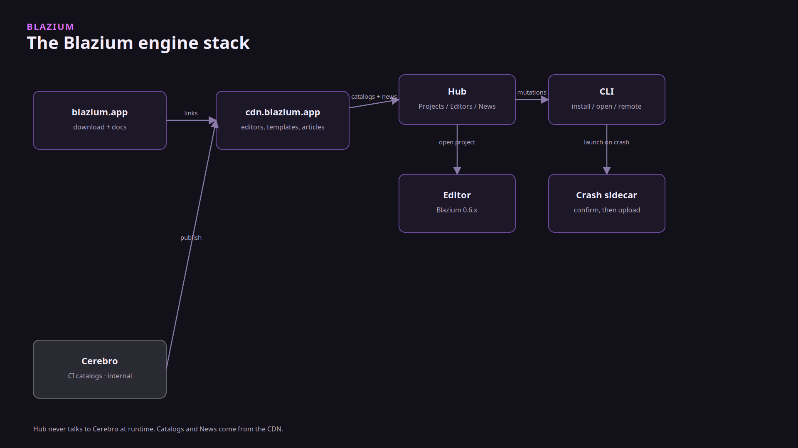

# Crash reports in Blazium

### We read the ones you send, and we patch the engine from them

*By Bioblaze Payne, Co-Founder of [Blazium Games](https://blazium.games)*

---

Godot does not ship a crash-reporter module. When the editor or a game died, we were guessing from a Discord message and a log someone remembered to copy. `modules/crash_reporter` writes a Breakpad minidump and a JSON sidecar on disk. A separate UI, [blazium_crash_reporter](https://github.com/blazium-games/blazium_crash_reporter), shows those two files and uploads them only after you press Send.

We read the reports that arrive at our endpoint, find the engine fault, and ship a patch for that crash. Analytics is a different module and a different URL. An analytics event is a counter. It is not the input for those patches.

Hangman, our example game, shipped on Steam, Discord, Google Play, and the Apple App Store. Crash reports from the editor, from Hub, and from games that opt in are how we find the faults that did not show up in that pass. Demon Lord: Clicker was built in part to validate the newer tools and the 2D side. Its bug notes are not this minidump.




## What is compiled

`can_build` is Windows and Linux/BSD. macOS, web, Android, and iOS do not compile the module. That is the current `config.py`, not a promised follow-up.

Breakpad is the in-process client, compiled when `crash_reporter=yes` (export templates) or `editor_crash_reporter=yes`. The module does not ship Breakpad's out-of-process `crash_generation_server`. The sidecar repository does not contain Breakpad either. It only shows the two files and uploads them after you confirm. `--auto-send` skips the question. We do not turn that on for Hub.

Editor builds do not POST the dump. `is_http_upload_available()` is true only when the template flag is on and the build is not the editor (`CRASH_REPORTER_ENABLED` without `TOOLS_ENABLED`). A valid `--crash-reporter` path selects sidecar mode. Otherwise the editor writes `{id}.dmp` and `{id}.json` and stops.

`induce_crash()` only does something when Breakpad was compiled in. Prefer `write_minidump()` in tests; [crash_reporter_module_tests](https://github.com/blazium-games/crash_reporter_module_tests) says not to call `induce_crash()` from headless runs.

## Ship it with a game

1. Compile the export template with `crash_reporter=yes`, or the dump writer is absent.
2. Place `crash_reporter.exe` (Windows) or `crash_reporter` (Linux) next to the game, or set the path. Defaults are `application/crash_reporter/reporter_filename` (`crash_reporter` / `crash_reporter.exe` on Windows). `reporter_sha256`, when set, is the expected lowercase hex of that binary; a mismatch makes `get_reporter_path()` return empty.
3. Set `application/crash_reporter/enabled` to true. The default is false.
4. Set `upload_mode` to `2` (sidecar), `1` (in-engine HTTP), or `3` (both). `0` leaves files on disk. The editor never takes the HTTP path.
5. Set `application/crash_reporter/endpoint` if the template bake left it empty. Hub's bake is `https://crash.blazium.app/v1/reports`. Your game does not inherit that URL.
6. Leave `require_user_consent` at its default, true, unless you already asked somewhere else. The sidecar still asks when it is the process that uploads. In-engine `upload_on_startup` only auto-uploads when consent is not required.

The engine launches the sidecar with `--crash-dir`, `--report-id`, `--endpoint`, `--app-id`, `--build-id`, `--contact-url`, and `--privacy-url`, plus any `reporter_args`. The dialog is Send, Discard, or Refresh, plus a "what happened" field and an anonymous option. The privacy URL is on the dialog so the upload target is visible before you send.

Point the editor at a local sidecar with `--crash-reporter <path>`. Relative paths resolve next to the editor executable.

## What gets written

`{crash-dir}/{id}.dmp` plus `{id}.json`. The editor crash directory is the editor data folder's `crashes`, or `BLAZIUM_CRASH_REPORTER_CRASH_DIR` if that is set. Export templates use `application/crash_reporter/crash_dir_name` (default `crashes`) under the user data directory.

Metadata can include engine version/hash, app identity, OS/arch, optional log tail (`include_logs`, `log_tail_kb` default 64), system info, a sanitized project-settings dump when enabled, and `custom_metadata`. Pending reports are pruned by `max_pending` (default 10) and `retain_days` (default 30).

The singleton is `CrashReporter`. Signals on a template that uploads in-engine: `upload_started`, `upload_progress`, `upload_succeeded`, `upload_failed`. Useful methods: `get_pending_reports`, `upload_pending`, `upload_report`, `discard_report`, `mark_report_submitted`, `launch_reporter`, `write_minidump`, `get_resolved_config`.

| Key | Default |
|---|---|
| `application/crash_reporter/enabled` | `false` |
| `application/crash_reporter/upload_mode` | `0` (Disabled) |
| `application/crash_reporter/require_user_consent` | `true` |
| `application/crash_reporter/spawn_on_crash` | `true` |
| `application/crash_reporter/spawn_on_next_launch` | `true` |
| `application/crash_reporter/upload_on_startup` | `true` |
| `application/crash_reporter/endpoint` | empty, or the template bake |
| `application/crash_reporter/timeout_sec` | `30` |
| `application/crash_reporter/max_upload_mb` | `32` (range 1–256) |
| `application/crash_reporter/retry_count` | `3` |
| `application/crash_reporter/delete_after_upload` | `true` |
| `application/crash_reporter/crash_dir_name` | `crashes` |
| `application/crash_reporter/max_pending` | `10` |
| `application/crash_reporter/retain_days` | `30` |

Editor environment overrides, not Project Settings: `BLAZIUM_CRASH_REPORTER_ENABLED`, `BLAZIUM_CRASH_REPORTER_CRASH_DIR`, `BLAZIUM_CRASH_REPORTER_ENDPOINT`, `BLAZIUM_CRASH_REPORTER_APP_NAME`, `BLAZIUM_CRASH_REPORTER_APP_VERSION`, `BLAZIUM_CRASH_REPORTER_BUILD_CHANNEL`, `BLAZIUM_CRASH_REPORTER_CONTACT_URL`. The editor ignores `application/crash_reporter/*` for those fields. Two Editor Settings keys are read-only: `blazium/crash_reporter/app_id` and `blazium/crash_reporter/build_id`.

## App id and the POST

SCons `editor_app_id` defaults to `custom_blazium_engine`. Official CI overrides it. Hub's bake is `blazium-hub`. An empty `editor_build_id` means the git hash at runtime. `CrashReporter.get_resolved_config()` returns the values the process actually used. Headers on upload are `X-App-Id` and `X-Build-Id`.

The POST is multipart: the minidump plus the metadata JSON (optional log part on the example server). Dumps are still written when the endpoint is empty. Upload is the part you turn on.

```gdscript
if CrashReporter.is_breakpad_enabled():
    var path := CrashReporter.write_minidump()
    print(path)
    print(CrashReporter.get_pending_reports())
# Do not call induce_crash() from headless tests.
```

```text
curl -F dump=@crash.dmp -F metadata=@crash.json http://127.0.0.1:8090/v1/reports
```

The sidecar catalog on the CDN is [crash_reporter.json](https://cdn.blazium.app/crash_reporter/crash_reporter.json). `blazium-cli update apply --product crash_reporter` can refresh the binary Hub shipped. The example ingest, [example_crash_reporter_server](https://github.com/blazium-games/example_crash_reporter_server), is a reference server (GET `/health`, POST `/v1/reports`, max body 64 MiB, optional stackwalk). It is not the Hub endpoint. Companion project: [example_crash_reporter_project](https://github.com/blazium-games/example_crash_reporter_project).

## Sidecar UI contract

[blazium_crash_reporter](https://github.com/blazium-games/blazium_crash_reporter) is a Blazium project, not a Breakpad host. `scripts/main.gd` parses `--crash-dir`, `--report-id`, `--endpoint`, `--app-id`, `--build-id`, `--contact-url`, and `--privacy-url`. The privacy link is shown when the URL is non-empty. Send builds the multipart POST; Discard deletes locally; Refresh reloads the on-disk pair. The anonymous checkbox is written into metadata as `anonymous` before upload. `--auto-send` short-circuits the dialog — useful for lab automation, wrong for Hub.

Example server contract (local only): `GET /health`, `POST /v1/reports` (multipart `dump` + `metadata`, optional `log`), `GET /v1/reports`, `GET /v1/reports/{id}`, stackwalk helpers. Max body 64 MiB. Stackwalk or Discord webhook failures do not fail ingest (`201`).

## Runtime API sketch

```gdscript
print(CrashReporter.is_available())
print(CrashReporter.is_breakpad_enabled())
print(CrashReporter.is_http_upload_available()) # false in editor
print(CrashReporter.get_crash_directory())
print(CrashReporter.get_upload_mode())
if CrashReporter.has_pending_reports():
    for row in CrashReporter.get_pending_reports():
        print(row["id"], " ", row["dump_path"])
# After an in-game consent UI, when require_user_consent was true:
# CrashReporter.upload_pending()
```

`write_minidump()` writes without killing the process. `induce_crash()` does not return. `cancel_upload()` aborts an in-flight in-engine POST.

## Edge cases

- macOS/web/mobile: module does not build; there is no dump writer to enable in Project Settings for those targets.
- Editor + empty sidecar path: dumps on disk, console message, no upload.
- `reporter_sha256` mismatch: spawn skipped.
- `upload_mode` InEngine or Both in the editor: HTTP path still unavailable; use sidecar.
- `--auto-send` on the sidecar binary skips consent; leave it off for human-facing builds.
- `max_upload_mb` rejects oversized dumps on the in-engine client before POST.
- `upload_on_startup` with `require_user_consent=true` will not silently drain the pending folder.
- `include_project_settings_dump` defaults false; turn it on only if you accept that metadata growth.

## Links

- Engine module: https://github.com/blazium-games/blazium/tree/blazium-dev/modules/crash_reporter
- Sidecar: https://github.com/blazium-games/blazium_crash_reporter
- Catalog: https://cdn.blazium.app/crash_reporter/crash_reporter.json
- Example server: https://github.com/blazium-games/example_crash_reporter_server
- Module tests: https://github.com/blazium-games/crash_reporter_module_tests
- Blazium Games: https://blazium.games

---

**[Jump into our Discord](https://blazium.app/chat)** for real-time chats, dev support and feedback

Or follow us everywhere else:

- **[GitHub](https://github.com/blazium-games)**
- **[IndieDB](https://www.indiedb.com/engines/blazium-engine)**
- **[X / Twitter](https://x.com/BlaziumGames)**
- **[YouTube](https://www.youtube.com/@blazium)**
- **[itch.io](https://blaziumengine.itch.io)**
