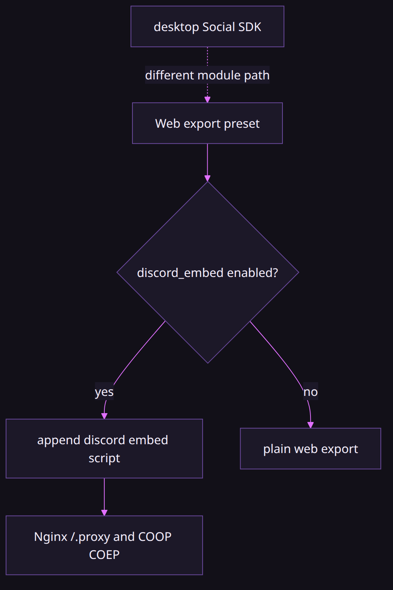
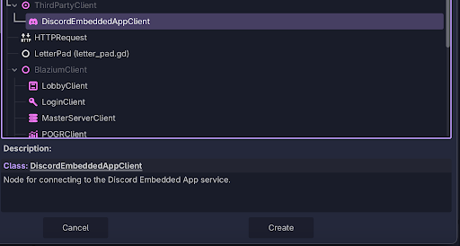
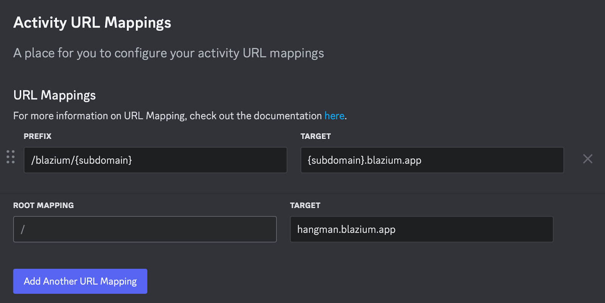
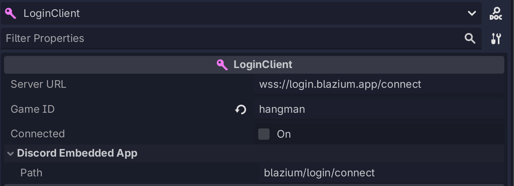
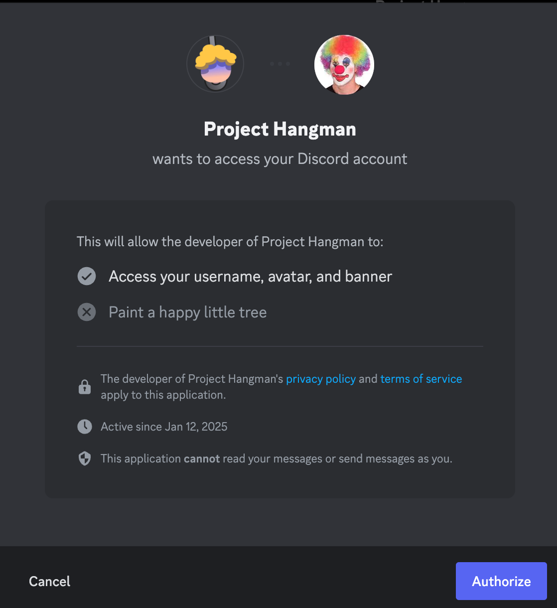

# Discord on Blazium

### Two jobs, two modules

*By Bioblaze Payne, Co-Founder of [Blazium Games](https://blazium.games)*

---

The embed work started in 2025 so Hangman could run inside a Discord voice channel without a separate install. Hangman has since shipped as a Discord app, and also on Steam, Google Play, and the Apple App Store. The Steam, Play, and Apple builds are not the thing that calls `DiscordEmbeddedAppClient`. The activity is.

A desktop build that shows presence and invites uses a different class, the `Discord` singleton, backed by the Discord Social SDK in `modules/discord_module`. The 0.6.725 notes describe that module as rich presence and social features. `initialize_presence_only` is auth-less RPC. `initialize` is the OAuth layer.


| | Embedded App | Social SDK |
|---|---|---|
| Where it runs | Web, inside the Discord client | Desktop game |
| Class | `DiscordEmbeddedAppClient` | `Discord` singleton |
| Module | `socialexports` | `discord_module` |
| Export | `Web` preset, `blazium/discord_embed/enabled` | Ordinary desktop export |
| Auth helper | `authorize` / `authenticate` | `authenticate_with_server` |
| Result type | `DiscordEmbeddedAppResult` | `DiscordAuthResult` |

`socialexports` also registers `YoutubePlayablesClient` and `ReactClient`. Those are other host pages. They are not the Social SDK. Building both Discord modules into one desktop binary does not make the embed SDK work on desktop, and the embed SDK does not replace `initialize` on desktop.

## Embedded Apps

`DiscordEmbeddedAppClient` bridges the Discord Embedded App SDK. The header notes SDK v1.9.0 (`sdk_version` defaults to `"1.9.0"`). It is a `Node`. `is_discord_environment()` is false unless the page is actually inside Discord. `is_ready` is the later gate; await `finished` on the returned `DiscordEmbeddedAppResponse`.

The web export writes `{name}.discord.embed.js` when `blazium/discord_embed/enabled` is set on the `Web` preset, and substitutes `$BLAZIUM_DISCORD_AUTODETECT` from `blazium/discord_embed/autodetect`. Those options are registered in `platform/web/export/export_plugin.cpp`. Host the files with [docker-webbuild-template](https://github.com/blazium-games/docker-webbuild-template). Nginx answers `/.proxy/` and sends `Cross-Origin-Opener-Policy: same-origin` and `Cross-Origin-Embedder-Policy: require-corp`. `docker compose up --build` serves `static/` on port 8080. Drop the exported web build into `static/`. In the Discord developer portal you create the application and set the URL mappings to that host. The engine does not create the application.

Hangman's `export_presets.cfg` already names a `Web` preset aimed at `../build/hangman/index.html`. Enabling Discord embed is a preset checkbox on top of that web export, not a separate platform row.



| Web export option | Default | Effect |
|---|---|---|
| `blazium/discord_embed/enabled` | `false` | writes `{name}.discord.embed.js` into the pack |
| `blazium/discord_embed/autodetect` | `false` | substitutes `$BLAZIUM_DISCORD_AUTODETECT` |
| `blazium/youtube_playable/enabled` | `false` | separate host path; not Discord |
| `blazium/web_headers/enabled` | `false` | optional header helpers on the same platform |

Both Discord embed and YouTube Playables share the third-party JS packing path in `platform/web/export/export_plugin.cpp`. Enabling YouTube does not enable Discord embed. Advanced options must be visible in the preset inspector to find the Discord checkboxes when they are marked advanced.





```gdscript
@export var discord: DiscordEmbeddedAppClient

func _ready() -> void:
    if not discord.is_discord_environment():
        return
    var ready: DiscordEmbeddedAppResult = await discord.is_ready().finished
    if ready.has_error():
        push_error(ready.error)
        return
    var auth: DiscordEmbeddedAppResult = await discord.authorize(
        "code", "", "none", ["identify", "guilds"]
    ).finished
    if auth.has_error():
        push_error(auth.error)
        return
    # Exchange auth data with your own backend if you need a game session.
```

That `authorize` signature is the one in the class reference: response type, state, prompt, and the scope list as an `Array`. Other methods on the same class include `authenticate`, `get_channel`, `get_channel_permissions`, `get_entitlements`, `get_instance_connected_participants`, `get_skus`, `set_activity`, `open_invite_dialog`, `open_share_moment_dialog`, `start_purchase`, `initiate_image_upload`, `open_external_link`, `set_orientation_lock_state`, and `subscribe_to_all_events`. Instance context getters cover `get_user_id`, `get_client_id`, `get_guild_id`, `get_channel_id`, `get_frame_id`, and related fields. You wait on `finished`.

### Authenticate after authorize

`authorize` returns OAuth material in `DiscordEmbeddedAppResult.data`. Exchange that with your backend (or Discord's token endpoint via your server), then call `authenticate(access_token)` so the Embedded App SDK session is established. Do not skip `is_ready` before either call.

```gdscript
func finish_embed_session(access_token: String) -> void:
    var auth: DiscordEmbeddedAppResult = await discord.authenticate(access_token).finished
    if auth.has_error():
        push_error(auth.error)
        return
    var channel: DiscordEmbeddedAppResult = await discord.get_channel(
        discord.get_channel_id()
    ).finished
    if channel.has_error():
        push_error(channel.error)
```

Purchase and entitlement helpers (`get_skus`, `get_entitlements`, `start_purchase`) only make sense after the activity application is configured for Discord monetization. `open_external_link` and `encourage_hardware_acceleration` are UI bridges into the Discord client, not browser `window.open` replacements outside the embed.

## Where LoginClient fits

`blazium-dev` does not register `LoginClient`. The screenshot below is from a Hangman scene in a build that compiled [blazium-sdk-module](https://github.com/blazium-games/blazium-sdk-module). A stock editor will not show that node. If the activity needs a session on your server, send the Discord token to an endpoint you run. The current SDK default host is `login.blazium.app`, which does answer (`{"status":"ok","success":true}`). The Server URL string in this older inspector is not that default.

Inside Discord, the SDK's `LoginClient` rewrites to `{client_id}.discordsays.com/.proxy/blazium/login` when left at the default. That rewrite is SDK code. `DiscordEmbeddedAppClient` does not do it for you. Map that path in the Discord developer portal if you use it.





## Social SDK on desktop

Use the `Discord` singleton from `discord_module`:

- `initialize_presence_only(client_id)` for rich presence without OAuth. Sets presence-only mode and emits `ready` without the full connect step.
- `initialize(client_id)` when you need friends, invites, and `authenticate_with_server`. Starts the OAuth authorization flow.
- `run_callbacks()` pumps the SDK. After `initialize` the module also runs it once per frame via the frame hook.
- `get_auth_state`, `get_access_token`, `get_username`, `get_user_id`, and `get_granted_scopes` are the reads after the player finishes OAuth (`AUTH_READY`).
- `create_or_join_lobby(secret)` is a Discord lobby. It emits `lobby_joined`. It is not `LobbyClient`.

```gdscript
func _ready() -> void:
    var err := Discord.initialize(client_id)
    if err != OK:
        push_error(err)
        return
    # Wait until get_auth_state() == Discord.AUTH_READY, then:
    var result: DiscordAuthResult = Discord.authenticate_with_server(
        backend_url, Discord.get_access_token(), client_id
    )
    if result.is_success():
        var session_jwt := result.get_jwt()
        # Keep session_jwt. Do not print it.
```

`authenticate_with_server` POSTs JSON `{"access_token": "...", "client_id": ...}` to the URL you pass and expects a JSON body with a `jwt` field. Optional fields the client also reads include identity metadata such as Discord id and username when present. That contract is what the engine client parses. It is not a published Blazium backend schema beyond that parse. Mint and verify the JWT with `JWTBuilder` (`set_issuer`, `set_subject`, `set_algorithm`, `set_expiration`, `sign`) and `JWT.parse` / `DecodedJWT`. HS256 and RS256 are the documented algorithms in `jwttool`.

Presence helpers include `clear_rich_presence` and activity invite accept/update signals. Relationship helpers (`accept_discord_friend_request`, `get_relationships`, `block_user`, and related) require OAuth, not presence-only mode.

Module tests live in [discord_module_tests](https://github.com/blazium-games/discord_module_tests) (`test_discord_auth.gd`, `test_discord_smoke.gd`).

## Integration boundaries

| Job | Use |
|---|---|
| Run inside Discord as an activity | Web export + `DiscordEmbeddedAppClient` + docker-webbuild-template |
| Rich presence / friends / invites on desktop | `Discord` singleton |
| Blazium lobby rooms without sharing peer IPs | SDK `LobbyClient` (custom module build) |
| Discord Social SDK lobby | `Discord.create_or_join_lobby` |
| Backend session JWT from Discord OAuth | `Discord.authenticate_with_server` or your own HTTP |

Hangman's Discord ship is the Embedded App path. Its Steam and mobile store builds do not imply Social SDK initialize on those packages. Demon Lord: Clicker used Discord presence as part of live-ops validation on desktop; that is the Social SDK job, not the embed client.

Do not put activity-only APIs on a desktop export, and do not expect `initialize` to hydrate an iframe inside Discord. The modules share a brand name and little else.

## Auth data flow (desktop)

1. `Discord.initialize(client_id)` starts OAuth.
2. Pump callbacks until `get_auth_state()` is `AUTH_READY`.
3. Read `get_access_token()` / `get_username()` / `get_user_id()`.
4. POST that access token through `authenticate_with_server` to your backend URL.
5. Keep `DiscordAuthResult.get_jwt()` as the game session. Verify later with `JWT` / `DecodedJWT` if the game itself must check claims.

The engine does not invent a Blazium-hosted Discord auth hostname for that POST. You own the URL. The client only requires a JSON `jwt` field on success.

### Presence-only versus OAuth surface

| Need | Call |
|---|---|
| Rich presence only | `initialize_presence_only` |
| Friends / invites / relationships | `initialize` then wait for `AUTH_READY` |
| Backend session JWT | `authenticate_with_server` after OAuth |
| Discord lobby | `create_or_join_lobby(secret)` |
| Clear activity | `clear_rich_presence` |

`get_granted_scopes` is meaningful only after OAuth. Relationship helpers such as `accept_discord_friend_request`, `get_relationships`, and `block_user` fail the mental model if you stayed in presence-only mode. Frame callbacks still matter: after `initialize`, the module hooks a per-frame `run_callbacks` pass; if you drive the SDK manually in tests, call `run_callbacks()` yourself.

## Embed host checklist

1. Export `Web` with `blazium/discord_embed/enabled` true.
2. Copy the build into `static/` of [docker-webbuild-template](https://github.com/blazium-games/docker-webbuild-template) (or an equivalent host that answers `/.proxy/` with COOP/COEP).
3. Create the Discord application and URL mappings for your activity paths.
4. Map SDK login/lobby proxy suffixes if you use those clients (`blazium/login`, `blazium/lobby/connect`, and related).
5. In the scene, guard on `is_discord_environment()`, await `is_ready`, then `authorize` / `authenticate`.

Missing step 2 with a correct export still fails inside Discord: the iframe needs the proxy and headers, not only the `.discord.embed.js` file.

## Social SDK failure cases

| Check | If it fails |
|---|---|
| `Discord.initialize(client_id)` | wrong client id, or Social SDK binary missing from the build |
| `get_auth_state() == AUTH_READY` | OAuth incomplete; do not call `authenticate_with_server` yet |
| `is_presence_only_mode` | OAuth methods are the wrong mode; re-init with `initialize` |
| HTTP body without `jwt` | your backend contract failed; engine returns error on `DiscordAuthResult` |
| `create_or_join_lobby` | Discord lobby secret/path issue; unrelated to Blazium lobby hosts |

Presence-only is enough for rich presence updates. Friends, invites, relationships, and `authenticate_with_server` need the full `initialize` path. Module tests in [discord_module_tests](https://github.com/blazium-games/discord_module_tests) cover auth and smoke cases against that singleton.

## Edge cases

- `is_discord_environment()` false outside the Discord client: guard before awaiting `is_ready`.
- Presence-only mode rejects OAuth-only calls; check `is_presence_only_mode` / auth state before `authenticate_with_server`.
- Embed JS is produced only when the Web export option is enabled; forgetting the option yields a normal web build that will not handshake.
- COOP/COEP must be present on the host; the template sets them on `/` and `/.proxy/`. YouTube Playables uses `/ytgame` without those headers for a different host rule.
- Do not expect `LoginClient` in a stock editor. Compile the SDK or talk to your own auth endpoint from the embed token.
- `create_or_join_lobby` and SDK `LobbyClient` can both exist in one custom build; they still talk to different backends.
- Leaving `client_id` unset on `DiscordEmbeddedAppClient` makes `authorize` fail before any network call.
- Desktop `Discord` and embed `DiscordEmbeddedAppClient` can both sit in one project tree; export presets decide which binary path actually runs.
- `subscribe_to_all_events` increases callback volume inside the activity; connect only the handlers you handle.
- `set_orientation_lock_state` uses the embed orientation enum constants; it does nothing on a desktop Social SDK build.

### Embed versus Social SDK auth results

| Result type | Module | Success fields to keep |
|---|---|---|
| `DiscordEmbeddedAppResult` | `socialexports` | `data` dictionary from authorize/authenticate; check `has_error()` |
| `DiscordAuthResult` | `discord_module` | `get_jwt()`, optional `get_discord_id` / `get_username` / `get_client_id` |

Do not cast across those types. An activity token is not a `DiscordAuthResult`, and a desktop OAuth access token is not an embed `authenticate` argument unless your backend minted or exchanged it for that purpose. Keep embed session code under web export autoloads and desktop Social SDK code under desktop export autoloads so a single scene does not call both without an environment guard.

## Links

- Engine: https://github.com/blazium-games/blazium
- Web host template: https://github.com/blazium-games/docker-webbuild-template
- SDK module (`LoginClient`): https://github.com/blazium-games/blazium-sdk-module
- Discord module tests: https://github.com/blazium-games/discord_module_tests
- Example Hangman: https://github.com/blazium-games/example-game-hangman
- Blazium Games: https://blazium.games

---

**[Jump into our Discord](https://blazium.app/chat)** for real-time chats, dev support and feedback

Or follow us everywhere else:

- **[GitHub](https://github.com/blazium-games)**
- **[IndieDB](https://www.indiedb.com/engines/blazium-engine)**
- **[X / Twitter](https://x.com/BlaziumGames)**
- **[YouTube](https://www.youtube.com/@blazium)**
- **[itch.io](https://blaziumengine.itch.io)**
