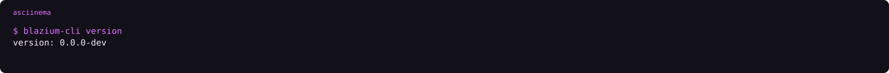
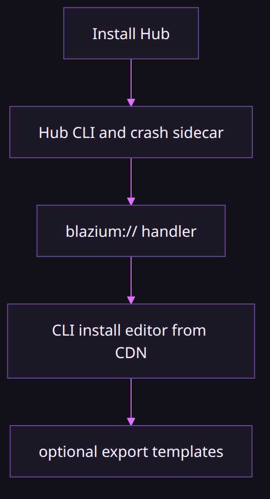
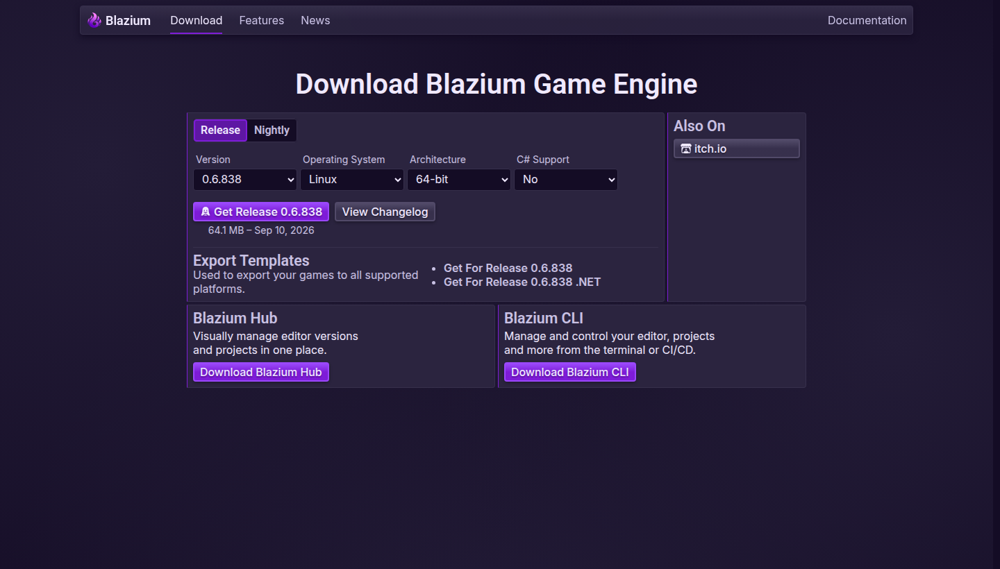

# Download Blazium and the dev tools

### One CDN, several pages, and a CLI that records what you installed

*By Bioblaze Payne, Co-Founder of [Blazium Games](https://blazium.games)*

---

Official editor builds are on [blazium.app/download](https://blazium.app/download). Hub and the CLI are on [blazium.app/dev-tools](https://blazium.app/dev-tools). Both pages point at files on `cdn.blazium.app`. We split them because the editor is the thing you make a game with, and Hub is the thing that installs that editor and, with it, the CLI and the crash sidecar.

The download page does not store binaries. It fills version lists from the CDN catalogs. When you pick a version, the button points straight at `https://cdn.blazium.app/{channel}/{version}/`. As of 11 October 2026 the release pointer is 0.6.838 and the nightly pointer is 0.6.924.


## What you are installing

The product version on the download page is Blazium `0.6.x`. That line is `blazium-dev`, compatible with Godot 4.3. Export templates follow the Blazium version, not a `4.3.2.stable` folder. Godot's download pages link at `downloads.godotengine.org`, and the editor asks `godotengine.org/mirrorlist/{version}.json`. Our download page and our CLI read the CDN. Our editor's template manager still asks `blazium.app/api/mirrorlist/`, and that live response is the GitHub release pack. The CDN mirror is the one the CLI uses, and it is what the site code is moving the editor toward.

Hub's own executable is a different binary, built from `blazium_4.8`. The editors it installs are the CDN builds. Published Hub installers and CLI binaries are Linux and Windows. There is no macOS installer in Hub's packaging tree, and no Flatpak. [blazium#428](https://github.com/blazium-games/blazium/issues/428) asks for one.


## Catalog pointers worth bookmarking

| URL | What it answers |
|---|---|
| `https://cdn.blazium.app/catalog/versions/release/latest.json` | Current release editor/templates version |
| `https://cdn.blazium.app/catalog/versions/nightly/latest.json` | Current nightly |
| `https://cdn.blazium.app/cli/cli.json` | CLI versions, download URLs, checksums |
| `https://cdn.blazium.app/catalog/tools/hub/manifest.json` | Hub installer index |
| `https://cdn.blazium.app/crash_reporter/crash_reporter.json` | Crash sidecar catalog |
| `https://cdn.blazium.app/toolchain/toolchain.json` | Toolchain catalog |
| `https://cdn.blazium.app/starters/starters.json` | Project starters |

There is no `hub/` prefix at the CDN root for installers. Hub packages are indexed from `catalog/tools/hub/`. Versioned editor zips and `.tpz` packs live under `/{channel}/{version}/` with `editors.json`, `details.json`, and friends.

## Hub and CLI

Windows Inno, Linux `.deb`. The Hub installer also installs `blazium-cli` and `crash_reporter`, so you do not download those separately. Start at [the Hub download](https://blazium.app/dev-tools/download?tool=hub). On Windows that is machine-wide under `{autopf}\Blazium`, Hub in `\Engine`, tools beside it, `blazium://` registered to the CLI.

The CLI on its own is for a terminal or a runner: GitHub Releases, `npm install -g @blazium-engine/cli`, or `https://cdn.blazium.app/cli/cli.json`. Direct page: [the CLI download](https://blazium.app/dev-tools/download?tool=cli). Optional npm platform packages skip the CDN fetch when present.



```text
asciinema play assets/cli-version.cast
```

You can unpack an editor zip by hand. The CLI is what records it in `hub.json` so Hub and `blazium-cli open` can find it:

```text
blazium-cli editors add /path/to/Blazium --version 0.6.838
blazium-cli install 0.6.838 --templates
```

`blazium-cli install <version> --templates` pulls the template pack from the CDN into the Blazium template root. A zip alone on disk is not enough for Hub to list that editor as installed.

## The rest of the dev tools

| Tool | Where it lives | When |
|---|---|---|
| Hub | installer | Making games on a desktop |
| CLI | [blazium-cli](https://github.com/blazium-games/blazium-cli) | Scripts, CI, `blazium://` |
| Docker web host | [docker-webbuild-template](https://github.com/blazium-games/docker-webbuild-template) | Serve a web export, including a Discord activity |
| setup-blazium-cli | [setup-blazium-cli](https://github.com/blazium-games/setup-blazium-cli) `v0.2.1` | Put the CLI on a runner |
| setup-blazium-engine | [setup-blazium-engine](https://github.com/blazium-games/setup-blazium-engine) `v0.3.0` | Install an editor on a runner |
| export-blazium-game | [export-blazium-game](https://github.com/blazium-games/export-blazium-game) `v0.3.2` | Export a preset |
| deploy-blazium-game | [deploy-blazium-game](https://github.com/blazium-games/deploy-blazium-game) `v0.0.2` | Push an already-exported artifact |
| Toolchain | [blazium-toolchain](https://github.com/blazium-games/blazium-toolchain) | PS1, PS2, N64, Interactive DVD |

The four Actions are separate repositories. They are not a folder inside the engine. Pin the tag. GitHub's Releases list lags the tags on setup-cli and setup-engine: the tags above exist, and the latest GitHub Release objects are older (`v0.2.0` and `v0.1.1`). `version: latest` on setup-engine tracks nightly. `latest-release` is the release channel.

Steam and itch reusable workflows inside deploy-blazium-game are deprecated. The replacement is `blazium-cli deploy steam` and `blazium-cli deploy itch`. Docker, Play, iOS, and macOS workflows in that repo are still the deploy path for those stores.


## What each page is for

| Page | Job |
|---|---|
| https://blazium.app/download | Pick an editor channel/version; link to CDN zip |
| https://blazium.app/dev-tools | Hub installer and CLI; links into Actions and Docker |
| https://cdn.blazium.app/… | Bytes and JSON catalogs every tool reads |
| https://blazium.games | Store. Not an engine download |

CI and public installs use the same CDN catalogs. The store at [blazium.games](https://blazium.games) is not this page. Store uploads are `blazium-cli games` or the standalone games CLI, not the editor zip.

## Practical install order

1. Desktop: install Hub from dev-tools. That gives you Hub, CLI, crash sidecar, and `blazium://`.
2. From Hub's Editors tab, or `blazium-cli install 0.6.838 --templates`, pull the editor and templates you will export with.
3. CI: pin `setup-blazium-engine@v0.3.0` with `version: latest-release` unless you intentionally want nightly.
4. Web host: export preset `Web`, drop files into [docker-webbuild-template](https://github.com/blazium-games/docker-webbuild-template) `static/`, then `docker compose up --build`.

If you only grab the editor zip from the download page and never run the CLI, Hub will not know that build exists until you `editors add` it.



## The download page on 11 October 2026

A capture of [blazium.app/download](https://blazium.app/download) on that date showed Release **0.6.838**, **64.1 MB**, dated **Sep 10 2026**, with controls for OS, architecture, and C#, plus links into export templates and buttons through to Hub and the CLI. Linux was selected in that capture; do not assume the page always defaults to Linux — pick the OS and architecture you need before you download.



The page is a picker over CDN catalogs, not a second host for the bytes. Choosing a version points the button at `https://cdn.blazium.app/{channel}/{version}/`. Export-template links from the same page are how you grab packs without opening Hub; the CLI path `install … --templates` or `templates download … --tpz` records them in the Blazium template root the editor actually checks (`0.6.838.release`, not a Godot `4.3.x.stable` folder).

Hub and CLI buttons leave this page for [dev-tools](https://blazium.app/dev-tools). That split is intentional: the editor zip alone does not register `blazium://` or write `hub.json`.

## Desktop vs CI download paths

| Goal | Desktop | CI runner |
|---|---|---|
| Get the CLI | Hub installer (or npm / GitHub asset) | `setup-blazium-cli@v0.2.1` or via setup-engine |
| Get an editor | Hub Editors tab or `blazium-cli install` | `setup-blazium-engine@v0.3.0` |
| Get templates | `install --templates` or `templates download --tpz` | `download_template: true` on setup-engine |
| Export a preset | Editor Export dialog | `export-blazium-game@v0.3.2` |
| Push an artifact | `blazium-cli deploy` / `games` | `deploy-blazium-game@v0.0.2` or CLI in the job |

`setup-blazium-engine` with `download_template: true` passes `--templates` on a cold install. On a cache hit it runs `blazium-cli templates download <version> --tpz` instead of re-fetching the editor zip, then exports `BLAZIUM_TEMPLATE` as the templates root. Empty `version` on setup-cli means `.latest` inside `cli.json`. `version: latest` on setup-engine means **nightly**. Those aliases are the most common mismatch between a green desktop and a red runner.

## Manual zip workflow

When you already have an editor archive and need Hub to see it:

```text
# unpack the zip somewhere stable, then:
blazium-cli editors add /path/to/Blazium --version 0.6.838
blazium-cli editors default 0.6.838
blazium-cli templates download 0.6.838 --tpz
blazium-cli open ./MyProject
```

`editors add` labels the binary with `--version` (and optional `--platform`, `--arch`, `--mono`). It does not take a channel flag; channel scoping applies to CDN installs under `{install-path}/{channel}/{version}`. Without `editors add`, the Projects tab and `open` have no registry row. Without templates in the Blazium root, export claims the pack is missing even if a Godot-shaped folder exists nearby.

Failure cases on this path:

- **Download page zip only.** Binary runs if you double-click it, but Hub's installed list stays empty until the CLI registers it.
- **Wrong template folder name.** The editor looks for `0.6.838.release` (or the nightly form), not `4.3.2.stable`.
- **Hub path in Settings points at a missing CLI.** News still loads; Install and Open fail in the tab console.
- **CI `version: latest` on setup-engine.** That alias is nightly. Desktop release 0.6.838 and a runner on 0.6.924 will disagree on templates and export output.

## Channels and what "latest" means

The download page and Hub Editors tab both speak in channels: `release`, `prerelease`, and `nightly`. Catalog pointers are per channel under `catalog/versions/{channel}/latest.json`. That is separate from CLI versioning in `cli/cli.json`, which has its own `.latest` field.

When a GitHub Action says `version: latest` on setup-engine, that alias tracks **nightly**, not release. When the same string appears as an empty CLI version on setup-cli, it means `.latest` inside `cli.json`. Those are different catalogs. Mixing them up is the usual reason a runner suddenly compiles against a newer engine than the editor on your desktop.

Nightly and release can share a version number shape (`0.6.x`) while living in different CDN prefixes. Always read the channel field in the catalog JSON you fetched, not only the semver string.

## Limits

- macOS Hub/CLI packages are not in the public packaging tree. macOS editor zips on the CDN are still installable from a CLI you build yourself or from setup-engine on a macOS runner.
- The in-editor template download path and the CLI template path are not the same mirror today.
- Action org typos in old examples (`blazium-engine/…`) are not the current repositories (`blazium-games/…`).
- Toolchain `ps3` / `ps4` names are reserved in the catalog story and do not ship as downloadable targets.

## Links

- Editor download: https://blazium.app/download
- Dev tools: https://blazium.app/dev-tools
- Release catalog: https://cdn.blazium.app/catalog/versions/release/latest.json
- CLI manifest: https://cdn.blazium.app/cli/cli.json
- Hub manifest: https://cdn.blazium.app/catalog/tools/hub/manifest.json
- Blazium Games: https://blazium.games

---

**[Jump into our Discord](https://blazium.app/chat)** for real-time chats, dev support and feedback

Or follow us everywhere else:

- **[GitHub](https://github.com/blazium-games)**
- **[IndieDB](https://www.indiedb.com/engines/blazium-engine)**
- **[X / Twitter](https://x.com/BlaziumGames)**
- **[YouTube](https://www.youtube.com/@blazium)**
- **[itch.io](https://blaziumengine.itch.io)**
