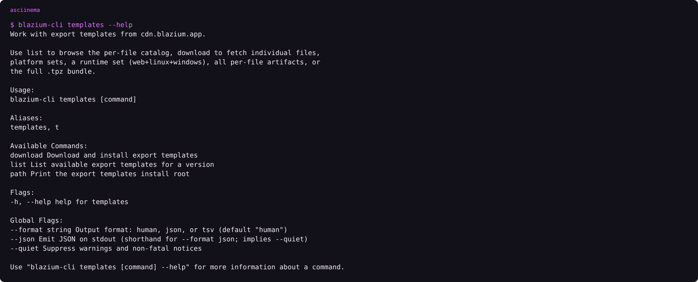

# Export templates and the CDN

### Same bits, two download paths, and a version folder Godot will not recognize

*By Bioblaze Payne, Co-Founder of [Blazium Games](https://blazium.games)*

---

A Blazium editor will not export with a Godot template pack, and a Godot editor will not export with ours. The version string inside the pack has to match the editor that is running. Godot looks for a folder like `4.4.1.stable` and asks [godotengine.org/mirrorlist](https://godotengine.org/mirrorlist/4.4.1.stable.json), which today points at `downloads.godotengine.org`. Blazium looks for `{version}.{channel}`, for example `0.6.838.release`, and the string in `version.txt` inside the `.tpz` is that same value. `.mono` is appended for the .NET pack.

We publish those packs to `cdn.blazium.app` so Hub, the CLI, and the website can share one copy. The editor does not read that copy yet.


## What the editor does today

`version.py` on `blazium-dev` sets `mirror_list` to `https://blazium.app/api/mirrorlist/`. The Export Template Manager requests `{mirror_list}{version}.{channel}.json`. A `.mono` suffix selects the .NET pack.

On 11 October 2026, [the 0.6.838 release list](https://blazium.app/api/mirrorlist/0.6.838.release.json) returned one mirror, named "Github Blazium Templates Mirror", pointing at the GitHub release asset. The matching [details.json](https://cdn.blazium.app/release/0.6.838/details.json) on the CDN already lists the CDN URL first and the GitHub release second. The handler in [blazium.app](https://github.com/blazium-games/blazium.app) (`templates.go`) reads `details.json` and would emit that order. Production is still serving the GitHub-only list. Until that site update is what you get from the API, the editor downloads templates from GitHub.

The download button is gated on the Godot-side `status` field in `version.py`, not on our channel stamp. On `blazium-dev` that field is `stable`, so release, prerelease, and nightly editors all offer the download. On `blazium_4.8` the field is `dev`, and a bare `dev` status hides the in-editor download. That line is not what the CDN is shipping as 0.6.x.


## What the CLI does

```text
blazium-cli install 0.6.838 --templates
blazium-cli templates list
blazium-cli templates list 0.6.838 --platform web
blazium-cli templates download 0.6.838 --tpz
blazium-cli templates download nightly --runtime --variant release
blazium-cli templates download 0.6.838 --platform android
blazium-cli templates path
```

`install --templates` uses the CDN `.tpz`. Individual file helpers try, in order:

1. `https://cdn.blazium.app/{channel}/{version}/template_files.json`
2. `…/templates.json`
3. `…/details.json`
4. Cerebro, only if `BLAZIUM_CEREBRO_URL` is set

Hub never calls Cerebro. The CLI's template channel is `nightly` or `release`. A prerelease editor version is fetched from the `release` prefix unless the nightly flag is set.

Download requires exactly one mode:

| Mode | Flag | Result |
|---|---|---|
| Full pack | `--tpz` | Classic `.tpz` into the templates root |
| One file | `--file NAME` (repeatable) | Named catalog entries |
| Platform set | `--platform web` (etc.) | All per-file entries for that platform |
| Runtime set | `--runtime` | web + linux + windows for `--variant` |
| Everything | `--all` | Every per-file catalog entry |

`--variant` is `debug` or `release` (default `BLAZIUM_TEMPLATE_VARIANT` or `release`). `--mono` is a second `.tpz` / preference for mono catalog rows. It is not a different version number. `--only-missing` skips files already present. `--dest` overrides the OS root.

On Windows the install root is `%LOCALAPPDATA%\Blazium\export_templates`. On Unix it is `~/.local/share/blazium/export_templates`. Override with `BLAZIUM_EXPORT_TEMPLATES_DIR`.



```text
asciinema play assets/cli-templates-help.cast
```

## What a pack contains

Each platform has a debug template and a release template. The web preset is named `Web`. These flags live on that preset, not in a separate product:

- `blazium/discord_embed/enabled` and `blazium/discord_embed/autodetect`
- `blazium/youtube_playable/enabled`
- `blazium/export_gzip_compressed_wasm/enabled`
- `blazium/export_gzip_compressed_wasm/keep_uncompressed_wasm`

`get_name()` for that platform is `Web`. A GitHub Actions `platform-name` has to match the preset name in `export_presets.cfg`, so the string is `Web`. Discord embed appends `{name}.discord.embed.js`. YouTube Playables appends `{name}.youtube.playables.js`. Gzip WASM is what the Docker host's `gzip_static` path expects.

If the editor is `0.6.838` and the only templates on disk sit under a Godot `4.3.2` path, the export dialog will say the templates are missing. `blazium-cli install 0.6.838 --templates` is the command that puts them in the folder this editor checks.

## What lands on the CDN

Storage is served at `https://cdn.blazium.app`. Versioned downloads live at `/{channel}/{version}/`: editor zips, `editors.json`, both `.tpz` packs, `details.json`, `template_files.json`, and the changelog. The catalog pointer is `catalog/versions/{channel}/latest.json`, not a copy of `editors.json` under `catalog/`.

| Prefix | Contents |
|---|---|
| `/{channel}/{version}/` | Editor builds and template manifests |
| `/cli/` | CLI binaries and `cli.json` |
| `/crash_reporter/` | Sidecar catalog `crash_reporter.json` |
| `/toolchain/` | `toolchain.json` |
| `/starters/` | `starters.json` project starters |
| `/articles/` | Hub News (`rss.xml`, bbcode, assets) |
| `/catalog/versions/{channel}/` | `latest.json` for that channel |
| `/catalog/tools/hub/` | Hub installer manifest |
| `/pipeline/` | Internal SDK/Xcode artifacts used by CI |

There is no `hub/` prefix at the CDN root. Hub installers are indexed from `catalog/tools/hub/manifest.json`.


Per-engine-line catalog keys (`catalog/versions/{channel}/{line}/latest.json`) are in the deploy pipeline and are not what every older object on the bucket uses yet. New deploys are what fill them. Do not script against a path that 404s until you have seen it for the version you want. Hub's CDN client understands `blazium-dev` and `blazium_4.8` as engine-line references when those keys exist.

## Two consumers, one truth

| Consumer | How it finds templates | Host it hits today |
|---|---|---|
| Editor Export Template Manager | `mirror_list` + `{version}.{channel}.json` | `blazium.app` → GitHub asset |
| `blazium-cli` / Hub install | `template_files.json` → `templates.json` → `details.json` | `cdn.blazium.app` |
| Website download buttons | Catalog `latest.json` → version folder | `cdn.blazium.app` |

The `.tpz` bytes on GitHub and on the CDN for a given version are meant to be the same publish. The split is the discovery path, not a second pack format. Prefer the CLI for automation. Prefer the in-editor button only when you are already inside that editor and accept the live mirror list.

## How CI installs the same packs

[setup-blazium-engine](https://github.com/blazium-games/setup-blazium-engine) at `v0.3.0` passes `--templates` into `blazium-cli install` when `download_template: true`. On a cache hit it calls `blazium-cli templates download <version> --tpz` instead of re-fetching the editor zip. The action then exports `BLAZIUM_TEMPLATE` as the templates root (`blazium-cli templates path`, or the OS default). The separate `export-blazium-game` action expects `android_source.zip` directly under that root for Android exports and writes `android/.build_version` as `{version}.release` or the nightly form with `-` turned into `.`.

That is the same folder layout a desktop CLI install creates. There is no parallel "Actions-only" template tree.

## Limits

- Prerelease editors do not get a third template CDN prefix; templates resolve as release unless nightly is set.
- Cerebro is not a public dependency. Leave `BLAZIUM_CEREBRO_URL` unset outside our build network.
- A Godot template folder name will never satisfy a Blazium editor's version check.
- Production `api/mirrorlist/` may lag the CDN `details.json` order until the site deploy that prefers CDN lands.
- Per-file downloads (`--platform`, `--runtime`, `--file`) need a working `template_files.json` (or a parseable fallback). If only a `.tpz` exists for that version, use `--tpz`.

## Links

- Download page: https://blazium.app/download
- Release catalog: https://cdn.blazium.app/catalog/versions/release/latest.json
- Release details.json: https://cdn.blazium.app/release/0.6.838/details.json
- Live mirror list: https://blazium.app/api/mirrorlist/0.6.838.release.json
- Template manager: https://github.com/blazium-games/blazium/blob/blazium-dev/editor/export/export_template_manager.cpp
- CLI: https://github.com/blazium-games/blazium-cli
- Blazium Games: https://blazium.games

---

**[Jump into our Discord](https://blazium.app/chat)** for real-time chats, dev support and feedback

Or follow us everywhere else:

- **[GitHub](https://github.com/blazium-games)**
- **[IndieDB](https://www.indiedb.com/engines/blazium-engine)**
- **[X / Twitter](https://x.com/BlaziumGames)**
- **[YouTube](https://www.youtube.com/@blazium)**
- **[itch.io](https://blaziumengine.itch.io)**
