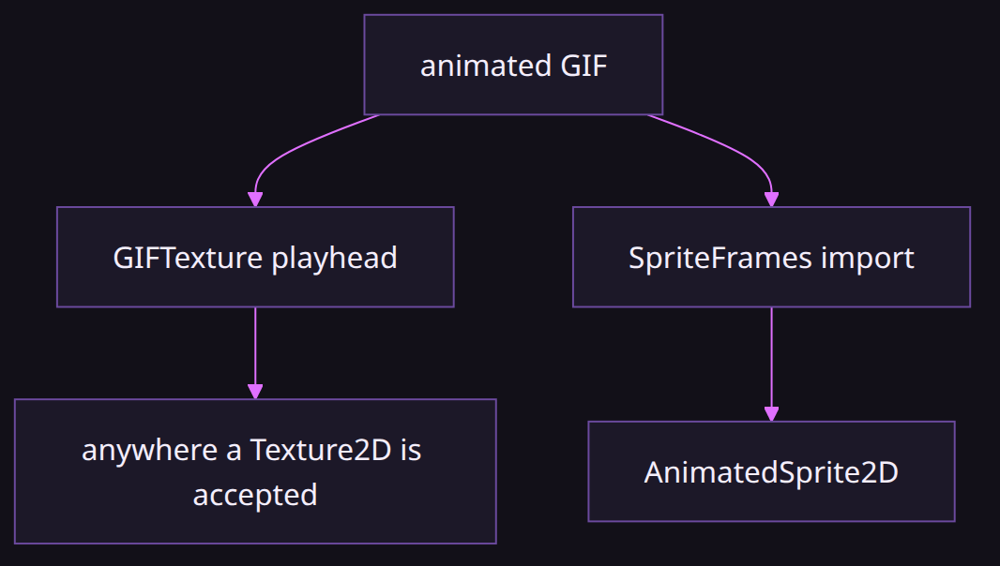
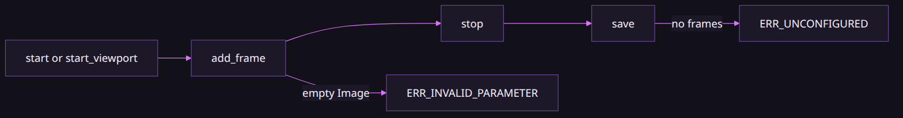

# GIF import and recording

### A texture with a clock, not a video codec

*By Bioblaze Payne, Co-Founder of [Blazium Games](https://blazium.games)*

---

Godot will import an image. It will not treat an animated GIF as a `Texture2D` you can drop on a sprite. `modules/gif` is the native path: decode on import, play as a texture, encode again from a viewport or from the engine movie recorder. Demon Lord: Clicker validated the engine's 2D side, but it does not use this module yet; GIF textures are a separate in-house validation target rather than a shipped-game claim.

The module is always built. `can_build` and `is_enabled` both return true. It is in the editor and in export templates. There is no CDN package for it. It will not grow into a video codec. The encoder is a palette path. `MovieWriterGIF` accepts the movie-writer audio callback and does not encode audio.


## Import as GIFTexture

Copy a `.gif` into the project. `ResourceImporterGIF` produces a `GIFTexture`. Assign it to `Sprite2D`, `Sprite3D`, `TextureRect`, a material, or a shader uniform. `GIFTexture` is a `Texture2D`. Runtime loaders also accept the format: `ImageLoaderGIF` and `ResourceFormatLoaderGIF` are registered with the module, and `ResourceSaverGIF` writes `.gif` back out, so scripted `load` / `ResourceSaver.save` paths work without opening the Import dock.

`resource_local_to_scene` defaults to true (`set_local_to_scene(true)` in the constructor), so each scene instance has its own playhead. Use Make Unique when two nodes in the same scene must not share one.

Importer options:

| Option | Default | Notes |
|---|---|---|
| `autoplay_on_load` | `true` | Matches `GIFTexture.autoplay_on_load` |
| `loop_count` | `0` | Netscape loop; `0` = forever |
| `speed_scale` | `1.0` | Negative = reverse |
| `dither` | `true` | Baking / encode edges |
| `display_mode` | `0` Source | `1` = Baked |
| `bake_compress` | `false` | Compress baked frames |
| `bake_storage` | `1` Generate On Load | `0` = Store |

Canvas and frame caps are Project Settings: `blazium/gif/max_canvas_pixels` (default `16777216`) and `blazium/gif/max_frames` (default `4096`). Over the cap, import fails with `ERR_OUT_OF_MEMORY`.

## Import as SpriteFrames



Select **SpriteFrames** in the Import dock’s Import As dropdown to use `ResourceImporterGIFFrames`. That path decodes into a `SpriteFrames` resource with animation name `default`, suitable for `AnimatedSprite2D` and `AnimationPlayer`. Prefer the default `GIFTexture` importer when you want a texture on Sprite2D or a material.

| Goal | Path |
|---|---|
| Drop on `Sprite2D` / material / shader uniform | Default `ResourceImporterGIF` → `GIFTexture` |
| Drive `AnimatedSprite2D` / `AnimationPlayer` | Import As `SpriteFrames` via `ResourceImporterGIFFrames` |
| Convert an existing `SpriteFrames` to a GIF | `GIFTexture.from_sprite_frames(frames, &"default")` then `save_to_path` |
| Convert a `GIFTexture` back to frames | `gif.to_sprite_frames(&"default")` |

The two importers share decode caps (`max_canvas_pixels`, `max_frames`) but produce different resource types. Switching Import As reimports; it does not keep a dual representation unless you also call the conversion helpers in script.

## Playback

`play` defaults to false. `loop` defaults to true. `autoplay_on_load` defaults to true. Netscape loop counts are honored while `loop` is true (`netscape_loop_count` of `0` means forever). Non-looping playback clears `play` when finished; setting `play` again restarts from frame 0. `speed_scale` defaults to `1.0`; negative values play in reverse. `current_frame` is the visible index; `wrap_frame` maps an arbitrary index into range.

```gdscript
var gif: GIFTexture = load("res://sprites/coin.gif")
$Sprite2D.texture = gif
gif.play = true
gif.loop = true
gif.speed_scale = 1.0
```

Useful getters and helpers:

```gdscript
var n := gif.get_frame_count()
var delay_cs := gif.get_frame_delay(0)
var delay_sec := gif.get_frame_delay_sec(0)
var tex: Texture2D = gif.get_active_texture(0)
var baked: Image = gif.get_baked_image(0)
var src: Image = gif.get_source_image(0)
```

Delay on `add_source_frame` is in centiseconds (default `10`). Disposal and position arguments match `GIFTexture.Disposal` and canvas offset. Call `bake_frames()` after editing source frames when you need composited full-canvas frames.

```gdscript
var from_frames := GIFTexture.from_sprite_frames(frames, &"default")
var back := gif.to_sprite_frames(&"default")
var err := gif.save_to_path("user://coin_out.gif")
```

`load_from_path` / `load_from_buffer` replace all frames on an existing texture. Signals: `frames_changed`, `rebaked`.

## Record a timed clip

```gdscript
var err := GIFRecorder.record_viewport($SubViewport, "user://clip.gif", 4.0, 12)
if err != OK:
	push_error(err)
```

`record_viewport` is static. Arguments: viewport, output path, duration in seconds, fps (C++ default `12`).

## Recorder states



A `GIFRecorder` instance moves through a small state set: idle → recording (after `start_viewport` / `start_window` / `start_screen` or while a timed `record_viewport` runs) → finished (`stop` emits `recording_finished` with a `GIFTexture`). `paused` skips new frames while true without ending the session. `is_recording()` is true while a timed or started capture is active.

| Transition | Call | Notes |
|---|---|---|
| Idle → recording | `start_viewport` / `start_window` / `start_screen` | Or static `record_viewport` for a timed clip |
| Recording → paused | `paused = true` | Frames are skipped, session stays open |
| Recording → finished | `stop()` | Returns `GIFTexture`; signal carries `(animation, path)` |
| Finished → disk | `save(path)` | `ERR_UNCONFIGURED` if no frames were captured |

Sources are `SOURCE_VIEWPORT` (`0`), `SOURCE_WINDOW` (`1`), and `SOURCE_SCREEN` (`2`). Manual `add_frame(image)` is for tests and custom pipelines; empty images reject with `ERR_INVALID_PARAMETER`. Hitting `max_frames` (or the project default when `max_frames` is `0`) returns `ERR_OUT_OF_MEMORY`.

## Record with start / stop

```gdscript
var rec := GIFRecorder.new()
rec.fps = 12
rec.loop_count = 0
rec.dither = true
rec.max_size = Vector2i(480, 270)
rec.max_frames = 0 # 0 → blazium/gif/max_frames

rec.recording_finished.connect(func(animation: GIFTexture, path: String) -> void:
	prints("finished", animation.get_frame_count(), path)
)

var start_err := rec.start_viewport($SubViewport)
# or: rec.start_window()
# or: rec.start_screen(0)
# or: rec.add_frame(some_image)

# later:
var anim: GIFTexture = rec.stop()
if anim:
	rec.save("user://manual.gif")
```

| Member / API | Default / notes |
|---|---|
| `fps` | `12` |
| `loop_count` | `0` (infinite) |
| `dither` | `true` |
| `max_frames` | `0` → project setting |
| `max_size` | `Vector2i(480, 270)`; `(0,0)` disables |
| `paused` | Skip new frames while true |
| `is_recording()` | Timed / started capture active |
| Sources | `SOURCE_VIEWPORT` `0`, `SOURCE_WINDOW` `1`, `SOURCE_SCREEN` `2` |

`add_frame` rejects an empty `Image` with `ERR_INVALID_PARAMETER`. Hitting `max_frames` returns `ERR_OUT_OF_MEMORY`. `save` without frames returns `ERR_UNCONFIGURED`. Headless SubViewports may produce zero frames; `stop` must still complete cleanly.

## Project hotkey capture

A Project Settings hotkey toggles capture when `blazium/gif/capture_hotkey` is not zero. The default is zero, so nothing is bound until you set a physical key code. `blazium/gif/capture_source` is Viewport (`0`) or Window (`1`). Files go to `blazium/gif/capture_output_dir` (default `user://`) as `capture_<ticks_msec>.gif`.

The hotkey path runs in the game (`Engine.is_editor_hint()` returns early). Editor capture goes through `GIFEditorPlugin` and advances on `SceneTree.process_frame`. The module is not tools-only; the same recorder classes exist in export templates.

## Movie writer

`MovieWriterGIF` registers GIF as a movie-writer target. Use it when the engine’s built-in movie recorder should write a `.gif` without calling `GIFRecorder`. It reports extension `gif`, default-internal fps of `12` for delay math (`delay_cs = max(1, round(100/fps))`), and drops audio. `write_begin` rejects canvases over `blazium/gif/max_canvas_pixels`. `write_frame` rejects once `blazium/gif/max_frames` is reached.

Keep the fps in the 10 to 15 range and keep the clip short. A long full-screen capture hits `max_frames` or `max_canvas_pixels` and the encode fails.

## Edge cases worth coding for

- Import fails hard when width×height exceeds `blazium/gif/max_canvas_pixels` or when frame count exceeds `blazium/gif/max_frames`. Raise the settings only if you accept the memory cost.
- `GIFRecorder.max_frames = 0` defers to the project setting; set a positive value to clamp one recorder instance tighter than the project default.
- `max_size` downscales before encode. `(0, 0)` disables that gate—easy to blow the canvas cap on a 1080p window capture.
- Empty `Image` to `add_frame` → `ERR_INVALID_PARAMETER`. `save` with no frames → `ERR_UNCONFIGURED`.
- Hotkey capture writes under `capture_output_dir` and ignores the editor hint path; bind a key only in game builds where you want that behavior.
- Movie writer and recorder share palette encode and project caps. Neither records audio into the GIF.
- Headless SubViewports may produce zero frames; call `stop` anyway so the session closes cleanly.
- `recording_finished` is typed with `GIFTexture` in this tree (not the older `GIFAnimation` name still present in public tests).
- `MovieWriterGIF.write_begin` rejects canvases over `max_canvas_pixels`; `write_frame` stops once `max_frames` is reached.

## Test-suite status

The public [gif_module_tests](https://github.com/blazium-games/gif_module_tests) suite still expects the older `GIFAnimation` and `GIFSprite2D` surface, including a recorder signal typed with `GIFAnimation`. The current engine binds recorder results as `GIFTexture`, so that suite is stale against `blazium-dev` and is not proof for the API documented here. Verify current behavior against this tree's `GIFTexture` and `GIFRecorder` class XML and ClassDB. Editor import UI, Movie Maker `--write-movie`, the capture hotkey, and window/screen grab still need manual coverage. When writing new Autowork cases, assert on `GIFTexture` frame counts from `stop()` / `recording_finished`, not on the retired type names. Import and record are the steps this article covers; the texture model itself is the companion topic.

## Links

- Module: https://github.com/blazium-games/blazium/tree/blazium-dev/modules/gif
- Tests: https://github.com/blazium-games/gif_module_tests
- Engine: https://github.com/blazium-games/blazium
- Blazium Games: https://blazium.games

---

**[Jump into our Discord](https://blazium.app/chat)** for real-time chats, dev support and feedback

Or follow us everywhere else:

- **[GitHub](https://github.com/blazium-games)**
- **[IndieDB](https://www.indiedb.com/engines/blazium-engine)**
- **[X / Twitter](https://x.com/BlaziumGames)**
- **[YouTube](https://www.youtube.com/@blazium)**
- **[itch.io](https://blaziumengine.itch.io)**
