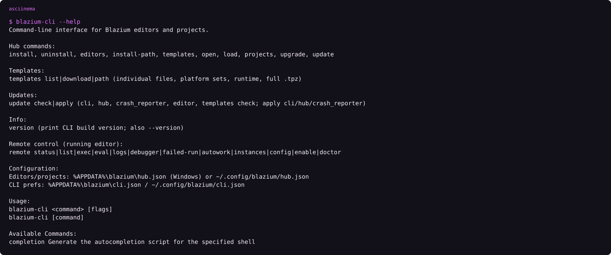

# GitHub Actions for Blazium

### Pin the tag you mean to run

*By Bioblaze Payne, Co-Founder of [Blazium Games](https://blazium.games)*

---

In 2025 we published the CLI, a deploy path, and a set of GitHub Actions next to Hangman. Hangman later shipped on Steam, Discord, Google Play, and the Apple App Store. Those storefronts are how export and deploy were checked. They do not mean each store build called the same workflow file.

The public actions are four repositories. They are not a folder in the engine. CI talks to the CDN through [blazium-cli](https://github.com/blazium-games/blazium-cli).


| Action | Tag to pin | Job |
|---|---|---|
| [setup-blazium-cli](https://github.com/blazium-games/setup-blazium-cli) | `v0.2.1` | Download the CLI from `cdn.blazium.app/cli/cli.json` and put it on `PATH` |
| [setup-blazium-engine](https://github.com/blazium-games/setup-blazium-engine) | `v0.3.0` | `blazium-cli install`, optional templates |
| [export-blazium-game](https://github.com/blazium-games/export-blazium-game) | `v0.3.2` | Export a preset |
| [deploy-blazium-game](https://github.com/blazium-games/deploy-blazium-game) | `v0.0.2` | Push an already-exported artifact |

`v0.2.1` and `v0.3.0` are git tags. The latest GitHub Release objects for those two repos are older (`v0.2.0` and `v0.1.1`). Pin the tag the action README uses, not whatever the Releases page calls Latest, until you have read the newer tag. Older examples that say `blazium-engine/export-blazium-game@master` use the former organization path. The current export action also self-checks out that old path, which GitHub redirects today. Prefer `blazium-games/…` and a version tag in new workflows.



```text
asciinema play assets/cli-help.cast
```

## A workflow

```yml
name: export
on: [push]
jobs:
  linux:
    runs-on: ubuntu-latest
    steps:
      - uses: actions/checkout@v4
      - uses: blazium-games/setup-blazium-engine@v0.3.0
        with:
          version: latest-release
          download_template: true
      - name: Autowork
        run: "${BLAZIUM_EDITOR} --headless --path . -s run_tests.gd"
      - uses: blazium-games/export-blazium-game@v0.3.2
        with:
          blazium-version: latest-release
          game-name: MyGame
          platform-name: Linux x86_64
```

`setup-blazium-engine` calls `setup-blazium-cli` for you. After a successful install it exports `BLAZIUM_EDITOR`, `BLAZIUM_EDITOR_BIN`, `BLAZIUM_INSTALLED_VERSION`, `BLAZIUM_INSTALL_PATH`, and `BLAZIUM_TEMPLATE`.

## setup-blazium-cli inputs

| Input | Default | Meaning |
|---|---|---|
| `version` | empty | CLI semver; empty uses `.latest` from the manifest |
| `manifest-url` | `https://cdn.blazium.app/cli/cli.json` | Override only if you host a mirror |
| `downloads-path` | `downloads` | Directory added to `PATH` |

The action resolves runner OS to `linux` / `windows` / `darwin`, prefers host arch, and falls back to `x86_64` when the preferred arch is missing from the manifest. It verifies SHA-256 when the manifest entry has one, then runs `blazium-cli --version`.

## Version input on setup-engine

`setup-blazium-engine` `version` defaults to `latest`.

| Input | Meaning |
|---|---|
| `0.6.838` | That release |
| `latest-release` | Highest version on the release channel |
| `nightly`, `latest`, `latest-nightly` | Nightly channel. `latest` is nightly |
| `0.6.924-nightly` | That nightly |
| `latest-0.6` | Highest 0.6.x across nightly and release |
| `latest-release-0.6` | Highest 0.6.x on release |
| `lts` / `latest-lts` | Passed through as install spec `lts` |

If you wanted a release and you wrote `latest`, you get a nightly. Templates install under the Blazium version, not Godot `4.3.2.stable`.

Other inputs: `download_editor` (default true), `download_template` (default false), `download_mono`, `platform`, `arch`, `use-cache`, `cli-version`, `bin-path` (default `bin`). The cache key includes the resolved version, platform, arch, and whether Mono was requested. Changing only the game source does not invalidate that cache. On a cache hit the action re-registers the binary with `blazium-cli editors add` and still fetches templates when `download_template` is true.

CLI only:

```yml
- uses: blazium-games/setup-blazium-cli@v0.2.1
- run: blazium-cli install 0.6.838 --templates --json --quiet
```

## Export: platform-name and secrets

`platform-name` must match the export preset name. The action rewrites `export_presets.cfg` from its own copy. Known mappings inside the action:

| `platform-name` | Artifact shape |
|---|---|
| `Windows Desktop x86_64` / `x86_32` / `arm64` / `arm32` | `.exe` |
| `Linux x86_64` / `x86_32` | `.x86_64` / `.x86_32` |
| `macOS` | `.app` |
| `iOS` | `.xcarchive` → `.ipa` |
| `Android` | `.aab` |
| `Web` | `index.html` under `build/` |

The web preset's `get_name()` is `Web`. Desktop names are whatever you keep in `export_presets.cfg`. Apple and Android signing secrets stay empty until you export a store build. Windows export on Linux installs Wine and rcedit and writes Godot editor settings for those paths. Android without a keystore does `--export-debug`; with a keystore it does `--export-release`.

Required inputs: `game-name`, `platform-name`. Optional: `blazium-version` (default `latest`), package ids, Apple/Android secret blobs, `steam-app-id` + `store-name: steam`, `base-game-version`, `use-cache`.

## Deploy

Deploy runs on an artifact from export. Workflows in [deploy-blazium-game](https://github.com/blazium-games/deploy-blazium-game):

| Workflow | Status |
|---|---|
| `deploy-docker.yml` | Active. Expects artifact preset name `Web` |
| `deploy-android.yml` | Active (Play) |
| `deploy-ios.yml` | Active |
| `deploy-macos.yml` | Active |
| `deploy-steam.yml` | Deprecated → `blazium-cli deploy steam` |
| `deploy-itchio.yml` | Deprecated → `blazium-cli deploy itch` |

Docker call shape from the README:

```yml
deploy-docker:
  uses: blazium-games/deploy-blazium-game/.github/workflows/deploy-docker.yml@v0.0.2
  with:
    artifact-name: Web
    docker-registry: registry.digitalocean.com
    registry-path: org-name/image-name
  secrets:
    docker-username: ${{ secrets.DOCKER_USERNAME }}
    docker-token: ${{ secrets.DOCKER_TOKEN }}
```

That workflow clones the webbuild template, drops the artifact into `static/`, and build-pushes with tags `latest` and `${{ github.sha }}`.

Steam / itch from the CLI instead:

```text
blazium-cli deploy steam upload
blazium-cli deploy itch push ./build --target user/game:windows
```

Credentials: `BLAZIUM_STEAM_*`, `BLAZIUM_BUTLER_API_KEY`, or `blazium-deploy.yml`. `deploy steam guard setup` is interactive. Do not put it in a job.

Do not paste secrets into the workflow file in a way that lands in the log. The kinds are Apple certificates, an Android keystore, a butler API key, a Docker token, and Steam publisher credentials.

## Headless checks

Headless Autowork is `"$BLAZIUM_EDITOR" --headless --path . -s run_tests.gd`. If an editor is already up with remote control, `blazium-cli remote autowork run --wait` talks to `127.0.0.1:6508`. Eval stays off unless `blazium/remote_control/allow_eval` is set. Port 6507 is the game JustAMCP default. Do not point the CLI at it.

## Environment exports after setup-engine

| Variable | Meaning |
|---|---|
| `BLAZIUM_EDITOR` | PATH-facing editor binary for later steps |
| `BLAZIUM_EDITOR_BIN` | Absolute path inside the Hub install tree |
| `BLAZIUM_INSTALLED_VERSION` / `version_latest` | Concrete resolved version |
| `BLAZIUM_INSTALL_PATH` | Editors root from `blazium-cli install-path` |
| `BLAZIUM_TEMPLATE` | Export templates root |

Use `"${BLAZIUM_EDITOR}" --headless …` rather than assuming `Blazium` is already on `PATH` from a previous job. Each job that needs the editor should run setup again or restore the cache the action manages.

macOS CDN zips are universal and named `*_macos.zip`. When `platform` is `macos` and `arch` is empty, setup-engine sets arch to `macos` so the CLI can match that filename token. Nested `.zip` leftovers from older packages are extracted before the action exports `BLAZIUM_EDITOR`.

## Limits

- Pin tags. Floating `@master` and the wrong org name are how old Hangman snippets rot.
- `latest` on setup-engine is nightly on purpose.
- export-blazium-game still vendors its own `export_presets.cfg` into the job; treat that as part of the contract when you customize presets.
- Steam and itch reusable workflows remain in the deploy repo as deprecated files; new jobs should call the CLI.
- setup-cli may select `darwin` as a platform string, but published CLI builds are Linux and Windows. A macOS runner only succeeds if the manifest you pointed at actually has a darwin entry, or you bring your own binary.

## Links

- setup-blazium-cli: https://github.com/blazium-games/setup-blazium-cli
- setup-blazium-engine: https://github.com/blazium-games/setup-blazium-engine
- export-blazium-game: https://github.com/blazium-games/export-blazium-game
- deploy-blazium-game: https://github.com/blazium-games/deploy-blazium-game
- CLI: https://github.com/blazium-games/blazium-cli
- Blazium Games: https://blazium.games

---

**[Jump into our Discord](https://blazium.app/chat)** for real-time chats, dev support and feedback

Or follow us everywhere else:

- **[GitHub](https://github.com/blazium-games)**
- **[IndieDB](https://www.indiedb.com/engines/blazium-engine)**
- **[X / Twitter](https://x.com/BlaziumGames)**
- **[YouTube](https://www.youtube.com/@blazium)**
- **[itch.io](https://blaziumengine.itch.io)**
