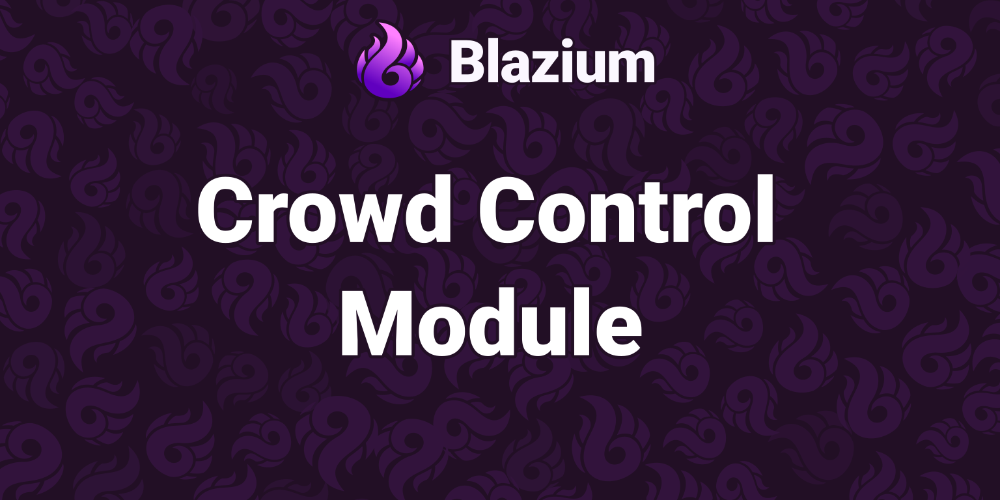

# Luau scripting in Blazium

### `.luau` next to GDScript, registered with the script server

*By Bioblaze Payne, Co-Founder of [Blazium Games](https://blazium.games)*

---



`modules/luau_module` registers Luau as a first-class script language in Blazium. You attach `.luau` or `.lua` files to nodes the same way you attach GDScript. Compiled `.luauc` sidecars load through the same resource loader. The module is marked experimental in class docs (`LuauScript`, `LuauScriptLanguage`, `LuaState`, `Luau`, and related types carry the experimental flag).

This is not a claim about beating GDScript on every frame. It is a second language path with a documented VM API (`LuaState`), a compiler utility (`Luau.compile`), two script syntaxes exercised by Autowork fixtures, and export options for bytecode. Use it when your team wants Luau syntax and engine bindings in the same project as GDScript.

## Build and enablement

`can_build` returns true for normal editor and template builds. Exceptions documented in `config.py`:

- On `linuxbsd` with the `mold` linker plus ASan or UBSan, the module is skipped (linker relocation overflow on large editor binaries).
- Codegen / JIT (`module_luau_module_codegen`) defaults on for `x86_64` / `arm64` on windows, linuxbsd, macos, android, and ios. It is forced off for web and unsupported arches.
- Analysis (`module_luau_module_analysis`) defaults on for editor builds only.
- Web builds enable `LUAU_MODULE_WEB_BRIDGE_ENABLED` and turn on C++ exceptions for Luau (Emscripten cannot mix `-fno-exceptions` with Luau TUs).

SCons knobs:

```text
module_luau_module_enabled=yes
module_luau_module_codegen=yes   # native CodeGen where supported
module_luau_module_analysis=yes # lint / typecheck in editor
```

The Autowork suite at [luau_module_tests](https://github.com/blazium-games/luau_module_tests) builds with `module_luau_module_enabled=yes` and `module_autowork_enabled=yes`.

## What registers

At `MODULE_INITIALIZATION_LEVEL_SERVERS` the module registers:

| Class | Role |
|---|---|
| `Luau` | Static `compile`, `clock`, status constants |
| `LuaCompileOptions` | `optimization_level`, `debug_level`, `coverage_level`, `type_info_level` |
| `LuaState` | Embedded VM |
| `LuaDebug` | Debugger helpers |
| `LuauScript` | Script resource (`.luau` / `.lua` / `.luauc`) |
| `LuauScriptLanguage` | `ScriptLanguage` on the script server |
| `LuauSignalWaiter` | Signal wait support |
| `ResourceFormatLoaderLuau` / `ResourceFormatSaverLuau` | Resource I/O |

Editor-only: `LuauSyntaxHighlighter`, `LuauFormatter`, `EditorExportLuau`, `LuauEditorPlugin`, `LuauLanguageServerPlugin`, and (unless `LUAU_NO_LSP`) `LuauLanguageProtocol`, `LuauTextDocument`, `LuauWorkspace`.

`LuauScriptLanguage::get_extension()` returns `"luau"`. The loader also accepts `"lua"` and `"luauc"`.

## Script forms

Two authoring styles are covered by fixtures under `fixtures/scripts/`.

**Table DSL** — return a table with `extends`, optional `class_name`, `export(...)` fields, and `_ready` / `_notification` handlers:

```luau
local TableDslNode = {
	extends = "Node",
	class_name = "LuauFixtureTableDsl",
	speed = export(42),
	label = export("table_dsl"),
	_ready = function(self)
		self.ready_called = true
	end,
}

return TableDslNode
```

**gdclass** — wrap a table with `gdclass(...)`, optionally with `-- @class` / `-- @extends` / `-- @property` annotations:

```luau
local GdclassNode = {
	extends = "Node",
	class_name = "LuauFixtureGdclass",
	speed = export(42),
	_ready = function(self)
		self.ready_called = true
	end,
}

return gdclass(GdclassNode)
```

Global helpers documented on `@Luau` include `gdclass`, `export`, `class`, `require`, `signal`, `await`, `wait`, and `wait_signal`. Annotations include `@abstract`, `@class`, `@icon`, `@property`, `@registerMethod`, `@rpc`, and `@tool`.

Attach the `.luau` file to a node in the editor, or load it:

```gdscript
var script: LuauScript = load("res://player/mover.luau")
var node := Node.new()
node.set_script(script)
add_child(node)
```

## Embedded VM from GDScript

`LuaState` wraps a Luau VM for sandboxed chunks without attaching a node script. Autowork `test_002_compile_and_sandbox` checks this path:

```gdscript
var state := LuaState.new()
state.open_libs()

var bytecode: PackedByteArray = Luau.compile("return 42", null)
assert(bytecode.size() > 0)
assert(state.load_bytecode(bytecode, "sandbox_chunk"))
state.sandbox()

var status := state.pcall(0, 1)
assert(status == Luau.LUA_OK)
assert(state.to_number(-1) == 42.0)
state.pop(1)

# After sandbox(), mutating builtins should fail:
status = state.do_string("string.byte = nil", "mutate_stdlib")
assert(status != Luau.LUA_OK)
state.close()
```

`LuaCompileOptions` defaults: `optimization_level` 1, `debug_level` 1, `coverage_level` 0, `type_info_level` 0. Pass an instance as the second argument to `Luau.compile` when you need non-default levels.

`open_libs` can take library masks. Require tests use `LuaState.LIB_BASE | LuaState.LIB_BLAZIUM` when loading modules from `res://` paths.

## Require and package path

`require` resolves modules for scripts and for embedded VMs. Fixtures under `fixtures/scripts/require/` load helpers via `res://…` paths. `LuauPackagePath::register_project_settings()` runs from `LuauScriptLanguage::init()`.

| Setting | Default |
|---|---|
| `luau_module/package/path` | `res://?.luau;res://?.lua;res://?.mod.luau;res://?/init.luau` |

Treat `require` as part of the language integration, not as an optional plugin. When you embed a `LuaState` yourself, open Blazium libs (`LIB_BASE | LIB_BLAZIUM` in the require tests) before expecting `res://` module resolution to match script-attached behavior.

## Editor and export settings

Editor settings registered on init:

| Setting | Default |
|---|---|
| `luau/editor/stylua_path` | `""` |
| `luau/editor/bytecode_compress_on_save` | `false` |
| `luau/editor/bytecode_encrypt_on_save` | `false` |
| `luau/editor/bytecode_minify_on_save` | `false` |

`EditorExportLuau` export options:

| Option | Default notes |
|---|---|
| `luau/compile_bytecode` | `true` |
| `luau/strip_source` | default true on web |
| `luau/minify` | `false` |
| `luau/tree_shake` | `false` |
| `luau/encrypt` | hidden on web |

Bytecode sidecars use the `.luauc` extension. `LuauScript.compile(force_recompile)` returns `PackedByteArray`. Autowork `test_015_bytecode_export` loads a prebuilt `TableDslNode.luauc` when present, otherwise smokes `Luau.compile` on the source fixture.

## Editor workflow

`LuauScript` is a `Script` resource, so the normal attach, instantiate, global-class, breakpoint, and reload paths apply. Its documented methods are deliberately small: `load_source_code(path)`, `compile(force_recompile=false)`, `new(...)`, and the placeholder-fallback check used by editor tooling. The language server and text-document classes are editor-only; exported games do not carry an editor JSON-RPC workspace.

The formatter surface is available through `LuauFormatter`:

```gdscript
var formatted := LuauFormatter.format_source(source)
var selection := LuauFormatter.format_selection(source, from_offset, to_offset)
var compact := LuauFormatter.minify_source(source)
```

`format_with_stylua(source, path)` uses the `luau/editor/stylua_path` setting when an external StyLua binary is configured. `tree_shake_source` and `minify_source` also back export options, but do not turn an arbitrary dynamic script into a statically provable program. Keep source control as the readable authority and treat generated bytecode as an export artifact.

## Hybrid projects

GDScript and Luau coexist. Autowork covers Callable bridges (`test_008_callable_gdscript`, `test_014_csharp_callable`), node notifications, export properties, global class names, autoload singletons, RPC smoke, soft reload, breakpoints, and placeholder `@tool` scripts. C# callbacks pushed into a `LuaState` must be wrapped in a `Callable` first (stated on the `LuaState` class description).

Run the suite:

```text
blazium --headless --path . -s run_tests.gd
blazium --headless --path . --aw-test=test_007_require
```

Exit code equals the Autowork fail count (`0` = pass).

## Limits the source states

- Classes are experimental; APIs can change with the module.
- Codegen is unavailable on web and on arches outside x86_64/arm64 desktop and mobile targets listed in `config.py`.
- Mold + sanitizer editor builds on Linux skip the module entirely.
- Sandbox prevents mutating stdlib after `state.sandbox()`; it is not a general security boundary for hostile host APIs you choose to expose.
- `.lua` and `.luauc` are accepted by the resource loader, but `LuauScriptLanguage.get_extension()` reports `.luau`; use that extension for source files unless compatibility requires otherwise.
- Stripping source or encrypting bytecode changes what ships, not what version control should retain. Encryption is hidden on web exports.
- Do not assume frame-time superiority over GDScript from this article; the module provides language integration and a VM, not a published benchmark.

## Links

- Module: https://github.com/blazium-games/blazium/tree/blazium-dev/modules/luau_module
- Tests: https://github.com/blazium-games/luau_module_tests
- Download: https://blazium.app/download
- Blazium Games: https://blazium.games

---

**[Jump into our Discord](https://blazium.app/chat)** for real-time chats, dev support and feedback

Or follow us everywhere else:

- **[GitHub](https://github.com/blazium-games)**
- **[IndieDB](https://www.indiedb.com/engines/blazium-engine)**
- **[X / Twitter](https://x.com/BlaziumGames)**
- **[YouTube](https://www.youtube.com/@blazium)**
- **[itch.io](https://blaziumengine.itch.io)**
