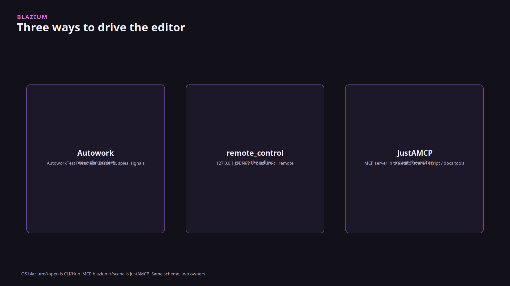
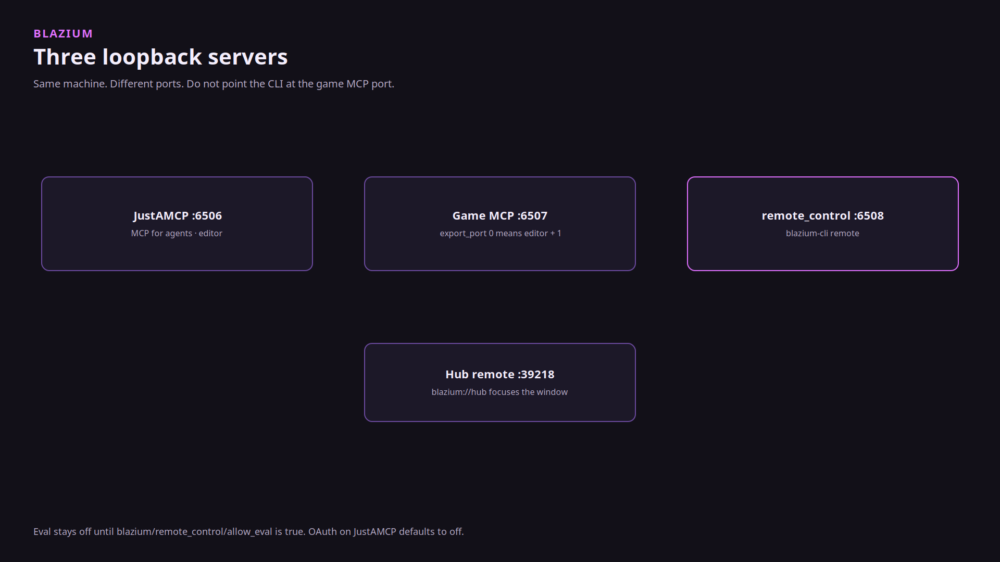
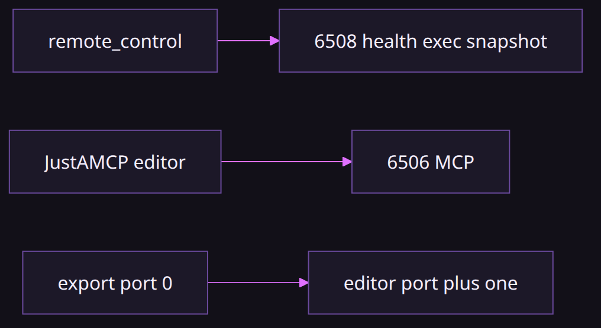
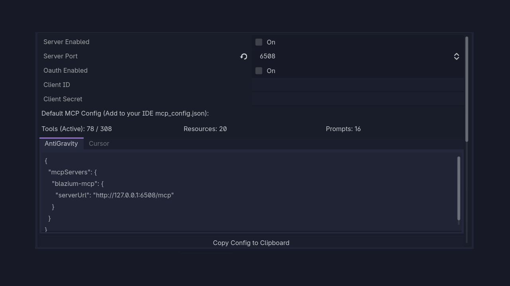

# Remote control and MCP

### Two loopback servers, and a test runner that does not need a third

*By Bioblaze Payne, Co-Founder of [Blazium Games](https://blazium.games)*

---

Driving the editor by clicking it does not survive CI, and it does not survive an agent that has to read the scene tree. We added an HTTP server so the CLI can check health, logs, play state, snapshots, and Autowork without a UI script. JustAMCP is the MCP server agents use to create and modify a project. They are different ports on purpose.

Godot does not ship either one. Both default to off in Project Settings and come up when you ask. Keep that mental model when reading Hub or CLI launch args: flags such as `--enable-remote-control` and `--enable-mcp` are how automation opts in for one session without rewriting every project's `project.godot`.







## Orchestration vs tools

| Surface | Port (default) | Client | Job |
|---|---|---|---|
| remote_control | **6508** | `blazium-cli remote`, curl, CI | Health, play, snapshots, logs, Autowork, instance id |
| JustAMCP (editor) | **6506** | MCP clients | Project/scene/script/resource tools, tags, semantic search |
| JustAMCP (game export) | **6507** when `export_port=0` | MCP during play | Runtime bridge, not CLI remote |

remote_control answers "is this editor up, and can I press Play?" JustAMCP answers "create a node, tag an asset, search the index." Autowork is the shared test runner both can start; it is not a third listen port.

## remote_control for CI and the CLI

`modules/remote_control` is always in the editor. Export templates get it only when `hub_build=yes`. The default bind is `127.0.0.1:6508`. `blazium/remote_control/server_enabled` defaults to false. `blazium-cli open` and `load` pass `--enable-remote-control` because `remote.enable_on_open` defaults to true.

`allow_eval` defaults to false. Eval runs GDScript or Luau in the editor process. `allow_runtime` defaults to false (templates need it to start the server). A token, when set, is `Authorization: Bearer` or `X-Remote-Control-Token`.

| Route | Job |
|---|---|
| `GET /v1/health` | Liveness |
| `GET /v1/status` | Project, pid, instance id, allow_eval |
| `POST /v1/instance` | Assign the short instance id |
| `GET /v1/commands` | What `exec` accepts |
| `POST /v1/exec` | Built-in commands |
| `POST /v1/eval` | Expression, if `allow_eval` |
| `GET /v1/logs` | Engine log |

Built-in exec names include `play_main_scene`, `play_current_scene`, `play_custom_scene`, `stop_playing`, `pause_playing`, `resume_playing`, `play_status`, `snapshot_editor`, `snapshot_scene`, `get_logs`, `debugger_info`, `autowork_run`, `autowork_status`, `autowork_results`, `mcp_status`, and `focus_window`. Snapshots return a PNG as `png_base64`. Play, pause, stop, and the snapshot are deferred onto the main thread so they do not block the server thread.

```text
blazium-cli open ./MyProject
blazium-cli remote status --format json
blazium-cli remote doctor
blazium-cli remote list
blazium-cli remote instances
blazium-cli remote exec ping
blazium-cli remote autowork run --wait
```

`remote list` prints commands registered on the connected instance (`GET /v1/commands`). `remote instances` lists active remote_control editor instances. There is no `blazium-cli remote ping` subcommand; health probes go through `remote status`, `remote doctor`, or `remote exec ping` (the built-in `ping` exec command).

```text
curl -sS http://127.0.0.1:6508/v1/health
curl -sS -X POST http://127.0.0.1:6508/v1/exec \
  -H "Content-Type: application/json" \
  -d '{"command":"ping","args":{}}'
```

`open` waits until `/v1/health` responds, then `POST /v1/instance` stores a 6-character id. One editor is selected for you. Two editors: the newest is the default, and the CLI warns unless `--quiet`. Select with `--instance` or `--project`.

`remote eval-gdscript` / `remote eval-lua` / `remote eval` return nothing useful until `allow_eval` is true (`blazium/remote_control/allow_eval`, default **false**). [remote_control_module_tests](https://github.com/blazium-games/remote_control_module_tests) covers lifecycle, health/status, exec ping, command list, and gated eval (Luau cases pending without `LuaState`).


```text
asciinema play assets/cli-remote-help.cast
```

`blazium-cli remote config set enable-mcp-on-load true` turns JustAMCP on when the CLI loads a project. `blazium-cli remote config set enable-on-open false` keeps later opens from starting remote control.

SCons `hub_register=yes` registers a freshly built editor with Hub after the build, through `blazium-cli`. That is a build step, not a runtime call.

## JustAMCP for agents

`modules/justamcp` is the native MCP server. Streamable HTTP is `POST /mcp`, `GET /mcp`, and `DELETE /mcp`, plus the legacy `/sse` and `/message` routes and the OAuth discovery paths under `/.well-known/`. `JustAMCPRuntime` stays up across scene changes.

Editor settings: `blazium/justamcp/server_enabled` (default false), `server_port` (default **6506**), `project_mcp_dir` (default `res://mcp`). OAuth (`oauth_enabled`) defaults to false. Game export: `export_port` defaults to **0**, which means editor port plus one, **6507**. CLI flags are `--enable-mcp`, `--mcp-port`, `--mcp-client-id`, and `--mcp-client-secret`.

Tool names are prefixed `blazium_` for much of the editor surface: project info, scene tree, scripts, resources, docs, Autowork, export. Asset tags are `blazium_tags_*`. Semantic search is `blazium_semantic_search` and the related prefixed index tools (`blazium_semantic_*`). The prompt `blazium_asset_tagging_workflow` is the tagging walk. Those tag tools are how an agent edits the project's tag dictionary without a sidecar database.

`mcp_status` on remote_control reports whether JustAMCP is up. It is not a proxy into MCP tool calls.




### JustAMCP port options

| Setting | Default | Meaning |
|---|---|---|
| `blazium/justamcp/server_enabled` | `false` | editor MCP listen |
| `blazium/justamcp/server_port` | `6506` | editor MCP bind |
| `blazium/justamcp/export_port` | `0` | **0 means editor port + 1** (6507) |
| `blazium/justamcp/project_mcp_dir` | `res://mcp` | project MCP files |
| `blazium/justamcp/oauth_enabled` | `false` | OAuth + `/.well-known/` |

CLI overrides: `--enable-mcp`, `--mcp-port`, `--mcp-client-id`, `--mcp-client-secret`. A non-zero `export_port` pins the game MCP port explicitly; leave `0` unless you need to avoid a collision with another local service.

## Two owners of blazium://

The OS handler is the CLI. `blazium://open?path=` starts an editor. Hub's remote port for `blazium://hub` is **39218**.

JustAMCP uses the same scheme for resources inside the editor: `blazium://docs/...`, `blazium://tags/...`, `blazium://semantic/...`, `blazium://scene/...`. Older `godot://` resource URIs are rewritten to `blazium://`. That rewrite does not register an OS protocol.

Do not point `blazium-cli remote` at 6507. That port is the game MCP default, not remote control.

## When to use which

- CI smoke: remote_control health → play → snapshot → Autowork.
- Agent editing a scene or tagging assets: JustAMCP tools and prompts.
- "Is MCP running?" from a shell: `blazium-cli remote exec mcp_status`, not a guess at 6507.
- Eval from a script: only after `allow_eval`, and only on loopback with a token if you set one.
- Opening a project from Hub or `blazium://open`: CLI owns the OS protocol and then talks remote_control on the editor's allocated port/token; do not hard-code 6508 if the CLI already assigned another port for that instance.

## Shared Autowork, different callers

Autowork is the native test runner. remote_control starts it with `autowork_run` and polls `autowork_status` / `autowork_results` (results path `user://autowork_results.json`). JustAMCP exposes Autowork through its own tool category so an agent can kick the same runner without speaking `/v1/exec`. There is still one results file and one job mutex on the remote_control side — a second `autowork_run` while a job is active returns `autowork already running`.

Use remote_control Autowork from CI shells. Use JustAMCP Autowork from an agent session that is already on port 6506. Do not run both starters against the same editor at once unless you have checked status first.

## CI workflow sketch

1. `blazium-cli open ./MyProject` (enables remote control when `remote.enable_on_open` is true).
2. `blazium-cli remote doctor` / `remote status --format json`.
3. `blazium-cli remote list` to confirm `play_main_scene`, `snapshot_editor`, and `autowork_run` are registered.
4. `blazium-cli remote exec play_main_scene` then `remote exec snapshot_editor` (or the dedicated snapshot helpers).
5. `blazium-cli remote autowork run --wait` and read `user://autowork_results.json` via `autowork_results`.
6. For agent edits in the same session, enable JustAMCP (`--enable-mcp` or settings) on **6506**; keep remote_control on **6508**.

```text
blazium-cli remote exec play_main_scene
blazium-cli remote exec snapshot_editor
blazium-cli remote exec mcp_status
```

If `allow_eval` must be on for a job, set it in the project or `blazium-cli remote enable --allow-eval`, run the eval, and turn it off afterward. Do not leave eval enabled on shared engineer machines.

### remote_control settings table

| Setting | Default | Role |
|---|---|---|
| `blazium/remote_control/server_enabled` | `false` | listen for `/v1/*` |
| bind address | `127.0.0.1` | loopback only by default |
| port | `6508` | CLI remote target |
| `allow_eval` | **false** | gates `POST /v1/eval` and CLI eval helpers |
| `allow_runtime` | `false` | templates need this to start the server |
| token | empty | when set, require `Authorization: Bearer` or `X-Remote-Control-Token` |

`blazium-cli remote config set enable-on-open false` stops later `open`/`load` launches from forcing the server on. `remote config set enable-mcp-on-load true` turns JustAMCP on when the CLI loads a project — still a different port from remote_control. `SCons hub_register=yes` registers a built editor with Hub through the CLI after compile; that is unrelated to runtime `/v1/exec`.

### Failure cases

| Symptom | Check |
|---|---|
| `remote ping` unknown | use `remote exec ping` or `remote status` |
| `remote list` empty / wrong | not connected; run `remote instances` and pick `--instance` |
| eval 403 | `allow_eval` still false |
| MCP tools missing on 6508 | wrong server; MCP is 6506 |
| game tools on 6507 while editor idle | export/runtime MCP only during play when enabled |
| `autowork already running` | poll `autowork_status` before a second start |
| template without routes | build lacked `hub_build=yes` |

## Limits

- remote_control bind defaults to loopback; it is not a cloud relay.
- Eval and runtime flags stay off until you flip them.
- Templates without `hub_build=yes` omit the module.
- JustAMCP OAuth is off unless you enable it; discovery documents exist under `/.well-known/` when on.
- Autowork results land at `user://autowork_results.json` via the remote_control builtins.
- Hub's own remote_control port for `blazium://hub` is **39218**, separate from editor **6508** and game MCP **6507**.
- CORS `OPTIONS` handlers exist on the remote_control `/v1/*` routes for browser-based tools on loopback; do not treat that as permission to bind publicly.
- `JustAMCPRuntime` surviving scene changes does not mean remote_control play state is MCP state — query each server on its own port.
- Module tests for remote_control live at https://github.com/blazium-games/remote_control_module_tests.
- `export_port=0` is not "MCP disabled"; it means editor port plus one.
- `remote instances` naming editors and `remote list` naming commands is easy to invert in muscle memory; check the subcommand help when the output shape looks wrong.

### Exec command groups

Built-ins cluster by job:

- Play: `play_main_scene`, `play_current_scene`, `play_custom_scene`, `stop_playing`, `pause_playing`, `resume_playing`, `play_status`
- Capture: `snapshot_editor`, `snapshot_scene` (`png_base64`, optional path)
- Diagnostics: `ping`, `get_logs`, `debugger_info`, `focus_window`
- Autowork: `autowork_run`, `autowork_status`, `autowork_results`
- Bridge: `mcp_status` (liveness only)

Play and snapshot work is deferred to the main thread so the HTTP poll thread does not block the scene tree. Autowork still has a single job mutex: a second `autowork_run` while busy returns `autowork already running`. Prefer JustAMCP's Autowork tools only when the agent session is already on port 6506; prefer `blazium-cli remote autowork` from CI shells.

Semantic and tag tools stay on the MCP side: `blazium_semantic_search` and other `blazium_semantic_*` index helpers, plus `blazium_tags_*` and the `blazium_asset_tagging_workflow` prompt. remote_control cannot invoke those tool names through `/v1/exec`; it can only report `mcp_status`. Keep agent project edits on 6506 and CI play/snapshot/Autowork on 6508 so a tool call never hits the wrong JSON server.

## Links

- remote_control: https://github.com/blazium-games/blazium/tree/blazium-dev/modules/remote_control
- JustAMCP: https://github.com/blazium-games/blazium/tree/blazium-dev/modules/justamcp
- CLI: https://github.com/blazium-games/blazium-cli
- Module tests: https://github.com/blazium-games/remote_control_module_tests
- Blazium Games: https://blazium.games

---

**[Jump into our Discord](https://blazium.app/chat)** for real-time chats, dev support and feedback

Or follow us everywhere else:

- **[GitHub](https://github.com/blazium-games)**
- **[IndieDB](https://www.indiedb.com/engines/blazium-engine)**
- **[X / Twitter](https://x.com/BlaziumGames)**
- **[YouTube](https://www.youtube.com/@blazium)**
- **[itch.io](https://blaziumengine.itch.io)**
