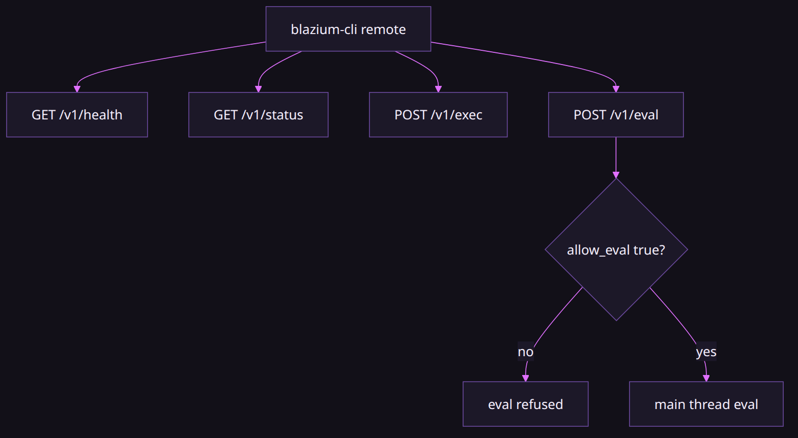

# Why the editor has a localhost HTTP server

### Scripts should not have to click the window

*By Bioblaze Payne, Co-Founder of [Blazium Games](https://blazium.games)*

---

The commit that added `modules/remote_control` says it is CLI-to-editor HTTP control. A follow-up made exec and eval non-blocking: they are deferred onto the main thread, and play, pause, stop, and a PNG snapshot are built-in commands. Script evaluation is gated by `blazium/remote_control/allow_eval`, which defaults to false. The test-runner side of the same idea is Autowork, so a headless job can run tests without a driver script glued on beside the editor.

Godot does not ship this server. We needed it because Hub and CI both have to open a project and know that the editor is actually up. Clicking is not a protocol. The JSON routes are intentionally small and versioned under `/v1/` so a CLI and a shell script can share the same contract without importing editor GDScript.


## What is on by default

Almost nothing. `blazium/remote_control/server_enabled` is false. `allow_eval` is false. `allow_runtime` is false. The bind is `127.0.0.1` and the port is **6508**, because the routes include play, snapshots, and eval. A token, when set, is `Authorization: Bearer` or `X-Remote-Control-Token` (also `--remote-control-token` / `--remote-control-port`).

| Setting | Default |
|---|---|
| `blazium/remote_control/server_enabled` | `false` |
| `blazium/remote_control/server_port` | `6508` |
| `blazium/remote_control/bind_address` | `127.0.0.1` |
| `blazium/remote_control/allow_eval` | `false` |
| `blazium/remote_control/allow_runtime` | `false` |
| `blazium/remote_control/token` | empty |

`blazium-cli open` turns the server on, because `remote.enable_on_open` defaults to true. After `GET /v1/health` the CLI posts `/v1/instance` and stores a 6-character id. That is how a later `remote status` knows which editor it is talking to. Two editors: the newest is the default, and the CLI warns unless you pass `--quiet`.

Eval runs GDScript or Luau inside the editor process. Leave it off unless you meant to type code into a running editor from a shell. Luau requires `luau_module`; without it, Luau eval tests stay pending.

Export templates do not include the module unless the build was made with `hub_build=yes`. Hub itself is one of those builds. A game you export for players is not, unless you asked for that flag. Template startup also requires `allow_runtime` before the server listens.

## HTTP API mechanics



Routes register on the `HTTPServer` singleton:

| Method | Path | Body / notes |
|---|---|---|
| GET | `/v1/health` | Liveness; includes `instance_id` when set |
| GET | `/v1/status` | Project path, pid, `allow_eval`, bind |
| POST | `/v1/instance` | `{ "instance_id": "ABC123" }` |
| GET | `/v1/commands` | Registered exec names |
| POST | `/v1/exec` | `{ "command": "name", "args": {} }` |
| POST | `/v1/eval` | `{ "expression": "...", "language": "gdscript" \| "luau" }` — 403 if eval off |
| GET | `/v1/logs` | Paginated engine log |
| OPTIONS | same paths | CORS preflight |

`POST /v1/exec` and `POST /v1/eval` are held and completed on the main thread so scene work does not block the HTTP poll thread. There is no separate privileged-exec switch: `exec` is available when the server is enabled; only evaluation is gated by `blazium/remote_control/allow_eval` (default `false`). A disabled eval returns HTTP 403 with a message that names that setting.

```text
curl -sS http://127.0.0.1:6508/v1/health
curl -sS http://127.0.0.1:6508/v1/status
curl -sS -X POST http://127.0.0.1:6508/v1/instance \
  -H "Content-Type: application/json" \
  -d '{"instance_id":"AB12CD"}'
curl -sS -X POST http://127.0.0.1:6508/v1/exec \
  -H "Content-Type: application/json" \
  -d '{"command":"play_status","args":{}}'
```

```gdscript
# From inside an editor script / Autowork test:
var server := RemoteControlServer.get_singleton()
print(server.get_allow_eval())
```

## Built-in commands

Registered in `remote_control_builtins.cpp` (non-exhaustive but the ones CI uses):

| Command | Role |
|---|---|
| `ping` | Liveness via exec |
| `play_main_scene` / `play_default_scene` | Play main scene |
| `play_current_scene` / `play_custom_scene` | Play variants |
| `pause_playing` / `resume_playing` / `stop_playing` | Transport |
| `play_status` | Is the game running? |
| `snapshot_editor` / `snapshot_scene` | PNG as `png_base64`; optional `args.path` writes a file |
| `get_logs` | Log slice |
| `debugger_info` / `debugger_error_breaks` | Debugger state |
| `get_failed_run` | Failed-run evidence bundle |
| `autowork_run` / `autowork_status` / `autowork_results` | Test runner; results at `user://autowork_results.json` |
| `focus_window` / `bring_to_front` | Window focus |
| `mcp_status` | JustAMCP port/started (not a tool proxy) |

## Auth and safety

Empty token: no auth header required (still loopback by default). Non-empty token: every route checks `Authorization: Bearer <token>` or `X-Remote-Control-Token`. Eval disabled returns HTTP 403 with a message pointing at `blazium/remote_control/allow_eval`. Autowork rejects a second concurrent job with `autowork already running`.

`blazium-cli open` allocates a unique port/token/instance id per editor so two projects on one machine do not collide on 6508. Prefer those allocated values over assuming the Project Settings default still applies after a CLI launch.

This is localhost automation. It is not a multiplayer API and not a public ingest. Binding off loopback is possible via `bind_address`, and that is a deliberate risk — leave it on `127.0.0.1` unless you know why you changed it.

| Failure | Response / behavior |
|---|---|
| `allow_eval=false` + `POST /v1/eval` | HTTP 403 naming `blazium/remote_control/allow_eval` |
| Bad / missing token when token set | Auth failure on every route |
| Second `autowork_run` while busy | Rejected with `autowork already running` |
| Luau eval without `luau_module` | Luau eval tests stay pending; do not expect Luau language |
| Template without `hub_build=yes` | Module absent; also needs `allow_runtime` before listen |
| Pointing CLI at JustAMCP 6506/6507 | Not remote control; use 6508 (or the CLI-allocated port) |

## Compile and test surface

`config.py`: editor always; templates only with `hub_build=yes`. Hard dependency on `httpserver`. Soft dependency on `luau_module` for Luau eval. JustAMCP is an optional peer behind `MODULE_JUSTAMCP_ENABLED` for `mcp_status` only — no soft-dep edge that would cycle the module graph.

[remote_control_module_tests](https://github.com/blazium-games/remote_control_module_tests) runs under Autowork: server lifecycle, `/v1/health` + `/v1/status`, exec ping, `/v1/commands`, gated GDScript eval, optional Luau eval.

```text
blazium --headless --path . -s run_tests.gd
```

## CLI client shape

`blazium-cli remote` defaults to host `127.0.0.1` and port `6508`. Persistent flags include `--instance` (6-char id) and `--project`. Subcommands the CLI wires for this module include `status`, `list` / commands, `exec`, `eval` / `eval-gdscript` / `eval-lua`, `logs`, `debugger`, `failed-run`, `autowork`, `instances`, `config`, `enable`, `doctor`, and snapshot helpers that call `snapshot_editor` / `snapshot_scene` and optionally write `-o file.png`.

```text
blazium-cli remote status --format json
blazium-cli remote exec play_status
blazium-cli remote snapshot editor -o /tmp/editor.png
blazium-cli remote autowork run --wait
blazium-cli remote doctor
```

Instance selection: with one live editor, the CLI uses it. With several, it picks the newest and warns unless `--quiet`. Retired ids error instead of silently targeting a dead port.

Leave `allow_eval` false unless a CI job must post expressions. Prefer `exec` commands (`play_status`, `snapshot_editor`, `autowork_run`) for automation that should stay on the built-in surface. Eval is GDScript or Luau inside the editor process; enabling it is an explicit Project Setting change, not a second “privileged exec” toggle — that toggle does not exist. Run health and status first, then exec; reach for eval only when a built-in command cannot express the check you need.

## The other port (boundary only)

JustAMCP is the MCP server, default port **6506**. A game export port of 0 means 6507. `blazium-cli remote` does not speak MCP. Pointing it at 6507 will not run `remote exec`. Use `mcp_status` when you only need to know whether MCP is listening.

`blazium://` as an OS protocol is the CLI. `blazium://scene/…` inside JustAMCP is a resource URI. Same scheme, two owners. Hub listens for CLI↔Hub remote control on **39218** — that is Hub's process, not an editor on 6508.

SCons `hub_register=yes` calls `blazium-cli` after a build to register that editor with Hub. That is not the HTTP server. It does not run while you are editing.

We used remote control in-house for health checks, play commands, snapshots, and Autowork in CI. That is the job. If you need scene graph edits or asset tagging from an agent, that is JustAMCP on 6506 — keep this module on the health/play/snapshot/exec contract. Snapshot PNGs are base64 in the JSON response so CI can archive them without a second file protocol.

## Links

- Module: https://github.com/blazium-games/blazium/tree/blazium-dev/modules/remote_control
- JustAMCP: https://github.com/blazium-games/blazium/tree/blazium-dev/modules/justamcp
- CLI: https://github.com/blazium-games/blazium-cli
- Tests: https://github.com/blazium-games/remote_control_module_tests
- Blazium Games: https://blazium.games

---

**[Jump into our Discord](https://blazium.app/chat)** for real-time chats, dev support and feedback

Or follow us everywhere else:

- **[GitHub](https://github.com/blazium-games)**
- **[IndieDB](https://www.indiedb.com/engines/blazium-engine)**
- **[X / Twitter](https://x.com/BlaziumGames)**
- **[YouTube](https://www.youtube.com/@blazium)**
- **[itch.io](https://blaziumengine.itch.io)**
