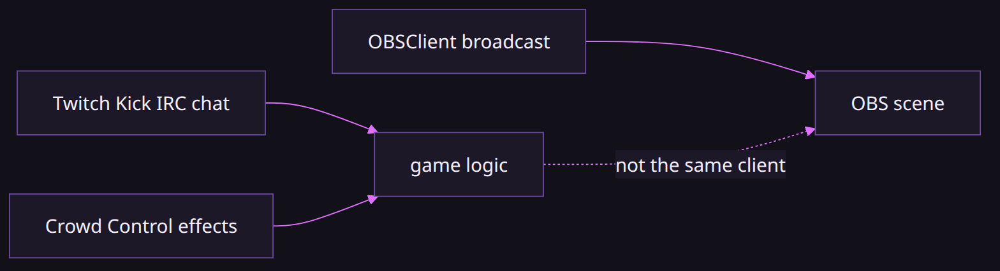
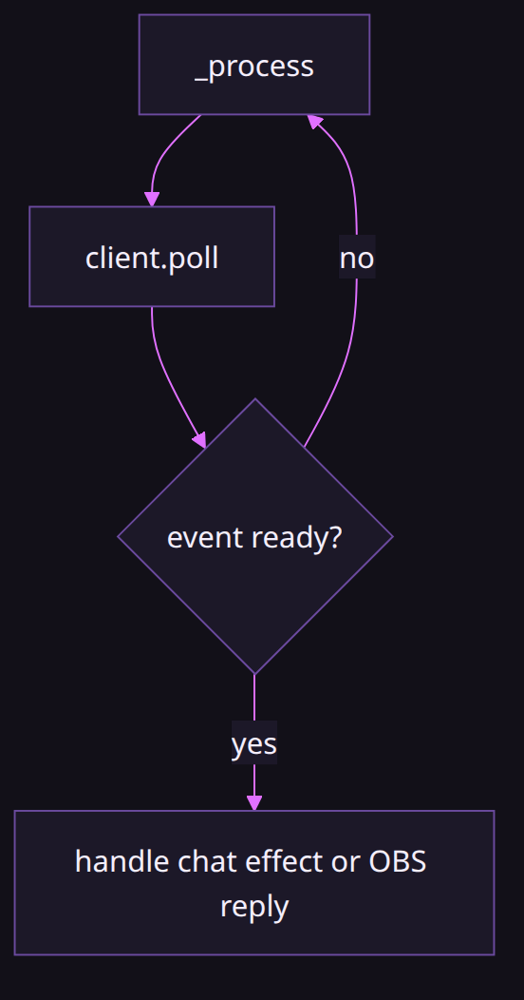
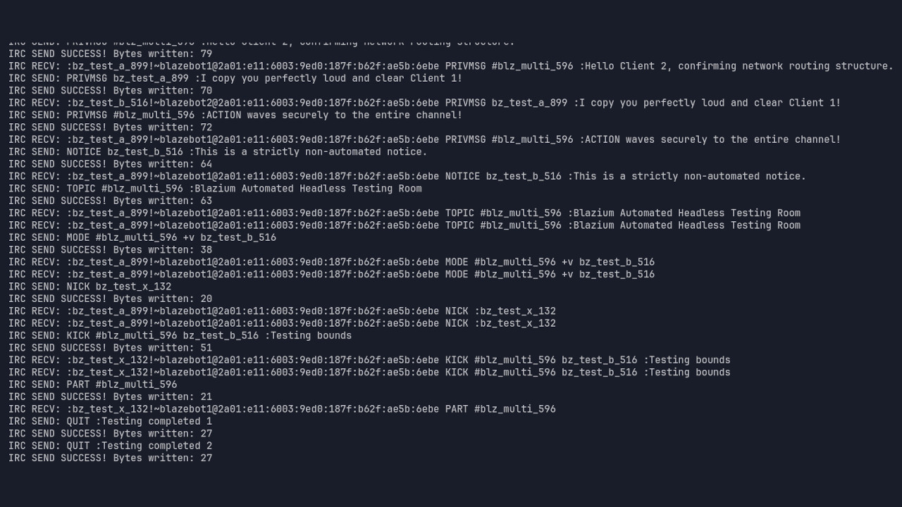

# Streaming tools in Blazium

### Chat, effects, and the broadcast are three sockets

*By Bioblaze Payne, Co-Founder of [Blazium Games](https://blazium.games)*

---

Godot does not ship a Twitch client, a Kick client, or an OBS websocket. We added them because a live game is a pile of HTTP and sockets that every project was binding by hand. They do not share a base class. You wire them.

We used `TwitchAPI`, `KickAPI`, IRC, Crowd Control, and `OBSClient` in-house to validate those clients. That pass does not name a channel or a shipped overlay. Hangman's public releases are Steam, Discord, Google Play, and the Apple App Store, not a claim that the Steam build is an OBS scene. Demon Lord: Clicker is a Steam live-ops validation story; it is not this streaming stack.




## What is in the tree

`twitchapi`, `kickapi`, `ircclient`, `crowdcontrol`, and `obsclient` are modules on `blazium-dev`. Each has its own test repository on the org. There is no scene that connects all five, and no Blazium service that holds your tokens. Put tokens in a `.env` file and read them with `ENV` from `modules/dotenv` (`load_env_file`, typed getters, and related helpers). That file is plain text. It is not a security boundary.

`CrowdControl` and `OBSClient` are `Object` singletons, not `Node`. Both need `poll()` from `_process`. Crowd Control has no `trigger()` method. The viewer starts the effect on Crowd Control's side. The game answers.

| Need | Class | Module |
|---|---|---|
| Twitch Helix | `TwitchAPI` | `twitchapi` |
| Twitch chat | `TwitchIRCClient` / `TwitchIRCClientNode` | `ircclient` |
| Kick HTTP | `KickAPI` | `kickapi` |
| Generic IRC | `IRCClient` / `IRCClientNode` | `ircclient` |
| Viewer effects | `CrowdControl` | `crowdcontrol` |
| Scenes, record, stream | `OBSClient` | `obsclient` |

`TwitchIRCClient` does not inherit `IRCClient`. It is a parallel `RefCounted` with `connect_to_twitch(username, oauth_token, use_ssl=true)`. `TwitchAPI.configure(client_id, access_token)` is Helix and polls responses every physics frame. `KickAPI.configure(access_token)` is the Kick HTTP API.



| Object | Poll / pump | If you forget |
|---|---|---|
| `IRCClient` | `poll()` or `IRCClientNode` | no messages |
| `TwitchIRCClient` | `poll()` (or `TwitchIRCClientNode`) | chat stalls |
| `TwitchAPI` | physics-frame response poll after `configure` | Helix callbacks never fire |
| `KickAPI` | same HTTP completion path as Twitch Helix-style clients | `request_completed` silent |
| `CrowdControl` | `CrowdControl.poll()` in `_process` | effects never arrive |
| `OBSClient` | `OBSClient.poll()` until handshake and while connected | scenes never change |

## IRC and Twitch chat

`IRCClient` speaks RFC 1459, RFC 2812, and IRCv3. `connect_to_server(host, port, use_ssl, nick, username, realname, password="")` opens the socket. You must `poll()` regularly, or use `IRCClientNode` for automatic polling. SASL helpers include `enable_sasl_plain`, `enable_sasl_external`, and a SCRAM entry that currently falls back to PLAIN with a warning. Set TLS options before connecting with `use_ssl=true`.

```gdscript
var irc := IRCClient.new()
func _ready() -> void:
    irc.message_received.connect(_on_irc_message)
    var err := irc.connect_to_server("irc.libera.chat", 6697, true, "MyBot", "bot", "My Bot")
    if err != OK:
        push_error(err)

func _process(_delta: float) -> void:
    irc.poll()
```



Twitch chat is the dedicated client:

```gdscript
var twitch_irc := TwitchIRCClient.new()
func _ready() -> void:
    ENV.load_env_file("res://.env")
    twitch_irc.connect_to_twitch(ENV.get_env("TWITCH_USER"), ENV.get_env("TWITCH_OAUTH"))
```

Helix stays on `TwitchAPI`. Example from the class reference: `TwitchAPI.configure(client_id, access_token)` then `TwitchAPI.get_users().get_users({"login": ["twitch"]})`, with `request_completed` / `request_failed` for results. Category getters include ads, analytics, bits, channel points, channels, chat, and more. Chat HTTP (send message, badges, emotes) is Helix; IRC is the firehose. Channel points redemptions arrive through Helix helpers such as `TwitchAPI.get_channel_points().get_custom_reward_redemption(...)`; they are not Crowd Control effects and they are not OBS scene changes until your game code says so.

`TwitchIRCClient` also exposes chat moderation helpers (`ban_user`, `timeout_user`, `delete_message`, `clear_chat`, slow-mode and followers-only toggles). Those are IRC capabilities on the chat socket. Helix moderation lives under `TwitchAPI.get_moderation()` and related request objects. Pick one path per action; do not assume a ban on IRC updates a Helix-only UI automatically.

```gdscript
func _ready() -> void:
    twitch_irc.twitch_message.connect(_on_twitch_chat)
    var err := twitch_irc.connect_to_twitch(
        ENV.get_env("TWITCH_USER"),
        ENV.get_env("TWITCH_OAUTH"),
        true
    )
    if err != OK:
        push_error(err)

func _process(_delta: float) -> void:
    twitch_irc.poll()

func _on_twitch_chat(channel: String, sender: String, message: String, tags: Dictionary) -> void:
    # Route to alerts or game logic. Do not call OBS here unless you mean to.
    pass
```

## Kick HTTP

`KickAPI` is a singleton for Kick's developer public API. Configure with an access token, then use category request handlers such as `get_users()`. Connect `request_completed`, `request_failed`, and `rate_limit_warning`. There is no Kick IRC class in-tree parallel to `TwitchIRCClient`; if you need Kick chat beyond HTTP, that is outside these modules.

```gdscript
func _ready() -> void:
    ENV.load_env_file("res://.env")
    KickAPI.configure(ENV.get_env("KICK_ACCESS_TOKEN"))
    KickAPI.request_completed.connect(_on_kick)
    KickAPI.get_users().get_users({"username": ["streamer_name"]})
```

## Crowd Control (effects)

`CrowdControl` connects to Crowd Control's PubSub. Default URL for `connect_to_crowdcontrol` is `wss://pubsub.crowdcontrol.live/`. Register the game on the Crowd Control Developer Portal for an App ID and secret. Auth helpers include websocket and HTTP polling paths; `authentication_url_ready` carries the URL the streamer must open. Cache tokens with `get_auth_token` / `set_auth_token` and `refresh_token` when needed.

When a viewer buys or triggers an effect, `effect_requested` delivers a dictionary with `reqId`, `code`, and `parameters`. Apply the effect in your game, then answer:

```gdscript
func _process(_delta: float) -> void:
    CrowdControl.poll()

func _on_effect(effect_data: Dictionary) -> void:
    var req_id = effect_data.get("reqId")
    match effect_data.get("code"):
        "give_coins":
            # mutate game state, then:
            CrowdControl.respond_to_effect_instant(req_id, CrowdControl.STATUS_SUCCESS, "Coins given!")
        "invert_controls":
            CrowdControl.respond_to_effect_timed(req_id, CrowdControl.STATUS_TIMED_BEGIN, 30000, "Invert Controls started.")
```

You do not start the effect from the game. Instant versus timed is the response API. Closing the socket is `close()`.

Auth bootstrap for Crowd Control: `set_credentials` with the portal App ID and secret, then `request_authentication_websocket` or `request_authentication_http`. Connect `authentication_url_ready` so the streamer can open the login URL. After `authenticated`, call `start_game_session` before expecting gameplay effects. `report_effects` updates menu availability (`MENU_VISIBLE`, `MENU_HIDDEN`, `MENU_AVAILABLE`, `MENU_UNAVAILABLE`). Timed effects need a later `respond_to_effect_timed(..., STATUS_TIMED_END, 0, ...)` when the duration finishes; leaving them open at `STATUS_TIMED_BEGIN` confuses the Crowd Control client.

| EffectStatus | When to send |
|---|---|
| `STATUS_SUCCESS` / `STATUS_FAILURE` | instant effects |
| `STATUS_UNAVAILABLE` / `STATUS_RETRY` / `STATUS_QUEUE` | cannot run now |
| `STATUS_TIMED_BEGIN` / `PAUSE` / `RESUME` / `END` | timed effects |

## OBS (broadcast)

`OBSClient` speaks obs-websocket 5.x. `connect_to_obs(url, password="", event_subscriptions=2047)` returns an `Error` when the attempt starts. Call `poll()` until the handshake finishes. `get_connection_state` / `is_obs_connected` tell you the socket came up. `set_current_program_scene` switches the program scene. The class also covers inputs, filters, record, stream, replay buffer, studio mode, and `send_request` / `send_request_batch` for anything not wrapped.

```gdscript
func _ready() -> void:
    ENV.load_env_file("res://.env")
    var err := OBSClient.connect_to_obs("ws://localhost:4455", ENV.get_env("OBS_PASSWORD"))
    if err != OK:
        push_error(err)

func _process(_delta: float) -> void:
    OBSClient.poll()

func cut_to_alert() -> void:
    if OBSClient.is_obs_connected():
        OBSClient.set_current_program_scene("Alert")
```


Record and stream controls (`get_record_status`, `get_stream_status`, pause/resume, replay buffer) sit on the same singleton. Use them when the game owns the broadcast machine. Do not assume a remote OBS over the public internet without your own tunnel; the default URL in docs is `ws://localhost:4455`.

## Wiring the three jobs

Keep the boundaries explicit:

1. **Chat / channel metadata** — `TwitchIRCClient` / `IRCClient` for messages; `TwitchAPI` / `KickAPI` for Helix-style HTTP.
2. **Viewer effects** — `CrowdControl` answers effects; it does not own chat or OBS.
3. **Broadcast** — `OBSClient` switches scenes, records, and streams; it does not parse Twitch chat.

A loop that is actually useful looks like this: Helix or IRC delivers a message, the game mutates something, Crowd Control may apply a paid effect on its own socket, then `OBSClient` changes a scene if you asked it to. Nothing in the engine does the middle step for you.

If you only need alerts on channel-point redemptions, you can skip Crowd Control entirely and drive OBS from Helix callbacks. If you only need paid chaos effects, you can skip OBS. The modules are independent on purpose so a failure on one socket does not take down the others.

## Tokens and dotenv

Load secrets with `ENV.load_env_file` (or the auto-load helpers) and read them with `ENV.get_env`, `get_env_int`, and the other typed getters. `get_missing_envs` is useful at boot. Pushing values into the OS environment is optional (`push` helpers in the same singleton). Treat `.env` as developer convenience on a stream PC, not as a vault.

```gdscript
func boot_stream_env() -> bool:
    ENV.load_env_file("res://.env")
    var missing := ENV.get_missing_envs([
        "TWITCH_USER", "TWITCH_OAUTH", "TWITCH_CLIENT_ID", "OBS_PASSWORD"
    ])
    if not missing.is_empty():
        push_error("missing env keys: %s" % str(missing))
        return false
    TwitchAPI.configure(ENV.get_env("TWITCH_CLIENT_ID"), ENV.get_env("TWITCH_OAUTH"))
    return true
```

Helix `configure` wants client id plus user access token. IRC `connect_to_twitch` wants login name plus oauth token. Reusing one token string is fine when the token has both chat and Helix scopes; failing chat while Helix works usually means the token lacks `chat:read` / `chat:edit`, not an engine bug.

## Minimal wiring sketch

```gdscript
func _process(_delta: float) -> void:
    CrowdControl.poll()
    OBSClient.poll()

func on_channel_points(reward_id: String) -> void:
    if reward_id == "alert_cam":
        if OBSClient.is_obs_connected():
            OBSClient.set_current_program_scene("Alert")

func on_cc_effect(effect_data: Dictionary) -> void:
    var req_id = effect_data.get("reqId")
    if effect_data.get("code") == "swap_scene":
        if OBSClient.is_obs_connected():
            OBSClient.set_current_program_scene("Chaos")
            CrowdControl.respond_to_effect_instant(
                req_id, CrowdControl.STATUS_SUCCESS, "Scene swapped"
            )
        else:
            CrowdControl.respond_to_effect_instant(
                req_id, CrowdControl.STATUS_UNAVAILABLE, "OBS down"
            )
```

Keep Helix redemption handlers and Crowd Control handlers in separate functions. A redemption id is not a Crowd Control `code`.

## OBS request surface beyond scenes

Scene switching is the common path; the singleton also wraps record/stream lifecycle and escape hatches:

| Job | Methods |
|---|---|
| Program / preview scene | `set_current_program_scene`, `get_current_program_scene`, preview getters/setters |
| Record | `get_record_status`, `pause_record`, `resume_record`, chapters |
| Stream | `get_stream_status`, start/stop helpers on the same client |
| Replay buffer | `get_replay_buffer_status`, `save_replay_buffer` |
| Inputs / filters | `create_input`, `get_input_list`, `create_source_filter`, mute/volume |
| Anything missing | `send_request` / `send_request_batch` (obs-websocket 5.x) |

```gdscript
func start_local_recording() -> void:
    if not OBSClient.is_obs_connected():
        push_warning("OBS not connected")
        return
    OBSClient.get_record_status(func(status, data):
        if status.result:
            # data carries active/paused/timecode fields from obs-websocket.
            print(data)
    )
```

`connect_to_obs(url, password="", event_subscriptions=2047)` — the default subscription mask is all events. Narrow it if your game only cares about scene changes. `get_connection_state` distinguishes handshake stages from a fully ready socket; `is_obs_connected` is the boolean gate for gameplay-triggered cuts.

Kick category handlers mirror the Helix style: after `KickAPI.configure`, use `get_users()`, `get_channels()`, `get_chat()`, `get_livestreams()`, and related request objects, with `request_completed` / `request_failed` / `rate_limit_warning`. There is still no in-tree Kick IRC client parallel to `TwitchIRCClient`.

### Boot order that survives a stream night

1. `ENV.load_env_file` and `get_missing_envs` for every token you will touch.
2. `TwitchAPI.configure` / `KickAPI.configure` before any Helix-style request.
3. `TwitchIRCClient.connect_to_twitch` (and `poll` every frame) if you need chat firehose.
4. Crowd Control: credentials → auth URL → `authenticated` → `start_game_session` → `poll`.
5. `OBSClient.connect_to_obs` → `poll` until `is_obs_connected` → only then cut scenes from game code.

Skip steps you do not need. Do not start OBS cuts from IRC handlers until step 5 reports connected. Do not answer Crowd Control effects before the game session starts. Keep each socket's error signal wired so one failure does not look like a silent stall on another module.

## Edge cases and limits

- Forgetting `poll()` on Crowd Control or OBS looks like a dead socket.
- `TwitchIRCClient` is not a subclass of `IRCClient`; do not cast across them.
- Tokens in `.env` are local convenience. Rotate them like any secret that sat on disk.
- There is no unified "StreamingManager" type and no Blazium-hosted token vault.
- SASL SCRAM-SHA-256 on `IRCClient` currently falls back to PLAIN with a warning; prefer `enable_sasl_plain` or `enable_sasl_external` for production IRC.
- In-house validation covered the clients. It did not ship a branded overlay as a product claim.
- Hangman storefronts do not imply streaming integration in those builds.
- `KickAPI.configure` with an empty token fails requests; there is no Discord-style embed rewrite for Kick hosts.
- OBS `connect_to_obs` returning `OK` only means the attempt started; wait until `is_obs_connected` before scene calls.
- Crowd Control without `start_game_session` after auth will not deliver gameplay effects even if the websocket looks up.
- `TwitchIRCClient.poll` and `CrowdControl.poll` / `OBSClient.poll` in the same `_process` is fine; they do not share a mutex across modules.
- Rate-limit warnings from Helix or Kick mean back off in your game code; the modules surface the warning, they do not queue retries for you.
- Empty OBS password is valid only when the websocket server allows unauthenticated clients; a mismatch fails the handshake after `connect_to_obs` already returned `OK`.

Test repos referenced from the class XML include [obsclient_module_tests](https://github.com/blazium-games/obsclient_module_tests), [irc_module_tests](https://github.com/blazium-games/irc_module_tests), [twitchapi_module_tests](https://github.com/blazium-games/twitchapi_module_tests), [kickapi_module_tests](https://github.com/blazium-games/kickapi_module_tests), and [crowdcontrol_module_tests](https://github.com/blazium-games/crowdcontrol_module_tests).

## Links

- Engine: https://github.com/blazium-games/blazium
- OBS tests: https://github.com/blazium-games/obsclient_module_tests
- IRC tests: https://github.com/blazium-games/irc_module_tests
- Twitch tests: https://github.com/blazium-games/twitchapi_module_tests
- Kick tests: https://github.com/blazium-games/kickapi_module_tests
- Crowd Control tests: https://github.com/blazium-games/crowdcontrol_module_tests
- Blazium Games: https://blazium.games

---

**[Jump into our Discord](https://blazium.app/chat)** for real-time chats, dev support and feedback

Or follow us everywhere else:

- **[GitHub](https://github.com/blazium-games)**
- **[IndieDB](https://www.indiedb.com/engines/blazium-engine)**
- **[X / Twitter](https://x.com/BlaziumGames)**
- **[YouTube](https://www.youtube.com/@blazium)**
- **[itch.io](https://blaziumengine.itch.io)**
