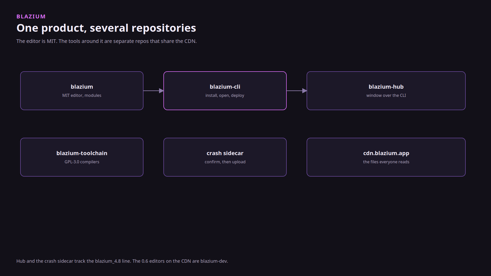
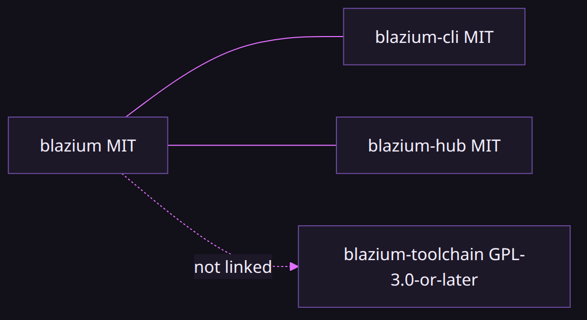
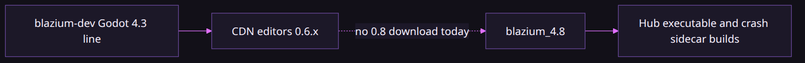
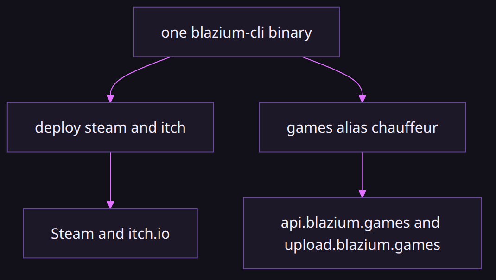

# Why the Blazium tools are separate repositories

### The editor should not have to be the download server

*By Bioblaze Payne, Co-Founder of [Blazium Games](https://blazium.games)*

---

The engine README groups what Blazium adds on top of Godot: editor and agent tools, store and platform modules, data modules, live-ops modules, and the older-console path. Those features do not all belong in one git tree. The editor is MIT and is the thing you ship a game with. The CLI installs that editor. Hub is a window over the CLI. The crash sidecar asks before a dump is uploaded. The toolchain is GPL-3.0-or-later because the compilers it fetches are not MIT. Putting GCC into `blazium.git` would have been the mistake the split exists to avoid.

They share `cdn.blazium.app` so a download does not depend on GitHub. The website, Hub, and the CLI read that host. The editor's template manager asks `https://blazium.app/api/mirrorlist/`; for `0.6.838`, the details catalog names the CDN pack as its primary URL and the mirror list includes GitHub alongside it. Release CI still publishes catalogs that Cerebro never exposes to Hub directly.

## Repository and license boundaries

| Repository | Role | License signal in-tree |
|---|---|---|
| [blazium](https://github.com/blazium-games/blazium) | Editor / engine (`blazium-dev`, `blazium_4.8`) | MIT (Godot heritage) |
| [blazium-cli](https://github.com/blazium-games/blazium-cli) | Install, projects, remote, deploy, `games` upload | MIT |
| [blazium-hub](https://github.com/blazium-games/blazium-hub) | Desktop UI over the CLI | MIT |
| [blazium_crash_reporter](https://github.com/blazium-games/blazium_crash_reporter) | Sidecar UI for dumps | Separate proprietary notice in that repo |
| [blazium-toolchain](https://github.com/blazium-games/blazium-toolchain) | PS1/PS2/N64/Interactive DVD toolchains | GPL-3.0-or-later |
| [blazium-sdk-module](https://github.com/blazium-games/blazium-sdk-module) | Optional `LoginClient` / lobby clients | Separate module, not in stock editor |
| [docker-webbuild-template](https://github.com/blazium-games/docker-webbuild-template) | Nginx host for web / Discord embed | Template repo, not the editor |

The split is process as much as license. Engine releases can ship on the MIT tree without waiting on GPL toolchain tarball policy. Hub and the crash sidecar can track `blazium_4.8` while the CDN editors remain `0.6.x` from `blazium-dev`. The SDK can move on its own cadence (last merge on that tree: September 2025) without blocking editor nightlies.

## Why Cerebro stays internal

Cerebro is the internal release surface that publishes CDN catalogs. Hub's CDN client hard-codes `https://cdn.blazium.app` and never calls Cerebro. News sanitization tests only allow `https://cdn.blazium.app` article URLs. That boundary keeps a desktop launcher from depending on internal deploy credentials. If the CDN is up, Hub News and editor installs work from public JSON. If GitHub is down, the CDN still serves the packs the catalogs name.

Release engineering can rotate Cerebro without shipping a Hub update. Hub only needs catalog shape stability on the CDN. That is the point of the process split: publish once to object storage, let every client read the same files.

## What we actually use them for

Hub, the CLI, the CDN, and the crash reporter exist for the engine. We read crash reports that are sent and we patch the engine from them. Analytics is a separate opt-in queue. It is not the patch input.

Hangman is the example game. It shipped on Steam, as a Discord Embedded App, on Google Play, and on the Apple App Store. The Discord embed work started so that game could run inside a voice channel. Those four storefronts are how export and deploy were checked. Demon Lord: Clicker was built in part to validate the newer tools, modules, and the 2D side under live Steam inventory and Discord presence traffic. Neither game collapses Hub, CLI, and toolchain into one repository; they consume the same published artifacts operators download.

In 2025 we also shipped the CLI, the deploy commands, and the GitHub Actions. The actions are four repositories: [setup-blazium-cli](https://github.com/blazium-games/setup-blazium-cli), [setup-blazium-engine](https://github.com/blazium-games/setup-blazium-engine), [export-blazium-game](https://github.com/blazium-games/export-blazium-game), and [deploy-blazium-game](https://github.com/blazium-games/deploy-blazium-game). Steam and itch reusable workflows in the deploy repo are deprecated in favor of `blazium-cli deploy`. Docker / Play / iOS / macOS workflows in that repo remain for those storefronts.

## Two lines, on purpose

`blazium-dev` is the Godot 4.3 line. The editors on the CDN are `0.6.x` from that branch. As of 11 October 2026, release is 0.6.838 and nightly is 0.6.924. `blazium_4.8` is the Godot 4.8 line. Hub's executable and the crash sidecar builds track it. There is no 0.8 download on the CDN today.

Keeping two lines in separate process lanes is why Hub can move with 4.8 APIs while shipping editors stay on the 0.6 catalogs players and studios already pin. Collapsing them early would force every Hub fix through an editor release train, or every editor nightly through Hub packaging.

## Store versus engine deploy

The store at [blazium.games](https://blazium.games) is not the engine and not Hub. A game on the store does not have to be made with Blazium. Uploads are `blazium-cli games` (alias `chauffeur`) against `https://api.blazium.games/api/v1` and `https://upload.blazium.games/api/v1`. Steam and itch stay on `blazium-cli deploy`. Mixing those commands is the usual "wrong storefront" failure.

That separation is intentional: Divine Games, Inc. operates the store; the engine remains MIT and usable without an account there. The CLI repo owns both verbs so installers can ship one binary, not so the products become one legal entity in a license file.

## Services module boundary

`LobbyClient` is not in the engine tree. It is in [blazium-sdk-module](https://github.com/blazium-games/blazium-sdk-module). `login.blazium.app` answers. The lobby hostname that SDK defaults to does not resolve. Web export hosting for a Discord activity is [docker-webbuild-template](https://github.com/blazium-games/docker-webbuild-template), which is Nginx, not the web editor and not the GPL toolchain.

Discord embed, YouTube Playables, JWT, dotenv, and CSV now have in-tree engine modules, although the older SDK still registers its own copies. The lobby stack remains SDK-only. That is another deliberate boundary: optional online services clients should not gate MIT editor releases, and they should not imply a public lobby hostname that is not up.

## CI, CDN catalogs, and reserved names

Catalog pointers:

- Editors release: https://cdn.blazium.app/catalog/versions/release/latest.json
- Editors nightly: https://cdn.blazium.app/catalog/versions/nightly/latest.json
- CLI: https://cdn.blazium.app/cli/cli.json
- Crash reporter: https://cdn.blazium.app/crash_reporter/crash_reporter.json
- Toolchain: https://cdn.blazium.app/toolchain/toolchain.json

There is a public board at the [Blazium Community Roadmap](https://github.com/orgs/blazium-games/projects/1). I did not find a single TODO file in the Hub, CLI, or toolchain repos that lists the rest of this as a dated plan. Reserved names in code are the honest "not yet": `ps3` and `ps4` exit 2 in the toolchain, Steam leaderboards are [issue 807](https://github.com/blazium-games/blazium/issues/807), and the project-card version dropdown in Hub is drawn and not read.

## Deployment ownership

| Artifact | Who builds it | Who publishes the catalog |
|---|---|---|
| Editor / templates `0.6.x` | Engine CI on `blazium-dev` | CDN via release pipeline (Cerebro internal) |
| Hub / crash sidecar | Their repos on `blazium_4.8` tracking | CDN JSON (`crash_reporter.json`, Hub installers) |
| CLI | `blazium-cli` CI | `https://cdn.blazium.app/cli/cli.json` |
| Toolchain | `blazium-toolchain` CI | `https://cdn.blazium.app/toolchain/toolchain.json` |
| Discord web host image | Your game CI + docker-webbuild-template | Your registry (Hangman used DigitalOcean-shaped envs in the template docs) |
| Steam / itch build | `export-blazium-game` + `blazium-cli deploy` | Steam / itch, not the Blazium Games API |
| Blazium Games store build | `blazium-cli games` | `api.blazium.games` / `upload.blazium.games` |

Actions repos stay thin wrappers around those owners. Deprecating `deploy-steam.yml` / `deploy-itchio.yml` in favor of the CLI is a process change inside the deploy action repo, not an engine module change.

## What the split prevents

- GPL compiler trees from relicensing the MIT editor by accident.
- Hub UI churn from blocking engine nightlies.
- Internal Cerebro credentials from shipping inside a desktop launcher.
- Store upload policy from coupling to Steam/itch deploy.
- Optional lobby clients from gating stock editor zips.
- Console reserved commands from advertising a ship date they do not have.

This page is the repository and process map: who owns which tree, which license applies, and why a download does not require GitHub or Cerebro credentials on the operator machine.

## Operator failure cases

| Failure | Boundary that was crossed | What to use instead |
|---|---|---|
| Hub cannot install an editor while GitHub is down | Assuming GitHub hosts the packs | CDN catalogs and packs on `cdn.blazium.app` |
| Hub tries to call Cerebro | Internal release surface | Hub only reads public CDN JSON |
| Store upload via `deploy steam` | Wrong CLI verb family | `blazium-cli games` / `chauffeur` for Blazium Games |
| Steam build via `games` | Wrong CLI verb family | `blazium-cli deploy steam` |
| Expecting `LobbyClient` in a stock editor zip | SDK module vs MIT editor | Compile [blazium-sdk-module](https://github.com/blazium-games/blazium-sdk-module) separately |
| Treating `ps3` / `ps4` as shippable | Reserved toolchain names | They exit `2` with status `planned`; no date |
| Pinning Hub fixes to a CDN `0.8` editor | Version-line collapse | Hub tracks `blazium_4.8`; CDN editors stay `0.6.x` today |
| Discord web host mistaken for toolchain | Hosting template vs GPL compilers | [docker-webbuild-template](https://github.com/blazium-games/docker-webbuild-template) is Nginx for `Web` exports |

Crash reports and analytics stay separate on purpose: dumps leave the machine only after the sidecar confirms Send; analytics is an opt-in `/v1/events` queue and is not the patch input. That is an operator-consent boundary, not a license boundary, but it belongs in the same map because Hub settings and the CLI attach path enforce it before any upload runs.

## How the pieces publish

Release engineering publishes once to object storage. Operators never need Cerebro credentials. Concrete public pointers stay stable even when internal tooling rotates:

| Public pointer | Consumer |
|---|---|
| `catalog/versions/release/latest.json` | Hub Editors tab, CLI install, setup-engine `latest-release` |
| `catalog/versions/nightly/latest.json` | Nightly channel, setup-engine `latest` / `nightly` |
| `cli/cli.json` | setup-blazium-cli and Hub-bundled CLI updates |
| `crash_reporter/crash_reporter.json` | Sidecar install / update |
| `toolchain/toolchain.json` | Console and Interactive DVD toolchain binary |
| `articles/rss.xml` | Hub News after a post is marked deployed |

Those same thin wrappers are why a deploy-workflow deprecation never requires an editor rebuild: the CDN catalogs and CLI binary remain the contract Hub and CI already speak.

## Links

- Engine: https://github.com/blazium-games/blazium
- Hub: https://github.com/blazium-games/blazium-hub
- CLI: https://github.com/blazium-games/blazium-cli
- Toolchain: https://github.com/blazium-games/blazium-toolchain
- Crash reporter: https://github.com/blazium-games/blazium_crash_reporter
- CDN release pointer: https://cdn.blazium.app/catalog/versions/release/latest.json
- Download: https://blazium.app/download
- Blazium Games: https://blazium.games

---

**[Jump into our Discord](https://blazium.app/chat)** for real-time chats, dev support and feedback

Or follow us everywhere else:

- **[GitHub](https://github.com/blazium-games)**
- **[IndieDB](https://www.indiedb.com/engines/blazium-engine)**
- **[X / Twitter](https://x.com/BlaziumGames)**
- **[YouTube](https://www.youtube.com/@blazium)**
- **[itch.io](https://blaziumengine.itch.io)**
