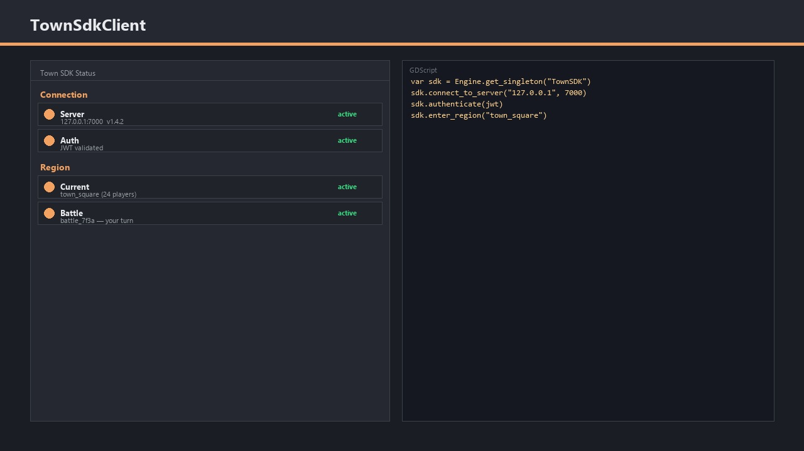
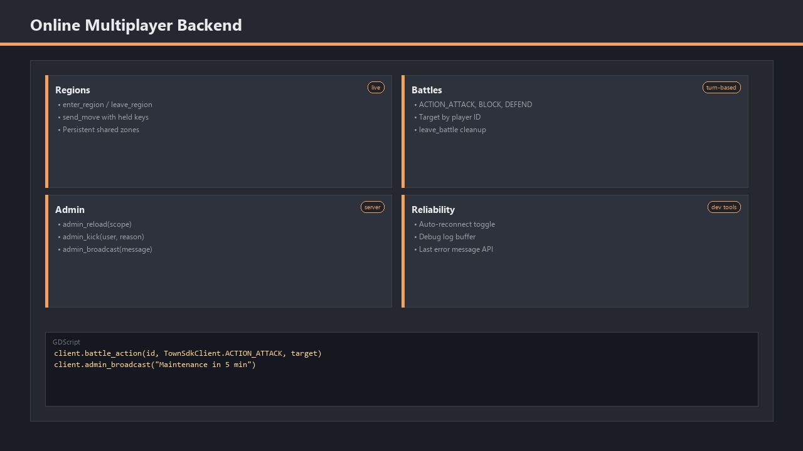
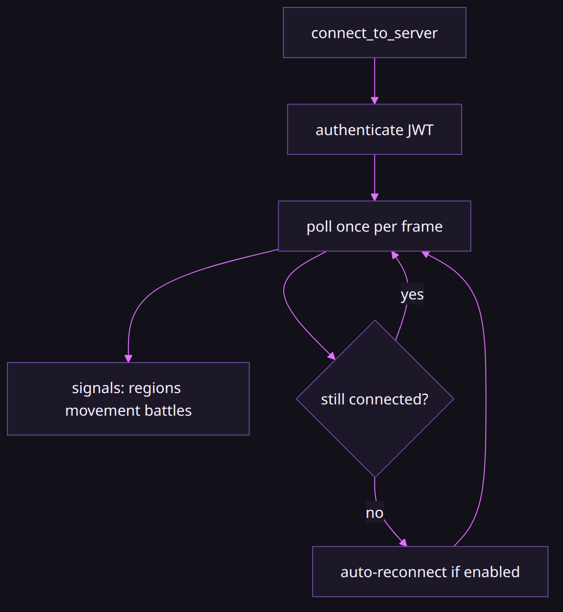

# Town SDK client

### `TownSDK` singleton for Town online servers

*By Bioblaze Payne, Co-Founder of [Blazium Games](https://blazium.games)*

---



The Town SDK exposes `TownSdkClient` through the engine singleton `TownSDK`. Autowork tests resolve it with `Engine.get_singleton("TownSDK")` and check `ClassDB.class_exists("TownSdkClient")` / `ClassDB.can_instantiate("TownSdkClient")`. From GDScript you connect, authenticate with a JWT, enter regions, send movement, dispatch battle actions, request admin stats, and opt into auto-reconnect.

The source needs an availability warning before any example: `modules/town_sdk` is on the public [`port-bioblaze-modules-4.8` branch](https://github.com/blazium-games/blazium/tree/port-bioblaze-modules-4.8/modules/town_sdk), not the default `blazium-dev` branch. It is therefore source you can inspect and build, not a promise that the current public editor or export templates contain `TownSDK`. The checked-in tests were run against a custom engine binary with the module compiled in.



## Build and registration status

The branch's `config.py` returns `true` from `can_build` and adds the public `turnbattle/*` headers. At scene initialization, `register_types.cpp` registers `TownSdkClient`, allocates one instance, and adds it to `Engine` under the name `TownSDK`. At shutdown it removes and deletes that singleton.

That registration code explains the two supported access paths:

```gdscript
var sdk: TownSdkClient = TownSdkClient.get_singleton()
# Or, when avoiding a hard type dependency:
var sdk_from_engine = Engine.get_singleton("TownSDK")
```

If either returns `null`, stop there. The module is not in that engine build. There is no project setting or downloaded add-on that can register native code missing from the binary.

## Singleton access

```gdscript
var sdk = Engine.get_singleton("TownSDK")
assert(sdk != null)
assert(ClassDB.class_exists("TownSdkClient"))
```

If the singleton is missing, your editor or template build does not include the Town SDK module. Build an engine that includes `modules/town_sdk` from the public `port-bioblaze-modules-4.8` branch before expecting these APIs.

## Connect and poll



```gdscript
var ok: bool = sdk.connect_to_server("127.0.0.1", 7005)
assert(ok)

for i in range(20):
	sdk.poll(0.1)
	OS.delay_msec(100)
	if sdk.is_client_connected():
		break

assert(sdk.is_client_connected())
sdk.disconnect_from_server()
```

| API | Role |
|---|---|
| `connect_to_server(address, port)` | Starts the client connection; returns whether initiation succeeded |
| `poll(delta)` | Pumps the client; tests call this between waits |
| `is_client_connected()` | Connection state |
| `disconnect_from_server()` | Tear down |

Live tests default to `127.0.0.1:7005` against a local `turnbattle` server. They are gated on `TOWN_LIVE_TESTS=1` and a local server binary; without that environment the suite marks cases pending.

The client is a pumped socket, not a blocking RPC layer. Autowork cases call `poll` between waits and again while waiting on signals such as `snapshot_received` or `move_state`. A game `_process` that never calls `poll` will stall on connect and never see region snapshots. Treat `connect_to_server` success as “initiation started,” then loop on `is_client_connected()` with `poll` until true or you give up.

```gdscript
func _process(delta: float) -> void:
	var sdk = Engine.get_singleton("TownSDK")
	if sdk == null:
		return
	sdk.poll(delta)
```

## JWT authentication

Authenticate after connect. Tokens in the test helper are RS256 JWTs minted with `JWTBuilder`, audience `turnbattle`, and optional `roles` including `"admin"`.

```gdscript
sdk.authenticate(valid_jwt)

sdk.disconnected.connect(func(reason: String) -> void:
	push_warning("disconnected: ", reason)
)
```

| API / signal | Role |
|---|---|
| `authenticate(jwt: String)` | Sends the player token |
| `disconnected(reason: String)` | Fired on disconnect payloads (invalid auth is observed this way in tests) |

There is no separate `auth_success` signal in the test suite. Valid auth is observed by staying connected; invalid auth is observed by `disconnected` firing. Claims such as `user_id` and admin `roles` are server-side JWT fields the helper mints; the client API surface used by tests is the `authenticate` call itself.

## Regions and movement

Region entry requires a prior successful auth in the test flow.

```gdscript
sdk.snapshot_received.connect(func(snapshot: Dictionary) -> void:
	assert(snapshot.has("players"))
)

sdk.enter_region("spawn")
# poll until snapshot_received …

sdk.send_move(1, 0.1) # held-key mask, delta seconds
# poll until move_state …

sdk.leave_region()
```

| API / signal | Role |
|---|---|
| `enter_region(region_id)` | Join a named region (`"spawn"` in tests) |
| `leave_region()` | Leave the current region |
| `snapshot_received(snapshot: Dictionary)` | Region snapshot; tests assert a `players` key |
| `send_move(held_keys, delta)` | Movement update; tests use `1` as held UP with comment `0 = NONE, 1 = UP, 2 = DOWN, …` |
| `move_state(state: Dictionary)` | Broadcast movement state after `send_move` |

Exact held-key enumerations beyond the test comment are server protocol details. Use the integers your Town server documents.

## Battles

```gdscript
# TownSdkClient::Action per test comment:
# ACTION_ATTACK = 0, ACTION_BLOCK = 1, ACTION_DEFEND = 2
sdk.battle_action("battle_id", 0, "enemyX")
sdk.leave_battle("battle_id")
```

| API | Role |
|---|---|
| `battle_action(battle_id, action, target)` | Dispatch an action; invalid IDs must not crash the client (suite sanity) |
| `leave_battle(battle_id)` | Leave; fake IDs must not crash the client |

Tests do not assert a successful match start against a live opponent in the checked-in suite; they assert graceful handling when the battle id is invalid. Wire `battle_action` / `leave_battle` to IDs your server actually opens.

## Admin stats

Admin JWT claims include `roles: ["admin"]` in the helper. Non-admin tokens must not receive stats.

```gdscript
sdk.authenticate(admin_jwt)
sdk.admin_stats_received.connect(func(payload: Dictionary) -> void:
	assert(payload.has("stats"))
	assert(payload["stats"].has("active_connections"))
)

sdk.admin_stats_request()
# poll until admin_stats_received …
```

| API / signal | Role |
|---|---|
| `admin_stats_request()` | Ask the server for stats |
| `admin_stats_received(payload: Dictionary)` | Payload with `stats.active_connections` in the passing admin test |

The branch class reference also exposes `admin_bank`, `admin_broadcast`, `admin_kick`, and `admin_reload`, with matching `*_received` signals. Those names are source-verified but not exercised by the checked-in live suite, so this article does not claim their server-side authorization or payload shape. `admin_stats_request` is the one path where the tests assert an admin response.

## Inventory, interaction, and game modes

The branch API is wider than the current tests. The class reference exposes these groups:

| Group | Methods or values |
|---|---|
| Inventory | `request_inventory`, `send_inventory_move`, `send_equip`, `send_drop`, `send_use`, `send_craft` |
| Interaction | `send_interact`, `send_pickup`, `send_integrity`, `send_screenshot_data` |
| FPS actions | `send_fire`, `send_melee`, `send_reload`, `send_move_look`, `send_move_pose` |
| Game mode | `GAME_TYPE_TURN_BASED`, `GAME_TYPE_FPS`, and the `game_type` property |
| Server metadata | `get_server_version`, `has_voip`, `get_voip_host`, `get_voip_port` |

`send_inventory_move(from, to)` is the only one of those with a documented payload shape: both dictionaries use `kind` (`bag` or `hotbar`), then `x`/`y` or `slot`. The remaining payload semantics belong to the Town server protocol and are not described deeply enough in the class XML to invent an example.

For diagnostics, the branch exposes `set_debug_logging_enabled(enabled, history_limit=64)`, `get_debug_log`, `clear_debug_log`, and last info/warning/error getters. A game can surface that ring buffer in a developer panel without scraping stdout.

## Auto-reconnect

```gdscript
sdk.authenticate(jwt)
sdk.set_auto_reconnect(true)

sdk.reconnecting.connect(func(attempt: int, next_delay: float) -> void:
	prints("reconnect attempt", attempt, next_delay)
)
sdk.reconnected.connect(func(resume_state) -> void:
	prints("reconnected", resume_state)
)
```

| API / signal | Role |
|---|---|
| `set_auto_reconnect(enabled)` | Enable automatic reconnect |
| `reconnecting(attempt, next_delay)` | Fired while retrying |
| `reconnected(resume_state)` | Fired after a successful reconnect |

The reconnect test kills the local server, waits for `is_client_connected()` to go false (ENet drop detection can take on the order of tens of seconds in that harness), asserts `reconnecting`, brings the server back, and asserts `reconnected`. Treat timing as environment-dependent, not as a hard SLA.

## Running the suite

```text
blazium --headless -s run_tests.gd
```

Live cases need:

| Env / path | Purpose |
|---|---|
| `TOWN_LIVE_TESTS=1` | Enable live server tests (otherwise `pending`) |
| `TOWN_SDK_TURNBATTLE_EXE` | Path to `turnbattle` (helper default is a local Windows build path) |
| `TOWN_SDK_SERVER_DIR` | Working directory for the server process |
| `TOWN_SDK_PRIVKEY_PATH` | RSA private key for minting JWTs |

Without a server binary the suite skips setup. Without `TOWN_LIVE_TESTS=1` individual tests call `pending(...)`.

## Minimal lifecycle

Putting the exercised calls in order:

```gdscript
var sdk = Engine.get_singleton("TownSDK")
sdk.connect_to_server("127.0.0.1", 7005)
while not sdk.is_client_connected():
	sdk.poll(0.1)
	OS.delay_msec(100)

sdk.authenticate(jwt)
sdk.enter_region("spawn")
# … snapshot_received …
sdk.send_move(1, 0.1)
# … move_state …
sdk.battle_action(battle_id, 0, target_id)
sdk.leave_battle(battle_id)
sdk.leave_region()
sdk.disconnect_from_server()
```

Always `poll` while waiting on signals. The client is not a blocking RPC layer in the tests; it is a pumped socket client.

## Failure cases the suite teaches

| Situation | Observation |
|---|---|
| Module not in binary | `Engine.get_singleton("TownSDK")` is `null`; `ClassDB.class_exists("TownSdkClient")` is false |
| Invalid JWT after connect | Stay connected briefly, then `disconnected(reason)` fires |
| Fake `battle_id` | `battle_action` / `leave_battle` must not crash the client |
| Non-admin token + `admin_stats_request` | Must not receive `admin_stats_received` with stats |
| Auto-reconnect after server kill | `reconnecting(attempt, next_delay)` then `reconnected(resume_state)` when the server returns; ENet drop detection can take tens of seconds in the harness |
| Missing `TOWN_LIVE_TESTS=1` | Live cases call `pending(...)` instead of failing hard |

There is no project setting that registers native Town SDK code missing from the binary. Build from `port-bioblaze-modules-4.8` (or an equivalent that includes `modules/town_sdk`) before expecting the singleton.

## Limits and omissions

- The module source and `TownSdkClient` class XML are public on `port-bioblaze-modules-4.8`, but absent from the default `blazium-dev` tree. Confirm the exact engine build before designing around it.
- Do not assume performance characteristics, encryption properties beyond “JWT string passed to `authenticate`”, or safety guarantees the tests do not assert.
- Admin coverage in-repo is `admin_stats_request` / `admin_stats_received` only.
- Movement key masks and battle action integers follow the server protocol; the client forwards what you pass.
- Kick, broadcast, bank, reload, inventory, FPS, and debug-buffer methods exist in the branch class reference; most are not covered by the public live test suite.

## Links

- Tests: https://github.com/blazium-games/town_sdk_module_tests
- Module branch: https://github.com/blazium-games/blazium/tree/port-bioblaze-modules-4.8/modules/town_sdk
- Blazium Games: https://blazium.games

---

**[Jump into our Discord](https://blazium.app/chat)** for real-time chats, dev support and feedback

Or follow us everywhere else:

- **[GitHub](https://github.com/blazium-games)**
- **[IndieDB](https://www.indiedb.com/engines/blazium-engine)**
- **[X / Twitter](https://x.com/BlaziumGames)**
- **[YouTube](https://www.youtube.com/@blazium)**
- **[itch.io](https://blaziumengine.itch.io)**
