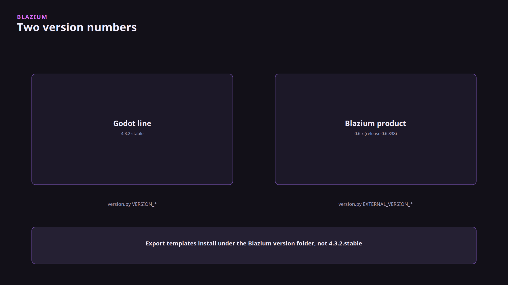
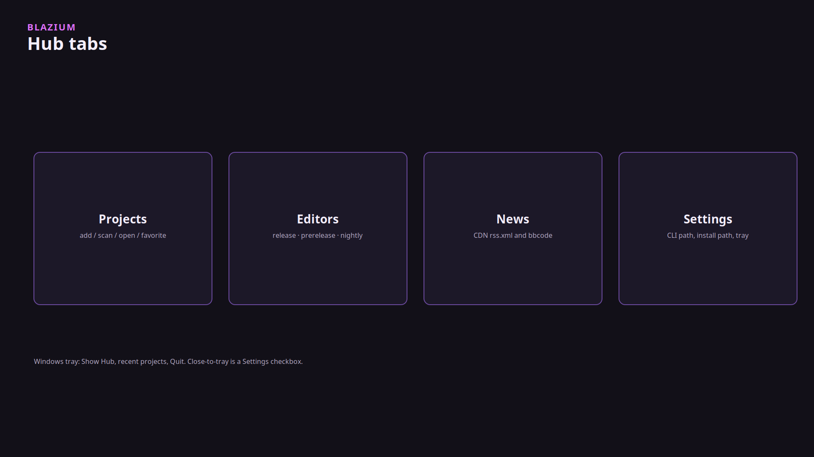
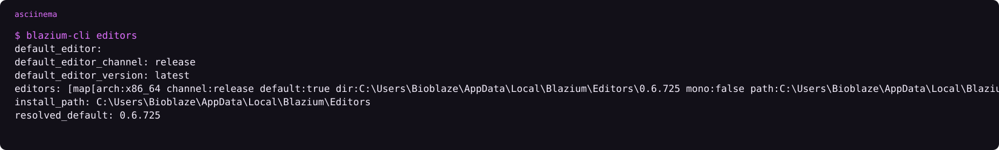

# The Blazium engine stack

### One CDN, a thin launcher, and an editor that is not the launcher

*By Bioblaze Payne, Co-Founder of [Blazium Games](https://blazium.games)*

---

You install Hub. Hub asks the CLI to fetch an editor from the CDN. The editor is the engine. News in Hub reads `https://cdn.blazium.app/articles/rss.xml` after a post is marked deployed and the publish workflow has uploaded it.

We split it this way because a full engine deploy should not depend on one person's laptop, and a download should not depend on GitHub being healthy. The website, Hub, and the CLI read `cdn.blazium.app`. The editor's export-template manager asks `https://blazium.app/api/mirrorlist/` for mirrors; as of 11 October 2026 the `0.6.838` list's primary `base.url` is the CDN pack, with a GitHub mirror entry alongside it. The CLI installs editors from the CDN catalogs either way.


| Box | Job |
|---|---|
| [blazium.app](https://blazium.app) | Download pages and docs |
| cdn.blazium.app | Editor builds, export templates, CLI, crash sidecar, toolchain catalog, Hub News |
| Hub | Projects, Editors, News, Settings. Shells the CLI |
| CLI | Installs editors, registers projects, handles `blazium://`, deploy, games upload |
| Editor | Blazium `0.6.x` on `blazium-dev` (Godot 4.3 compatible) |
| Crash sidecar | Shows the dump. Uploads only after you confirm |
| Cerebro | Internal. Release CI publishes catalogs. Hub never calls it |


There is a second engine line, `blazium_4.8`, which tracks Godot 4.8. Hub's own executable, the crash sidecar builds, and the skills tooling track that branch. The editors you install from the CDN are `0.6.x` from `blazium-dev`. As of 11 October 2026 the release catalog is [0.6.838](https://cdn.blazium.app/catalog/versions/release/latest.json) and nightly is 0.6.924. There is no `0.8` build on the CDN yet. CI policy maps 0.8 and 0.9 to the 4.8 line when those versions exist. They do not exist as downloads today.

Published Hub and CLI binaries are Linux and Windows. There is no Flatpak. [blazium#428](https://github.com/blazium-games/blazium/issues/428) is the open request. The store at [blazium.games](https://blazium.games) is a different product. Uploads there go through `blazium-cli games` (alias `chauffeur`), not through `blazium-cli deploy`. Steam and itch are `deploy`.

## Two version numbers



Godot compatibility for `blazium-dev` is 4.3. The product you download is Blazium `0.6.x`. Export templates install under the Blazium version and channel, such as `0.6.838.release`, not `4.3.2.stable`. Mixing those folders is the usual "templates missing" failure. Godot's own mirror list uses `4.x.y.stable` and points at `downloads.godotengine.org`. Blazium's `version.py` still records Godot-shaped `major/minor/patch` for compatibility and `external_*` for the product number you see on the CDN.

## The walk

1. Get Hub from [the dev-tools download](https://blazium.app/dev-tools/download?tool=hub). Windows is Inno, machine-wide, admin. Linux is a `.deb`. The installer also lays down `blazium-cli` and `crash_reporter`.
2. Hub opens with four tabs: Projects, Editors, News, Settings.



3. Editors tab. Channel `release`, `prerelease`, or `nightly`. Install. The CLI downloads from `cdn.blazium.app` into `{install-path}/{channel}/{version}`.
4. Projects tab. Add a `project.godot`, or scan a folder. Open runs `blazium-cli open`. The version dropdown on the card is drawn and not read. Open uses the CLI default until that is wired.
5. The editor starts with remote control on port **6508** unless `enable_on_open` is off, so `blazium-cli remote` can reach it. JustAMCP, if you enable it, is port **6506** (game MCP defaults to 6507). Hub's own remote control port is **39218**.



```text
asciinema play assets/cli-editors.cast
```

Useful CLI surface once Hub is installed:

```text
blazium-cli editors
blazium-cli editors default --channel release --version latest
blazium-cli open /path/to/project
blazium-cli remote status --format json
blazium-cli deploy steam
blazium-cli games --help
```

`open` and `load` start the editor with `--editor --path`. They do not run the game. Both attach remote control by default when `remote.enable_on_open` is true.

## Crash reports and analytics

Crash reports: the engine writes a minidump and a JSON file. The sidecar asks. Nothing leaves the machine until Send. Editor builds do not HTTP-upload dumps by themselves. We read the reports that are sent and patch the engine from them. Analytics is a separate opt-in queue on `/v1/events`. It is not the patch input. Hub's settings capture data-collection consent before editor analytics attach.

When you open a project from Hub, the CLI can attach the crash reporter based on Hub settings (`should_attach_editor_crash_reporter`). That is still consent-gated. Treat a dump on disk as local until the sidecar UI confirms upload.

## Toolchain and web export

The toolchain is GPL-3.0-or-later so GCC and the console SDKs stay out of the MIT editor. Catalog entry: `https://cdn.blazium.app/toolchain/toolchain.json`. The editor spawns it for Interactive DVD. PS1, PS2, and N64 are terminal commands in that binary. `ps3` and `ps4` exit 2. They are reserved names, not a ship date.

A web export is the preset named `Web`. [docker-webbuild-template](https://github.com/blazium-games/docker-webbuild-template) is Nginx for that folder, including Discord's `/.proxy/` path and COOP/COEP headers. It is not a toolchain target and it is not the web editor. Hangman's Discord activity used that hosting shape. YouTube Playables gets a `/ytgame` location in the same template without those COOP/COEP headers, because that host has different size and header rules.

## Remote control while you work

Default editor remote control binds `127.0.0.1:6508` (`blazium/remote_control/server_port`). The CLI talks to `/v1/health`, assigns a short instance id, and then runs `remote exec`, `remote eval`, logs, and debugger helpers. JustAMCP HTTP for the editor defaults to **6506**; the game MCP host defaults to editor port plus one (**6507**). Do not point Hub's **39218** remote at those editor ports; Hub remote is for showing/focusing Hub itself via `hub_remote.json`.

## What else is in the editor

`LobbyClient` and `LoginClient` are not registered on `blazium-dev`. They live in [blazium-sdk-module](https://github.com/blazium-games/blazium-sdk-module). `login.blazium.app` answers. The lobby and master-server hostnames in that SDK do not resolve. Game traffic that does compile in the engine is ENet and the Discord Social SDK lobby, which is a different object from `LobbyClient`.

Multiplayer, GIF textures, asset tags, and the streaming clients (Twitch, Kick, IRC, Crowd Control, OBS) are modules in the editor repo. Tags and semantic search are editor-only. GIF is always built. Steam, Discord Social SDK, JWT, dotenv, and social exports (Discord Embedded App, YouTube Playables, React bridge) ship in-tree.

Hangman is the example game that shipped on Steam, as a Discord Embedded App, on Google Play, and on the Apple App Store. That is the operator proof that export and deploy work across those storefronts. Demon Lord: Clicker validated newer modules and 2D under live Steam traffic; it is not a substitute for Hub install steps.

## Two meanings of blazium://

| Who | Example | Job |
|---|---|---|
| OS / CLI | `blazium://open?path=` | Open a project. Hub's remote port is **39218** |
| JustAMCP | `blazium://scene/…`, `blazium://tags/dictionary` | MCP resource inside the editor |

Same scheme. Two owners. The OS handler is the CLI (`handle-uri`). Games launcher remote uses port **39220** and `launcher_remote.json`. Hub stays on **39218** with `hub_remote.json`.

## Limits you will hit

- No Flatpak yet ([blazium#428](https://github.com/blazium-games/blazium/issues/428)).
- No `0.8` editor on the CDN yet, even though Hub tracks `blazium_4.8`.
- Hub project-card version dropdown is UI-only today.
- Stock editors lack `LobbyClient` / `LoginClient`; compile [blazium-sdk-module](https://github.com/blazium-games/blazium-sdk-module) if you need them.
- Lobby and master-server default hostnames in that SDK do not resolve; only `login.blazium.app` answers among those baked hosts.

## Operator checklist

1. Install Hub (gets CLI + crash sidecar).
2. Install an editor from the Editors tab (CDN).
3. Register or scan a project; open via CLI.
4. Export templates: match Blazium version + channel folder names.
5. Steam/itch: `blazium-cli deploy`. Blazium Games store: `blazium-cli games`.
6. Discord activity web host: docker-webbuild-template, not the toolchain.
7. Crash dumps: confirm in the sidecar before anything leaves the machine.
8. Keep Godot `4.3.x.stable` template folders out of Blazium `0.6.x` paths.

## Links

- Download: https://blazium.app/download
- Dev tools: https://blazium.app/dev-tools
- Engine: https://github.com/blazium-games/blazium
- Hub: https://github.com/blazium-games/blazium-hub
- CLI: https://github.com/blazium-games/blazium-cli
- CDN release pointer: https://cdn.blazium.app/catalog/versions/release/latest.json
- Blazium Games: https://blazium.games

---

**[Jump into our Discord](https://blazium.app/chat)** for real-time chats, dev support and feedback

Or follow us everywhere else:

- **[GitHub](https://github.com/blazium-games)**
- **[IndieDB](https://www.indiedb.com/engines/blazium-engine)**
- **[X / Twitter](https://x.com/BlaziumGames)**
- **[YouTube](https://www.youtube.com/@blazium)**
- **[itch.io](https://blaziumengine.itch.io)**
